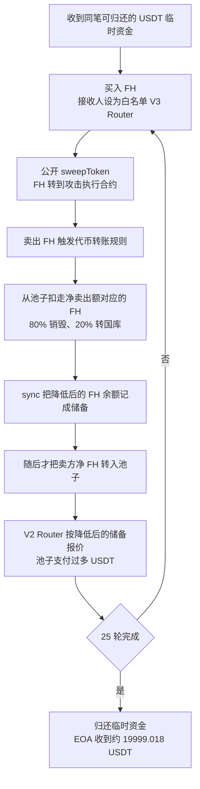

# Falcon Heavy（FH）：卖出时先扣资金池代币，再用降低后的储备报价

源表第 **89** 行，案例日期保留 **2026-08-26**。BSC [代表交易](https://bscscan.com/tx/0x7a3cadc2f33e000b0091307df62db2f5cc79ab8e0b022fd84de9e1c2c0745bd2)实际在区块 **117,979,402**、**2026-08-25 09:54:52 UTC** 执行成功；北京时间为同日 17:54:52。源表日期与链上日期不同，不能仅用时区解释。原始披露是 [TenArmor 警报](https://x.com/TenArmorAlert/status/2092427353456812207)，估计损失约 2 万美元。

## 背景、角色和正常业务

FH 是带买卖手续费和通缩规则的代币，在 Pancake V2 与 USDT 组成交易池。普通卖出应让卖方的 FH 进入池子，交易池再依据储备和实际输入计算应支付的 USDT。代币可以收手续费，但不能把池子已有的 FH 库存当作卖方付出的 FH。

| 地址或角色 | 本案作用 |
| --- | --- |
| FH Token，`0xdCf0DFe0053677A67610c6d08EA1f5c78DF8cA37` | 含漏洞的余额账本和买卖规则；本案原始源码来自 Sourcify，创建与运行时代码均为 `exact_match` |
| FH/USDT 池，`0x8f2d1A3992856a860304f1B86534B6B129Cc4df7` | 持有并支付 USDT 的受害资金池 |
| Pancake V2 Router，`0x10ED43C718714eb63d5aA57B78B54704E256024E` | 用余额与储备差额处理有转账手续费的代币，再调用池子换币 |
| Pancake V3 Router，`0x1b81D678ffb9C0263b24A97847620C99d213eB14` | FH 构造函数预设的买入白名单接收者；公开 `sweepToken` 可把收到的 FH 转给调用者指定地址 |
| `0x727Fb666E3F2531e807E987532C6e2C22ADC45aD` | 攻击执行合约，不是受害源码地址 |
| `0x7FA3bC0d5667fFd14d7ACD6Ce5f2432AC13a6FDA` | 主交易发起人和最后 USDT 收益接收者；对应源表 `malicious_address` |
| `0x8F73b65B4caAf64FBA2aF91cC5D4a2A1318E5D8C` | 同笔交易先提供、后收回相同数量 USDT 的临时资金来源 |

FH 的 [构造函数 241–288 行](../../dataset/benchmark_complete/20260826_FH/source-bundles/fh-token/contracts/FHToken.sol#L241-L288)创建交易池、设置白名单并启用交易。正常适配手续费代币的路径是：Router 转入卖方代币 → 读实际余额和原储备 → 算出输入额 → 按 AMM 公式报价 → 池子付款。对应 [V2 Router 704–738 行](../../dataset/benchmark_complete/20260826_FH/source-bundles/pancake-v2-router/PancakeRouter.sol#L704-L738)。

## 具体错误

**FH 在卖出时先拿走池子自己的 FH，更新成更低的储备，最后才转入卖方的 FH。**

[FHToken._transfer 的完整实现 290–378 行](../../dataset/benchmark_complete/20260826_FH/source-bundles/fh-token/contracts/FHToken.sol#L290-L378)先判断收款方是否是已登记池子，再进入卖出分支。关键顺序在 334–362 行：

1. 从卖方扣掉动态手续费，得到 `netAmount`。
2. 如果总供应量仍高于目标值，把 `netAmount` 的 80% 用 `_burn(pair, burnAmount)` 从池子销毁，另 20% 用 `super._transfer(pair, TREASURY_WALLET, treasuryAmount)` 从池子转到国库。
3. 调用 `pair.sync()`，把已被扣低的池子余额记为储备。
4. 最后才执行 `super._transfer(sender, recipient, netAmount)`，把卖方净额转入池子。

这不是事件名称造成的误读。[基础 ERC20 的 `_transfer` 与 `_burn` 139–175 行](../../dataset/benchmark_complete/20260826_FH/source-bundles/fh-token/contracts/FHToken.sol#L139-L175)确实会扣掉传入地址的余额；这里传入的是 `pair`。销毁还会增加 `0xdead` 的记录并减少总供应量。

V2 Router 随后用 `balanceOf(pair) - reserveInput` 得到输入额，并用 [314–321 行的 AMM 公式](../../dataset/benchmark_complete/20260826_FH/source-bundles/pancake-v2-router/PancakeRouter.sol#L314-L321)报价。被错误降低的是报价用的 FH 储备。虽然卖方随后转入的净额是真实的，它却在一个已被代币内部规则抽走库存的储备基准上换出 USDT，从而取得过高付款。

归档的 [PancakePair 正常参考实现](../../dataset/benchmark_complete/20260826_FH/source-bundles/pancake-pair-reference/PancakePair.sol#L260-L335)展示 `sync` 将余额写入储备；[408–449 行](../../dataset/benchmark_complete/20260826_FH/source-bundles/pancake-pair-reference/PancakePair.sol#L408-L449)展示 `swap` 的余额读取、K 检查与付款。K 检查使用调用开始时已经更新的储备，因此并不能识别此前 FH 合约自行扣走的库存。此参考响应原来对应另一个已验证池地址 `0x63844BD4BFad910B1643713302a1cC1ed20d50c3`。本批读取目标池在区块 117,979,401 和 117,979,402 的 runtime，二者与参考响应中的链上 runtime 逐字一致。这个比对支持本案使用相同运行逻辑，但不会把参考地址源码变成目标地址的直接验证记录、目标创建交易证明或本地重编译证明。

## 触发条件与买入白名单

调用者不需要 FH 管理员权限。它需要有可卖出的 FH；交易必须开启，参与地址不能在黑名单中，转账不能走免手续费或添加流动性的提前返回分支，池子也必须有足够 FH 可被扣除。通缩分支还要求 `netAmount > 0`、`totalSupply() > targetSupply`，目标供应量是 210 万 FH。费用会随价格跌幅改变，不能把所有轮次都写成固定 5%。相关条件和费率算法都保留在 [290–418 行](../../dataset/benchmark_complete/20260826_FH/source-bundles/fh-token/contracts/FHToken.sol#L290-L418)。

买入白名单没有阻断这条路径。构造函数第 282 行把 Pancake V3 Router 加入白名单，攻击买单把 FH 接收人设为该 Router。其 [PeripheryPayments.sweepToken 30–41 行](../../dataset/benchmark_complete/20260826_FH/source-bundles/pancake-v3-router/contracts/base/PeripheryPayments.sol#L30-L41)是公开函数，仅检查余额不少于 `amountMinimum`，然后把余额转给指定 `recipient`，不要求调用者具有管理员权限。FH 从 Router 到攻击合约的转账不是从池子发出，因此不会走买入白名单检查。

主回执也记录了这个实际路径：每轮 FH 先从池子进入该 V3 Router，再以相同净额进入攻击执行合约。未读取完整内部调用跟踪，所以中间函数选择仍需与源码和事件一起解释，不能声称已经逐条核对全部内部 calldata。

`inSwap` 和池子的 `lock` 也不是这条路径的有效阻断条件。普通卖出首次进入时 `inSwap` 为假；源码先在 `transferFrom` 内完成 FH 逻辑，之后 Router 才调用池子的 `swap`，提前的 `sync` 不需要在已锁定的 `swap` 内重入。

## 历史步骤和真实付款

原始回执含 **50 个 Swap**、**75 个 Sync**，可分为 **25 轮买入和卖出**。本批没有运行交易，只对回执和公开公式作离线整数计算。

第一轮可直接看到以下顺序。金额按 FH 和 BSC USDT 的 18 位口径展示，原始整数同时保存在解码文件中；区块 117,979,402 的 `decimals()` 原响应为 `0x12`，即 18；[USDT 原始实现 339–373 行](../../dataset/benchmark_complete/20260826_FH/source-bundles/bsc-usdt/BEP20USDT.sol#L339-L373)也给出同一位数。

| 顺序 | 回执证据与金额 |
| --- | --- |
| 取得临时资金 | USDT 从 `0x8F73…5D8C` 转入攻击合约，原始数量 `25999350000000000000000`，即 25,999.35 USDT |
| 首次买入 | 19,799.505 USDT 进入池子；FH 经费用扣除后，94,403.718192223997182425 FH 先进入白名单 V3 Router，再转到攻击合约 |
| 从池子扣 FH | 日志 398 从池子向 `0xdead` 转出 71,746.825826090237858643 FH；日志 400 从池子向国库转出 17,936.706456522559464661 FH |
| 提前更新储备 | 日志 **401** 的 Sync 写入约 **39,799.005 USDT / 10,944.132778204047747828 FH** |
| 卖方输入随后才到 | 日志 **402** 才把 **89,683.532282612797323304 FH** 从攻击合约转入池子 |
| USDT 付款 | 日志 **403** 从池子向攻击合约支付 **35,460.851598565761023680 USDT**，随后日志 405 记录 Swap |

把日志 401 的储备和日志 402 的净输入代入 V2 Router 原始公式，得到的整数输出与日志 403 **完全一致**。另外 24 轮也逐轮吻合。每轮先移走池子库存、降低报价基准，再用卖方净输入取得较高 USDT 输出，池子因此被持续抽空。

最后一次 Sync 的 USDT 储备是 **0.481893447071469596 USDT**。攻击合约归还 **25,999.35 USDT**，再给交易发起地址转出 **19,999.018106552928530404 USDT**。按同笔所有 USDT Transfer 求净额：

- 受害池净减少 `19999018106552928530404` 原始单位。
- 攻击者 EOA 净增加相同数量。
- 临时资金来源和攻击执行合约的 USDT 净变化均为零。

这能证明本笔池子净流出和攻击者代币净收入一致。没有把临时资金本金当成损失，也没有把 FH 代币的销毁和国库转账另外估成美元损失。

## 证据和限制

核心漏洞和必要 Router 源码均下载自权威验证平台 **Sourcify**，原响应逐字保存。FH 为创建与运行时 `exact_match`；两 Router 和 USDT 为平台的 `match`。FH、两 Router、USDT 的攻击前后 runtime 均与各自 Sourcify `onchainBytecode` 逐字一致；目标池 runtime 与已验证参考池 runtime 也逐字一致。FH 还直接等于平台保存的 `recompiledBytecode`。其余源码包使用平台记录的 immutable／元数据变换后也与历史字节码一致；这里只做字节比较，没有本地编译。每个原始响应和提取源码都有 URL、下载时间记录或明确标注的下载后文件写入时间，以及 SHA-256。没有使用分析文章、PoC 或第三方重建文件替代原始源码。

来源见 [provenance.json](../../dataset_artifacts/benchmark_complete/20260826_FH/provenance.json)，精简内容见 [切片清单](../../dataset_artifacts/benchmark_simplified/20260826_FH/slice_manifest.json)，原交易、官方 BSC RPC 回执及 [离线解码](../../dataset_artifacts/batches/20261026_x96_y5/fh/decoded_evidence.json)可交叉核查。

目标池的直接 Sourcify 请求返回 404，BscScan 源码页返回 403；已保存失败原响应。官方 BSC 节点读取历史状态返回 `missing trie node`，随后从 Blast 归档 RPC 取得上述历史代码和 USDT 位数。完整内部调用跟踪接口仍不可用。本批没有重建全部攻击前白名单、手续费和总供应量状态，成功回执可以支持实际走过的分支条件，不能扩大为所有历史设置都已检查。

攻击执行合约的原始源码查询为 Sourcify 404、BscScan 403；Dedaub 页面和 API 也返回 403。之后通过 ethervm.io 公开表单，把已归档的历史 runtime 提交给在线反编译服务，取得了[高层反编译输出](../../dataset_artifacts/batches/20261026_x96_y5/fh/attacker.ethervm.decompiled.sol)。原始 HTML、请求体和[反编译来源记录](../../dataset_artifacts/batches/20261026_x96_y5/fh/decompilation-provenance.json)均已保存。服务另附的反汇编与输入 runtime 全部 **3,577 字节**逐字节相符；输入 SHA-256 为 `9466bf0dd8f8017357fd9a60cffbcc60124884f95cb5dd157ae21d85bbe1b26f`。反编译引擎版本未在页面报告，输出中的两处 `Error` 注释原样保留。它是服务重建的高层代码，只作攻击合约上下文，不是原始源码，也不补成完整调用跟踪；纯 hex、反汇编和 HTML 不归入正式源码。

两份 CSV 保留源表约 **20,000 美元**的事件估计，中文为 **2 万美元**、英文为 **20 千美元**。回执净转账按 18 位 USDT 口径为 **19,999.018106552928530404 USDT**，未扣除 BNB gas 与交易 value。二者接近但口径不同。未执行下载的代码或 PoC，未本地编译、部署、分叉重放或发送交易。