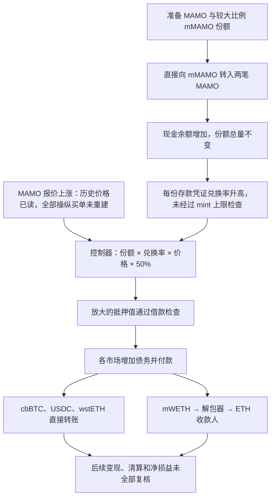

# Moonwell MAMO：捐赠增厚份额与价格上涨共同放大抵押借款

源表日期为 **2026-08-27**，本批固定快照第 **85** 行，案例标识 `20260827_Moonwell_MAMO`。这里分析 Base 上的 MAMO 抵押市场；已核对的最后一笔借款所在区块 50,516,833 的时间为 2026-08-27 09:30:13 UTC，与源表同日。源码来自 Sourcify 的已验证原始源包，交易与历史状态来自 Base 官方 RPC，560 ETH 最终付款另用 Base Blockscout 原始调用树交叉核对。

## 背景：存款凭证为什么能借出其他资产

Moonwell 是抵押借贷市场。用户把一种代币存入市场，取得代表存款权益的 mToken，再把这些权益作为抵押，借走其他市场持有的资产。mMAMO 是 MAMO 的存款凭证；mcbBTC、mUSDC、mWETH 和 mwstETH 则管理相应借款资产。借贷控制器 Comptroller 计算账户的抵押价值，决定是否允许借款。

[Moonwell 官方论坛复盘](https://forum.moonwell.fi/t/post-mortem-mamo-market-incident-on-base/2208)把事件归为薄流动性 MAMO 的价格操纵与抵押记账放大组合。本文独立核对了两次直接捐赠、历史份额与价格、17 笔借款及其中一次完整 ETH 付款；没有重新构造全部操纵交易，也没有把论坛的总损失或收益直接当作本批计算结果。

| 角色 | 地址与作用 |
| --- | --- |
| 攻击操作账户 | `0x719eae70d4a83f35bf82a2740699f5db84be919d`，直接捐赠和借款，属于攻击者角色 |
| MAMO | `0x7300b37dfdfab110d83290a29dfb31b1740219fe`，底层 ERC20 代币 |
| mMAMO | `0x2f90bb22eb3979f5ffad31ea6c3f0792ca66da32`，被利用的抵押市场代理 |
| 共用市场实现 | `0x1fadff493529c3fcc7ee04f1f15d19816dda45b7`，mMAMO、mUSDC、mcbBTC、mwstETH 的历史实现 |
| Unitroller / Comptroller | `0xfbb21d0380bee3312b33c4353c8936a0f13ef26c` / `0x73d8a3bf62aaca6690791e57ebaee4e1d875d8fe`，历史代理和风险计算实现 |
| ChainlinkOracle | `0xec942be8a8114bfd0396a5052c36027f2ca6a9d0`，读取各资产价格 |
| MAMO 报价包装器 | `0xdbd37c274a70a8a3f92a227c843a6a8d3203afe6`，按配置返回有效报价轮次 |
| mWETH 实现 / 解包器 | `0x599d4a1538d686814ee11b331eacbba166d7c41a` / `0x1382cff3cee10d283dcca55a30496187759e4caf`，将借出的 WETH 换成原生 ETH 支付 |

正常流程是：**用户授权并存入 MAMO → 供应上限检查 → 按存入前兑换率增加份额 → 用户加入抵押市场 → 控制器按份额、兑换率、价格和抵押因子计算额度 → 借款市场记债并付款。**

存款入口见 [MErc20.mint](../../dataset/benchmark_complete/20260827_Moonwell_MAMO/source-bundles/market-implementation/src/core/MErc20.sol#L46-L49)。[MToken.mintFresh](../../dataset/benchmark_complete/20260827_Moonwell_MAMO/source-bundles/market-implementation/src/core/MToken.sol#L498-L563)先调用控制器，再读取兑换率，转入资产并同时增加总份额及个人份额。[Comptroller.mintAllowed](../../dataset/benchmark_complete/20260827_Moonwell_MAMO/source-bundles/comptroller-implementation/src/core/Comptroller.sol#L215-L242)只在这一入口检查供应上限。加入抵押市场的权限和记账在 [enterMarkets / addToMarketInternal](../../dataset/benchmark_complete/20260827_Moonwell_MAMO/source-bundles/comptroller-implementation/src/core/Comptroller.sol#L102-L145)。

## 具体错误：现金余额变化被直接放大为抵押权益

一句话说，**控制器信任了可以通过直接转账抬高的存款凭证兑换率，再把它乘以被推高的 MAMO 报价；供应上限没有覆盖这种额外抵押增量。**

[MErc20.getCashPrior](../../dataset/benchmark_complete/20260827_Moonwell_MAMO/source-bundles/market-implementation/src/core/MErc20.sol#L171-L174)直接读取 MAMO 的 `balanceOf(address(this))`。[MToken.exchangeRateStoredInternal](../../dataset/benchmark_complete/20260827_Moonwell_MAMO/source-bundles/market-implementation/src/core/MToken.sol#L340-L370)采用：

```text
每份 mMAMO 对应的 MAMO = (池内实际余额 + 已借出 MAMO - 协议储备) / mMAMO 总份额
抵押价值上限 = 用户份额 × 每份兑换率 × MAMO 美元报价 × 抵押因子
```

直接调用 MAMO 的普通 `transfer` 向 mMAMO 转账，会改变第一式的分子，但不会调用 mMAMO 的存款函数，也不会新增份额。原有持有人分享这笔捐赠。捐赠本身确实付出了代币成本；并非凭空增加美元价值。只有在攻击者掌握较高份额、能够取得大量 MAMO，同时市场报价显著偏离大额清算可实现价值时，这种记账与估值组合才会造成有利可图的坏账路径。

控制器在 [getHypotheticalAccountLiquidityInternal](../../dataset/benchmark_complete/20260827_Moonwell_MAMO/source-bundles/comptroller-implementation/src/core/Comptroller.sol#L563-L619)把兑换率、价格和抵押因子相乘，再扣除已有债务及本次新增借款。这里没有对“由直接捐赠形成的额外抵押量”再次套用供应上限，也没有按薄市场能实际变现的数量折价。[borrowAllowed](../../dataset/benchmark_complete/20260827_Moonwell_MAMO/source-bundles/comptroller-implementation/src/core/Comptroller.sol#L310-L356)依然检查暂停、市场、借款上限和短缺，但输入的抵押价值已经过高。

价格路径也有正常检查。[ChainlinkOracle](../../dataset/benchmark_complete/20260827_Moonwell_MAMO/source-bundles/chainlink-oracle/src/core/Oracles/ChainlinkOracle.sol#L50-L113)要求正数报价及有效更新时间，管理员价格设置带权限检查；[ChainlinkOEVWrapper.latestRoundData](../../dataset/benchmark_complete/20260827_Moonwell_MAMO/source-bundles/mamo-feed/src/oracles/ChainlinkOEVWrapper.sol#L210-L258)按已有配置选择有效报价轮次。本文没有发现攻击者修改管理员报价、盗取 Chainlink 签名或绕过签名验证的证据。市场价格能被交易推高、借贷系统又缺少相应抵押规模保护，是与普通报价验证不同的问题。

## 利用条件及历史状态

源码要求攻击账户先持有 mMAMO 并进入抵押市场，有资金取得用于捐赠的 MAMO；借出市场必须可借、有现金且不超借款限制。成功借款回执证明这些路径条件在对应交易中成立；没有据此宣称所有历史管理参数都已完整重建。

本批在官方 RPC 上读取了捐赠前、第一次捐赠后和第二次捐赠后的区块末状态：

| 状态 | 区块 | mMAMO 总份额原始整数 | 实际 MAMO 余额 | 每份 mMAMO 对应的 MAMO |
| --- | ---: | ---: | ---: | ---: |
| 捐赠前 | 50,516,525 | 97172160295247068 | 18,269,431.581880587061637194 | 0.0205132568127692808921476270 |
| 第一次捐赠后 | 50,516,526 | 97172160295247068 | 53,179,828.266673230835810615 | 0.0564395926914084042877489143 |
| 第二次捐赠后 | 50,516,561 | 97172160295247068 | 71,662,825.945738094497214450 | 0.0754603632406632280153424515 |

三个时点份额总量相同，兑换率约为原来的 **3.678614 倍**。这些是实际读取值；利息和储备也参与公式，不能仅用现金之比代替兑换率之比。第二段现金余额增长还比第二笔捐赠多 104.053224118141044604 MAMO；本批没有重建该区间的全部其他转账，因此 3.678614 倍是端点观测，不是把所有变化都归给两笔捐赠的精确分解。代币精度和原始状态分别保存在 [历史解码结果](../../dataset_artifacts/batches/20261026_x96_y5/moonwell/decoded_evidence.json)及原始响应中。

攻击时点读取的 MAMO 供应上限为 **20,000,000 MAMO**，抵押因子为 **50%**。在所选高价区块 50,516,812，账户持有份额原始数 `73560251550279382`，对应约 **55,508,833.107 MAMO** 的份额权益；控制器实际读取的报价为 **0.40248571 美元**。结合后续区块 50,516,833 已观察到的 50% 因子，估算这项抵押的毛额度约 **1,117.08 万美元**。价格与份额取自较早的 50,516,812 块，因子取自后续区块，不能把它当成同一时点的精确剩余额度；还须扣除已有债务，并考虑合约整数截断。这里也没有声称所有借款使用同一价格，或该采样价就是全程最高价。

## 历史步骤：从捐赠到真实借款

1. **准备存款份额和大量 MAMO。** 官方复盘说明攻击者通过交易取得 MAMO 并正式存款。本文没有重新汇总所有初始买单和铸造交易；独立历史账户快照证实攻击账户已经持有约 75.7% 的 mMAMO 份额，满足捐赠后大部分权益归自己的条件。
2. **第一次直接捐赠。** [交易 0x056597…](https://basescan.org/tx/0x056597f42302ab7f9f5e91c7f84856d3ba73827da7f956645d1f26bdde109ce9)将 **34,910,396.684792643774173421 MAMO** 从攻击账户转入 mMAMO。回执没有该市场的 Mint 事件；紧随其后的历史份额总量仍相同。因此这是原有份额增厚，不能记为新增正式存款份额。
3. **第二次直接捐赠。** [交易 0xaf284d…](https://basescan.org/tx/0xaf284d7f60dd8f2ebb41cba6a080e95a6deceb3a2c93ff58016996de61de3cd9)又转入 **18,482,893.625840745520359231 MAMO**，同样没有 Mint。两笔合计 **53,393,290.310633389294532652 MAMO**。
4. **高报价与增厚后的兑换率进入同一抵押公式。** 选定早期区块报价为 0.01054105 美元，后续采样区块读取到 0.40248571 美元，最后一笔借款区块为 0.39844045 美元。上涨的历史报价已直接读取；“攻击者如何通过每一笔外部交易把价格推高”仍以官方调查为背景，本文没有完整复演这一市场过程。
5. **按放大的抵押价值分批借款。** 已取得 17 笔成功借款回执，解码出 18 个 Borrow 事件，并逐个对应真实 ERC20 Transfer 或 WETH Withdrawal。源码 [borrowInternal / borrowFresh](../../dataset/benchmark_complete/20260827_Moonwell_MAMO/source-bundles/market-implementation/src/core/MToken.sol#L728-L814)在控制器允许后检查现金、增加债务，再执行 `doTransferOut`。首批 cbBTC 的[源表交易](https://basescan.org/tx/0xafb6f0fa257b115a5c813bf787b4c1535e63888b1d0dbeb1f3788f557f51798f)和最后 USDC 的[源表交易](https://basescan.org/tx/0xee2b75648c288e0e57678a177d54aec2e8ecb8920842c72e8784186c18c88b18)均已取得原始回执。
6. **代币或 ETH 交到攻击账户。** cbBTC、USDC、wstETH 的回执显示市场直接转给借款人。mWETH 使用不同的历史实现：[MWethDelegate.doTransferOut](../../dataset/benchmark_complete/20260827_Moonwell_MAMO/source-bundles/mweth-implementation/src/MWethDelegate.sol#L16-L35)先把 WETH 交给解包器，再调用 [WethUnwrapper.send](../../dataset/benchmark_complete/20260827_Moonwell_MAMO/source-bundles/weth-router/src/WethUnwrapper.sol#L24-L36)，该函数限制调用者为 mWETH，提现 WETH 并通过原生 ETH 调用付款。[560 ETH 借款交易](https://basescan.org/tx/0x7043f55bdcf70ea2980c8729299a022e842a9a6b8622e1c5a7ac527051800f02)的[原始调用树](../../dataset_artifacts/batches/20261026_x96_y5/moonwell/weth-borrow-raw-trace.json)直接证实解包器向攻击地址支付 560 ETH，无调用错误。
7. **后续处置及最终损益。** 本批保存了选定跨链转出回执作为背景，但没有重建全部回款、清算、偿还和持仓。这里的借款不是已经在同笔归还的闪电贷本金；借款总量也不能直接当作最终净收益。



## 已确认资金流与金额口径

本批按原始整数、历史 decimals() 与每次借款的付款日志汇总：

| 资产 | 18 次借款的合计数量 | 付款证据 |
| --- | ---: | --- |
| cbBTC | 71.35549505 | 市场到借款人的 Transfer |
| WETH / ETH | 623.600287604679454542 | WETH 转入解包器及对应 Withdrawal；其中 560 ETH 的最终收款另有完整调用树 |
| USDC | 2,560,000 | 市场到借款人的 Transfer |
| wstETH | 368 | 市场到借款人的 Transfer |

这是**所列交易的毛借款流出**，没有扣除买入 MAMO 的成本、捐赠成本、归还、费用及后续清算。源表早期约 **800 万美元**、官方论坛约 **1,102.8 万美元毛借款**、约 **913.1 万美元剩余债务**和约 **678.4 万美元估计净收益**属于不同口径。两份 CSV 的美元损失栏均留空；没有用零或毛借款代替未统一的损失数字。

## 原始源码、历史绑定与证据边界

[完整来源清单](../../dataset_artifacts/benchmark_complete/20260827_Moonwell_MAMO/provenance.json)保存每个原始 URL、原响应和源码哈希；[精简切片清单](../../dataset_artifacts/benchmark_simplified/20260827_Moonwell_MAMO/slice_manifest.json)记录原文件及连续行号。源码进入 `dataset`，ABI、编译设置、抓取记录与说明留在 `dataset_artifacts`。Chainlink 源包包含开发机绝对路径，本批只去掉原机器路径前缀形成安全相对路径；源码内容逐字不变，原始文件名保留在清单。

已经分别核实：

- **源码机制：** 实际余额计价、供应上限仅在 mint 检查、抵押公式、借款记债、代币转账及 WETH 解包付款。
- **历史部署：** 在区块 50,516,833 读取五个市场代理的 implementation()、Unitroller 的实现与 oracle，以及报价包装器和底层 feed/aggregator 的关联。八个核心实现/报价/解包合约的历史运行代码，与各自 Sourcify `onchainBytecode` 逐字一致；Sourcify 报告相应源包 exact_match。这里没有进行本地重新编译。
- **历史状态与交易：** 两笔捐赠前后余额、份额和兑换率，选定区块的价格、供应上限和抵押因子，17 笔成功借款及 560 ETH 的完整付款调用树。区块末状态不是交易内部逐指令状态。
- **尚未复核：** 所有外部操纵买单、所有历史管理配置、全部清算及最终净损失。其余借款未逐笔取得完整内部跟踪。当前标签和当前实现显示没有被单独当成历史绑定证据。

本批只进行公开资料下载、原文提取和离线整数核算；未执行上游脚本或 PoC，未编译、部署、分叉重放或发送交易。精简代码是原文片段，不保证脱离完整源包后可以独立编译。直接 EOA 捐赠与借款的核心路径不需要未开源攻击辅助合约。

批次入口：[固定快照](../../dataset_artifacts/batches/20261026_x96_y5/snapshot.json)、[逐行处理结果](../../dataset_artifacts/batches/20261026_x96_y5/results.json)、[原始状态与交易解码](../../dataset_artifacts/batches/20261026_x96_y5/moonwell/decoded_evidence.json)。
