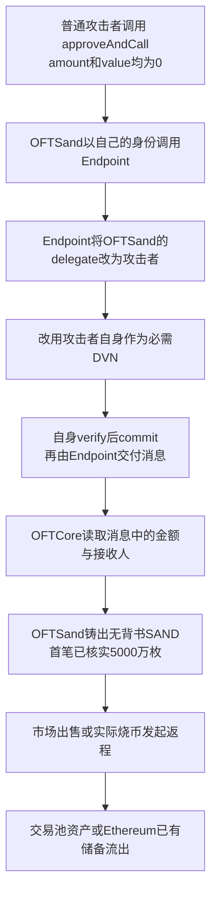

# The Sandbox SAND OFT：公开代调用函数把跨链配置权交给了普通调用者

源表第 **92** 行，事件目录日期保留 **2026-08-22**。Base 的[权限接管交易](https://basescan.org/tx/0x149eb0eec5f1c793b094b46889059b510281a7eff3c1597bb262777a5cfaa237)实际发生于 **2026-08-21 23:41:41 UTC**，北京时间 8 月 22 日 07:41:41；表中[代表铸币交易](https://basescan.org/tx/0xbddb102a5dbc9324a84390aaa5a9767b89c2bac8955d486fe1cf697e2e9a8fa9)发生在 24 秒后。原始披露入口是 [The Sandbox 官方 X](https://x.com/TheSandboxGame/status/2091063415649251821)，技术说明见[官网事故复盘](https://www.sandbox.game/en/blog/august-22-exploit-post-mortem/3526/)。

## 业务背景与正常资金流程

SAND 的这条跨链路线把以太坊已有代币和 Base、BNB Smart Chain 上的映射代币联系起来。正常从以太坊桥出时，已有 SAND 留在保管合约中，远端收到经过验证的消息后才铸造等量映射 SAND；返程则先烧掉映射 SAND，再由以太坊保管合约支付已有储备。正常使用者付出的是已有代币，不能只提交一个想要的金额就增加自己资产。

Base 的 `OFTSand` 同时承担两份工作：它既是持有余额的代币，又是有权配置 LayerZero 通信规则的跨链应用。源码的[继承和构造函数 15–34 行](../../dataset/benchmark_complete/20260822_TheSandbox/source-bundles/sandbox-oft/@sandbox-smart-contracts/oft-sand/contracts/OFTSand.sol#L15-L34)把 `SandBaseToken` 和 `OFTCore` 合在同一地址；`SandBaseToken` 又继承提供代调用功能的 [ERC20BasicApproveExtension](../../dataset/benchmark_complete/20260822_TheSandbox/source-bundles/sandbox-oft/@sandbox-smart-contracts/oft-sand/contracts/sand/SandBaseToken.sol#L8-L20)。问题来自这两种身份被放在同一合约中。

| 地址或角色 | 职责及本案边界 |
| --- | --- |
| Base OFTSand：`0xac531Eb26Ca1d21b85126De8FB87E80E09002DcF` | 有漏洞的代币与跨链应用；直接部署，无代理 |
| Base LayerZero EndpointV2：`0x1a44076050125825900e736c501f859c50fe728c` | 维护应用的 delegate、通信库配置和消息交付；属于正常外部依赖 |
| Base ReceiveUln302：`0xc70ab6f32772f59fbfc23889caf4ba3376c84baf` | 按应用配置核验消息；攻击者改的是该库的验证配置，未部署替代库 |
| 以太坊 OFTAdapterForSand：`0xac531Eb26Ca1d21b85126De8FB87E80E09002DcF` | 保管并支付以太坊 SAND；同地址、不同链、不同实现 |
| 攻击操作地址：`0x67624bfadee937c9281b4f98ce18af1bee01257e` | 发起权限接管和首笔铸币交易 |
| 首笔接收地址：`0x07bc449e85d9b66899425df8c8ab49cfb44a5f1e` | 在代表交易中收到新铸造的 5,000 万枚 Base SAND |

源表中 `malicious_address` 的其他地址是调查线索，不能因此认定为受害合约，或认定它们全有同一种攻击权限。

## 具体错误：检查了首参数，却放出了合约自己的身份

正常的 [OAppCore.setDelegate，80–82 行](../../dataset/benchmark_complete/20260822_TheSandbox/source-bundles/sandbox-oft/@layerzerolabs/lz-evm-oapp-v2/contracts/oapp/OAppCore.sol#L80-L82)带有 `onlyOwner`，普通用户不能从这里修改跨链代理人。但另一条公开入口破坏了这个边界。

[approveAndCall，16–33 行](../../dataset/benchmark_complete/20260822_TheSandbox/source-bundles/sandbox-oft/@sandbox-smart-contracts/oft-sand/contracts/sand/ERC20BasicApproveExtension.sol#L16-L33)让调用者自选 `target` 和 `data`。它先检查数据的第一个参数是不是调用者，然后执行 `target.call(data)`。目标合约看到的直接调用者是 **OFTSand**，不再是最外层的普通用户。这段代码没有限制目标必须是收款合约，也没有排除跨链配置函数。

[BytesUtil，5–21 行](../../dataset/benchmark_complete/20260822_TheSandbox/source-bundles/sandbox-oft/@sandbox-smart-contracts/oft-sand/contracts/libraries/BytesUtil.sol#L5-L21)只要求数据至少 68 字节，并检查选择器后的第一个 32 字节等于调用者地址。历史攻击把内部调用做成 `setDelegate(攻击者)`，再补一个全零的 32 字节，长度正好是 **4 + 32 + 32 = 68**。普通 `setDelegate(address)` 编码只有 36 字节，会被这个长度检查挡住；实际交易的尾部填充因此是必要证据。

[EndpointV2.setDelegate，327–330 行](../../dataset/benchmark_complete/20260822_TheSandbox/source-bundles/layerzero-endpoint/contracts/EndpointV2.sol#L327-L330)按 `delegates[msg.sender] = _delegate` 保存代理人。OFTSand 代为调用时，这正常地变成了“把 OFTSand 的 delegate 设为攻击者”。攻击者绕过了本地 `onlyOwner` 的入口，并没有破解或获得 owner 私钥。

同一扩展的 [paidCall，41–57 行](../../dataset/benchmark_complete/20260822_TheSandbox/source-bundles/sandbox-oft/@sandbox-smart-contracts/oft-sand/contracts/sand/ERC20BasicApproveExtension.sol#L41-L57)也有相同的任意目标外呼。它在 `amount == 0` 时跳过 allowance 调整，仍然执行外部调用。这是源码可推出的另一路径；本批取得的首次接管交易实际使用的是 `approveAndCall`。

## 成立条件和后续铸币边界

这次权限接管不要求攻击者预先持有 SAND，也不需要支付 SAND。原交易的授权数量和原生币 value 都是 0；[`_approveFor` 167–177 行](../../dataset/benchmark_complete/20260822_TheSandbox/source-bundles/sandbox-oft/@sandbox-smart-contracts/oft-sand/contracts/sand/ERC20BaseToken.sol#L167-L177)只检查 owner、spender 不是零地址，然后记下授权值。普通直接调用者通过 [ERC2771Handler._msgSender，38–48 行](../../dataset/benchmark_complete/20260822_TheSandbox/source-bundles/sandbox-oft/@sandbox-smart-contracts/oft-sand/contracts/sand/ERC2771Handler.sol#L38-L48)取得自己的地址，无需成为可信转发者。

取得 delegate 后，Endpoint 的 [`_assertAuthorized` 355–357 行](../../dataset/benchmark_complete/20260822_TheSandbox/source-bundles/layerzero-endpoint/contracts/EndpointV2.sol#L355-L357)把攻击者视为该应用的合法配置人；[MessageLibManager.setConfig，307–311 行](../../dataset/benchmark_complete/20260822_TheSandbox/source-bundles/layerzero-endpoint/contracts/MessageLibManager.sol#L307-L311)便允许他更改已注册通信库针对该应用的配置。这不等于攻击者可以注册任意新库，也不等于直接成为 OFTSand 的 owner。

实际接管后的配置交易使用已有 **ReceiveUln302**（`0xc70ab6f32772f59fbfc23889caf4ba3376c84baf`），把以太坊来源路线的 `requiredDVNCount` 改成 1、`requiredDVNs` 改成攻击操作地址，确认数改成 1。DVN 可以理解成“这条消息是否真实的验证者”。[ReceiveUln302.setConfig，33–43 行](../../dataset/benchmark_complete/20260822_TheSandbox/source-bundles/layerzero-receive-library/contracts/uln/uln302/ReceiveUln302.sol#L33-L43)只接受 Endpoint 的调用，Endpoint 已经把攻击者认作该应用的配置人。

[ReceiveUlnBase._verify，43–46 行](../../dataset/benchmark_complete/20260822_TheSandbox/source-bundles/layerzero-receive-library/contracts/uln/ReceiveUlnBase.sol#L43-L46)把验证提交者按 `msg.sender` 记录；[48–77 行及 90–124 行](../../dataset/benchmark_complete/20260822_TheSandbox/source-bundles/layerzero-receive-library/contracts/uln/ReceiveUlnBase.sol#L48-L124)再检查配置要求的验证者是否提交足够确认。攻击者先把必需验证者换成自己，再自己提交，便能让伪造的内容通过这套正常检查。[ReceiveUln302.commitVerification，48–61 行](../../dataset/benchmark_complete/20260822_TheSandbox/source-bundles/layerzero-receive-library/contracts/uln/uln302/ReceiveUln302.sol#L48-L61)将通过检查的 payload hash 交给 Endpoint，之后才允许交付给 OFTSand。

这里的 `optionalDVNCount=0` 在 [UlnBase.getUlnConfig，74–118 行](../../dataset/benchmark_complete/20260822_TheSandbox/source-bundles/layerzero-receive-library/contracts/uln/UlnBase.sol#L74-L118)中表示继承默认 optional 配置，不能写成“把所有验证关掉”或“零验证铸币”。本批没有另外读取该历史块的完整默认 optional 配置；但实际 verify、commit 和交付均有成功回执，证明这次提交满足了当时生效的条件。

铸币入口仍有真实检查：[OAppReceiver.lzReceive，95–110 行](../../dataset/benchmark_complete/20260822_TheSandbox/source-bundles/sandbox-oft/@layerzerolabs/lz-evm-oapp-v2/contracts/oapp/OAppReceiver.sol#L95-L110)要求调用者是 Endpoint，并要求源链 sender 等于配置的 peer。Endpoint 也会检查消息库、nonce 和已验证的 payload hash；攻击者不能只直接调用代币的 `lzReceive` 就铸币。权限失守破坏的是“由谁决定验证规则”，而这些后续检查仍按当时配置执行。

消息通过后，[OFTCore._lzReceive，218–249 行](../../dataset/benchmark_complete/20260822_TheSandbox/source-bundles/sandbox-oft/@sandbox-smart-contracts/oft-sand/contracts/oft/OFTCore.sol#L218-L249)读取消息里的接收人和金额，再调用 [OFTSand._credit，108–117 行](../../dataset/benchmark_complete/20260822_TheSandbox/source-bundles/sandbox-oft/@sandbox-smart-contracts/oft-sand/contracts/OFTSand.sol#L108-L117)。后者直接进入 [ERC20BaseToken._mint，200–215 行](../../dataset/benchmark_complete/20260822_TheSandbox/source-bundles/sandbox-oft/@sandbox-smart-contracts/oft-sand/contracts/sand/ERC20BaseToken.sol#L200-L215)，增加总供应量和接收人的余额。这说明配置权限的失守为什么会延伸到资产，而不仅是一个无资金影响的管理员字段。

## 历史交易与付款因果

本批取得了下列连续 nonce 的原始历史交易、对应成功回执，并取得接管和首铸的内部调用跟踪：

| UTC 时间 / Base 区块 | 已核实操作 |
| --- | --- |
| 23:41:41 / 50,283,177 | nonce 1：[approveAndCall 接管 delegate](https://basescan.org/tx/0x149eb0eec5f1c793b094b46889059b510281a7eff3c1597bb262777a5cfaa237)。内部跟踪显示 OFTSand 确实以自己的地址调用 Endpoint.setDelegate；回执记录 `DelegateSet(OFTSand, 攻击者)`。 |
| 23:41:45 / 50,283,179 | nonce 2：[修改验证配置](https://basescan.org/tx/0xb757a126b4cb78fded5ea63c67fcdba6ec8e5c949491b7d944106d2b6cce20c7)，为来源 endpoint ID 30101 设置上述 UlnConfig；回执记录 `UlnConfigSet`。 |
| 23:41:51 / 50,283,182 | nonce 3：[攻击者自身提交 verify](https://basescan.org/tx/0xccf27c81e05e4280c21b8605e05d658b5ce4b4108fca629db9a1a3a4c44e9961)，确认数 1。header 长 81 字节，来源为 30101，目标为 Base 30184，nonce 为 396。 |
| 23:41:59 / 50,283,186 | nonce 4：[commitVerification](https://basescan.org/tx/0xaf28ebeb649f2234e6e44617ee93318af6300a48155d41fd6c4bd28a070fe076)，使用与上一笔完全相同的 header 和 payload hash；回执记录 Endpoint 的消息验证事件。 |
| 23:42:05 / 50,283,189 | nonce 5：[表中代表铸币交易](https://basescan.org/tx/0xbddb102a5dbc9324a84390aaa5a9767b89c2bac8955d486fe1cf697e2e9a8fa9)。Endpoint 调用 OFTSand；`Transfer` 日志从零地址向 `0x07bc…5f1e` 增发 **50,000,000 SAND**，随后记录 `OFTReceived` 和 `PacketDelivered`。 |
| 23:42:09 / 50,283,191 | [首笔出售](https://basescan.org/tx/0xf4ea3fb662c23aec4155db32f2c3fdddcebd07adcbc5cb782a8b0388618a7d4b)：接收合约向池子 `0xa69c…9405` 交付 **1,496,724.864727844728117234 SAND**，池子付出 **14.64553552927302136 WETH**，同笔转到攻击操作 EOA。余下 **48,503,275.135272155271882766 SAND** 也转到该 EOA。 |

首铸消息中的源 sender 为 `0xac531…2DcF`，是被填入 header 的以太坊远端 peer 字段，并非攻击操作 EOA。把字段写成已配置 peer，可以通过代币的 peer 比较；这个相等关系并不能补救已经被攻击者控制的验证规则。消息中的共享精度金额为 `50000000000000`，按 6 位共享精度转换成 18 位本地精度，恰为 5,000 万枚 SAND。

首卖的两种 SAND 去向按原始整数相加，正好是首铸的 5,000 万枚。WETH 是交易池中已有的资产，这笔成功转账把“能增发代币”和“确有真实资产流出”接了起来。这里只核算这一笔兑换，未扣本案全部 gas、其他交易成本或后续资金回流，也未换算成美元净利润。

首铸接收人和首卖执行者都是辅助合约 `0x07bc449e85d9b66899425df8c8ab49cfb44a5f1e`。Sourcify 查询返回 404 和 `match:null`，没有取得它的验证原源码。本批因此另外用 **首铸前区块 50,283,188** 及 **首卖区块 50,283,191** 的历史运行代码补充公开反编译；两个区块返回的 1,701 字节完全相同。向 ethervm.io 公共表单提交该代码后，返回了 417 行高层重建结果。返回页面附带的反汇编与输入的 1,701 个字节全部对应，原请求、原页面、时间和 SHA256 均已保存。

首卖原交易的 selector 为 `0xb704b531`，参数中的池地址为 `0xa69c…9405`。高层重建的[分派和交换执行，32–100 行](../../dataset/benchmark_complete/20260822_TheSandbox/decompiled/sale-helper.ethervm.decompiled.sol#L32-L100)显示，该入口把收到的池地址作为调用目标，把自身作为兑换接收人。重建的[回调，222–285 行](../../dataset/benchmark_complete/20260822_TheSandbox/decompiled/sale-helper.ethervm.decompiled.sol#L222-L285)中可见对 SAND 的付款，[交换后的余额转出，101–220 行](../../dataset/benchmark_complete/20260822_TheSandbox/decompiled/sale-helper.ethervm.decompiled.sol#L101-L220)中则可见把 WETH 与剩余 SAND 发给内嵌地址 `0x67624b…1257e`。这些重建内容与首卖回执的四笔转账相符，补上了“接收首铸代币的合约如何执行兑换并转出余额”这一环。

这份辅助合约文件属于 **公开在线反编译的高层重建代码**，不是官方原始 Solidity，也没有宣称可独立编译。返回结果虽然没有 `Error` 注释，字节绑定也通过了核对，但这不证明高层重建与原程序语义完全等价；服务给出的函数名也可能来自签名库猜测。根因仍由前述五个验证原源码包证明，实际资金流仍以原始成功回执为准。[反编译来源记录](../../dataset_artifacts/batches/20261026_x96_y5/sandbox/decompilation-provenance.json)保留了这些限制。

另一条变现路线是返程赎回。正常返程在 [OFTSand._debit，88–101 行](../../dataset/benchmark_complete/20260822_TheSandbox/source-bundles/sandbox-oft/@sandbox-smart-contracts/oft-sand/contracts/OFTSand.sol#L88-L101)真实烧掉远端 SAND。以太坊同地址上的合约是另一份实现 **OFTAdapterForSand**；其 [OFTAdapter._debit，61–70 行](../../dataset/benchmark_complete/20260822_TheSandbox/source-bundles/sandbox-ethereum-adapter/@sandbox-smart-contracts/oft-sand/contracts/oft/OFTAdapter.sol#L61-L70)锁住已有代币，[`_credit` 80–89 行](../../dataset/benchmark_complete/20260822_TheSandbox/source-bundles/sandbox-ethereum-adapter/@sandbox-smart-contracts/oft-sand/contracts/oft/OFTAdapter.sol#L80-L89)则通过 `innerToken.safeTransfer` 支付储备。底层以太坊 SAND 的 [transfer，47–53 行](../../dataset/benchmark_complete/20260822_TheSandbox/source-bundles/sandbox-ethereum-sand/src/Sand/erc20/ERC20BaseToken.sol#L47-L53)及 [`_transfer`，156–163 行](../../dataset/benchmark_complete/20260822_TheSandbox/source-bundles/sandbox-ethereum-sand/src/Sand/erc20/ERC20BaseToken.sol#L156-L163)会扣掉付款方现有余额，不能凭空铸出以太坊 SAND。

因此，无背书的 Base SAND 后续仍可以被真实烧毁；如果返程消息通过正常验证，adapter 会支付真实储备。这个付款机制已取得完整原始源码。官网列出的[首个以太坊赎回交易](https://etherscan.io/tx/0x468d7438c58cb28df28f48a548ca479fc56f1493903024d42d5f744409a6f338)也已取得原始交易，目标是 LayerZero Executor；但本批 PublicNode 的回执请求返回 `result:null`，Llama 重试又在 35 秒后超时且未取得响应；不能因此把那笔实际到账或跨全部赎回的总额写成已经独立核验。

## 金额口径、源码来源和证据限制

**两份 CSV 的损失字段均留空（loss_usd=null）。** 源表 lost/lost_u 写约 **670,000 美元**，而官方后续复盘写约 **697,000 美元**；本批没有取得足够证据统一两者的统计范围与计价，因此不选择其中一个作为确定损失。两个数字仅作为带来源的估计保留，也不能把 5,000 万枚新币乘市场报价当作实际损失。

官网后续复盘另报约 **697,000 美元**，对应从以太坊保管合约释放 **14,742,341.841492 SAND**；其中 **14,095,483.660582 SAND** 到攻击者、**646,858.180910 SAND** 到第三方套利者。这是官方跨多笔交易的统计，本批尚未独立汇总全部对应回执。源表估计、官方后续统计、单笔代币铸造量以及攻击者净收益必须分别保留。

完整原始源码来自 **Sourcify 已验证合约接口**，共五个源码包、143 个原文件。Base OFTSand、以太坊 adapter 和以太坊原始 SAND 的创建与运行代码都是 `exact_match`；Base EndpointV2 与 ReceiveUln302 为 `match`，不可写成 `exact_match`。这些地址的 Sourcify 响应均识别为无代理，部署记录早于事件，未把报告、PoC、反编译结果或修复版本混作原始源码。

本批额外从 Base RPC 取出攻击前一个区块 **50,283,176** 的 OFTSand、EndpointV2 与 ReceiveUln302 运行字节码，三份均与各自 Sourcify 原响应的 `runtimeBytecode.onchainBytecode` **逐字相同**。这把核心漏洞和正常验证依赖绑定到攻击前部署。它不替代历史存储值重建，也不证明未逐笔取得的跨链付款；以太坊 adapter 和原始 SAND 未另外做攻击块字节码比较。

[来源和文件散列](../../dataset_artifacts/benchmark_complete/20260822_TheSandbox/provenance.json)、[本批历史字节码比对](../../dataset_artifacts/batches/20261026_x96_y5/sandbox/historical_bindings.json)、[原始中间交易列表](../../dataset_artifacts/batches/20261026_x96_y5/sandbox/intermediate-txlist.json)、[接管 trace](../../dataset_artifacts/batches/20261026_x96_y5/sandbox/takeover-trace.json)、[首铸 trace](../../dataset_artifacts/batches/20261026_x96_y5/sandbox/mint-trace.json)、[首卖回执](../../dataset_artifacts/batches/20261026_x96_y5/sandbox/first-sale-receipt.json)与[离线解码](../../dataset_artifacts/batches/20261026_x96_y5/sandbox/decoded_evidence.json)可交叉检查。源码提取保留原文件名和原字节，精简版只使用连续原文区间，并通过切片清单定位。

获取限制也单独保留：官网复盘正文可由网页检索工具读取，但直接下载被 403 页面拦截；X 页面响应不等于取得帖子正文；以太坊赎回回执先返回 null，备用 RPC 又在 35 秒后超时。官方跨链总额和 BNB Smart Chain 扩展影响仍标为官方披露，未冒充本批逐笔重建。

本案没有执行从外部下载的脚本、PoC 或攻击代码；未编译、部署、分叉重放，也未发送交易。
