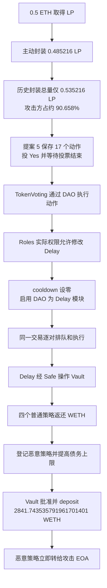

# Term Labs：少量封装 LP 取得多数票权后，治理提案关闭延时并转走金库 WETH

源表第 **91** 行，事件日期 **2026-08-23**，Ethereum。独立核验的资金执行交易为 [`0xd354…4129`](https://etherscan.io/tx/0xd354a15b15cb73d30908f411aee3f795ec86737a4d080e9a818ac4d6d3014129)，区块 **25,816,049**，时间 **2026-08-23 06:25:47 UTC**。源表第一笔 `0x724e…a0e` 是取得 LP 的准备交易，不能当成提案创建交易。

**本案成立的是部署层的治理组合缺陷：主动封装的一小部分 LP 决定投票，而该投票结果却能调用足以取消延时、改变执行模块和分配全部可用金库资金的权限。** 已取得核心组件在 Sourcify 上验证的原始源码，并用历史调用跟踪确认实际执行的实现地址。下面的路径无需假设攻击者窃取了管理员私钥；这也不等于完成了所有链外密钥事件的取证。

## 背景与正常流程

Term 的 ETH Meta Vault 接受 WETH 存款，给存款人 LP 份额，再把资金分配到普通策略中。金库里的“策略债务”是分配给某个策略管理的资产账面金额，不是自动证明该策略里的资产还能取回。LP 可以主动封装成治理代币参与 DAO 投票；未封装的普通 LP 不进入这个投票代币的供给和票权快照。

[项目官方治理说明](https://developers.term.finance/periphery-contracts/curated-vaults/administration/term-vault-governance)把正常安排描述为：Proposer Safe 提议操作，经过 Delay 的七日等待，再由 Governor Safe 操作 Vault；LP DAO 可以投票调用 `setTxNonce`，跳过队列中的某个操作。这份官方页面在采集时仍可访问，已保存[原始网页](../../dataset_artifacts/batches/20261026_x96_y5/term/official-governance.html)及[可读文本](../../dataset_artifacts/batches/20261026_x96_y5/term/official-governance-readable.txt)。它说明业务预期，不单独证明攻击前的具体存储值。

| 角色 | 实际地址 | 本案中的作用 |
| --- | --- | --- |
| ETH Meta Vault | `0x26fCb50eEC367ddAB060ccf5E7394Cecd95F7Db2` | 持有 WETH，登记策略、分配和收回策略债务 |
| 封装 LP 投票代币 | `0x5b96c5bBdcB361E1E9944bAa071b237E27829Be0` | 接收 LP 后按同额铸造票权代币，并记录历史快照 |
| TokenVoting | `0x213771693A4411446b4ECce5bce4a405778b2171` | 创建、投票和执行提案 |
| DAO | `0x0ae12AF3878a2d896f5C4DCE3Be7250FB187c0a6` | 执行通过的动作；历史上能使用 Roles 的 role 1 |
| Roles／Delay 的 owner | `0xD9DdE54D99a27F0f0E2b282369BFaa95528e9B75` | 检查模块成员和角色权限后，以自己的身份调用 Delay |
| Delay | `0x35C99CF4a5DF2D9bCd822BeE32676D9590229e33` | 排队操作、检查冷却期，再经 Safe 执行 |
| 管理 Safe | `0x46DA347d1Db6EdCA62BF6Cd5892Dc284fC938613` | 已启用 Delay 模块，并持有相关金库操作权限 |
| 攻击辅助代理 | `0x64E477800051EFb06Ae4086f4b258b270668b4dF` | 取得封装票权、提交提案、投票和调用执行 |
| 恶意策略 | `0x184f2E57b4cE135181FA2A2166AC394339016338` | 获准接收金库配置的 WETH，随即转给攻击钱包 |
| 攻击钱包 | `0xa908b3472d76e7744baB0A5911768a4a6300612B` | 发起交易，接收最终 WETH |

正常的 Vault 管理接口本来就有权把资金配置给新策略，因此治理权限必须限制在业务允许的范围。只把管理函数加上 `onlyOwner` 或角色检查，并不能约束一个已经通过治理拿到该调用身份的提案。

## 具体代码问题与权限如何接起来

### 1. 投票分母只包含主动封装的 LP

[`GovernanceWrappedERC20.depositFor`](../../dataset/benchmark_complete/20260823_TermLabs/source-bundles/term-voting-token/src/token/ERC20/governance/GovernanceWrappedERC20.sol#L80-L86)调用 OpenZeppelin 的 [`ERC20WrapperUpgradeable.depositFor`](../../dataset/benchmark_complete/20260823_TermLabs/source-bundles/term-voting-token/@openzeppelin/contracts-upgradeable/token/ERC20/extensions/ERC20WrapperUpgradeable.sol#L46-L51)：从调用方转入 underlying LP，再给指定账户铸造同额封装代币。该封装代币的 [`_afterTokenTransfer`](../../dataset/benchmark_complete/20260823_TermLabs/source-bundles/term-voting-token/src/token/ERC20/governance/GovernanceWrappedERC20.sol#L96-L109)还会在首次接收且没有委托记录时自委托，产生投票权。

[`TokenVoting.totalVotingPower`](../../dataset/benchmark_complete/20260823_TermLabs/source-bundles/term-voting/src/plugins/governance/majority-voting/token/TokenVoting.sol#L66-L69)直接使用这个封装代币的 `getPastTotalSupply`。[`createProposal`](../../dataset/benchmark_complete/20260823_TermLabs/source-bundles/term-voting/src/plugins/governance/majority-voting/token/TokenVoting.sol#L72-L147)选取前一区块作为快照，并按该分母计算最低参与票权；提案中的目标、金额和 calldata 则按输入原样保存。历史票权读取来自 [`ERC20VotesUpgradeable`](../../dataset/benchmark_complete/20260823_TermLabs/source-bundles/term-voting-token/@openzeppelin/contracts-upgradeable/token/ERC20/extensions/ERC20VotesUpgradeable.sol#L78-L99) 的 checkpoint。

本案提案快照是区块 **25,772,693**。历史 trace 里的真实返回值是：总封装供给 **0.535216182805348480 LP**，攻击辅助合约票权 **0.485216182805348480 LP**，占 **90.65798053079714%**。两者相减可知，攻击者封装前已有的封装供给只有 **0.05 LP**。这些值来自当时的 `getPastTotalSupply` 和 `getPastVotes` 调用，未用当前总供给代替历史值。

因此，“攻击者只存入少量资金”不意味着“攻击者在这个投票系统里只占少量票权”。系统的分母没有覆盖全部未封装 LP，也没有用金库全部资产作为投票安全基准。

### 2. 通过提案后可以执行动作列表，角色范围没有停在“否决某笔操作”

[`TokenVoting._vote`](../../dataset/benchmark_complete/20260823_TermLabs/source-bundles/term-voting/src/plugins/governance/majority-voting/token/TokenVoting.sol#L158-L200)把历史票权累加到对应选项；[`MajorityVotingBase._canExecute`](../../dataset/benchmark_complete/20260823_TermLabs/source-bundles/term-voting/src/plugins/governance/majority-voting/MajorityVotingBase.sol#L478-L509)检查支持率、参与率和是否已经执行。通过后，[`_execute`](../../dataset/benchmark_complete/20260823_TermLabs/source-bundles/term-voting/src/plugins/governance/majority-voting/MajorityVotingBase.sol#L456-L465)和 [`_executeProposal`](../../dataset/benchmark_complete/20260823_TermLabs/source-bundles/term-voting/src/core/plugin/proposal/ProposalUpgradeable.sol#L72-L81)把已保存的动作交给 DAO。

[`DAO.execute`](../../dataset/benchmark_complete/20260823_TermLabs/source-bundles/term-dao/src/core/dao/DAO.sol#L233-L299)先检查执行权限，再逐个 `.call` 目标地址。其执行内容不限于 `setTxNonce`；业务范围要靠实际授予的目标权限约束。历史跟踪显示本案 DAO 成功调用 Roles 的 `callTargetFunctionWithRole`，role 参数为 **1**。

[`Roles.callTargetFunctionWithRole`](../../dataset/benchmark_complete/20260823_TermLabs/source-bundles/term-roles/contracts/Roles.sol#L356-L373)有 `moduleOnly`，也调用了 [`Permissions.check`](../../dataset/benchmark_complete/20260823_TermLabs/source-bundles/term-permissions/contracts/Permissions.sol#L177-L194)。后者检查角色成员，再由 [`checkTransaction`](../../dataset/benchmark_complete/20260823_TermLabs/source-bundles/term-permissions/contracts/Permissions.sol#L247-L290)检查目标、函数或参数权限。通过后，Roles 直接向指定目标发出调用。

本案实际通过了三次检查：`Delay.setTxCooldown(0)`、`Delay.setTxExpiration(0)`、`Delay.enableModule(DAO)`。这足以证明实际配置授予 DAO 的能力超过了官方描述的单纯否决。未取得完整历史权限存储，因此不声称 role 1 一定用了“所有函数通配”，也不把某种具体权限配置方式当成已证实事实。

### 3. 可被治理修改的延时，无法再约束同一个治理动作列表

[`Delay.setTxCooldown`](../../dataset/benchmark_complete/20260823_TermLabs/source-bundles/term-delay/contracts/Delay.sol#L92-L109)是正常的 `onlyOwner` 管理函数，允许把冷却期设为零；`setTxExpiration(0)`使操作不因有效期到期失效。[`Modifier.enableModule`](../../dataset/benchmark_complete/20260823_TermLabs/source-bundles/term-delay/@gnosis.pm/zodiac/contracts/core/Modifier.sol#L82-L94)也有 `onlyOwner`。历史调用来自真正通过 owner 检查的 Roles，未绕过这些检查。

接着 DAO 已被加入 Delay 的模块列表，可以调用 [`execTransactionFromModule`](../../dataset/benchmark_complete/20260823_TermLabs/source-bundles/term-delay/contracts/Delay.sol#L123-L143)排队。它记录的是本次交易的 `block.timestamp`。随后同一动作列表立即调用 [`executeNextTx`](../../dataset/benchmark_complete/20260823_TermLabs/source-bundles/term-delay/contracts/Delay.sol#L172-L203)，检查的是“当前时间减排队时间是否大于等于当前 cooldown”。此时左边为零、cooldown 也已为零，所以无需再经过独立的等待期。

这条路径继续经 [`Module.exec`](../../dataset/benchmark_complete/20260823_TermLabs/source-bundles/term-delay/@gnosis.pm/zodiac/contracts/core/Module.sol#L43-L77)进入 Safe。Safe 的 [`execTransactionFromModule`](../../dataset/benchmark_complete/20260823_TermLabs/source-bundles/term-safe/contracts/base/ModuleManager.sol#L56-L73)检查来者是已启用模块，然后直接执行，不要求每笔重新附带 Safe owner 的签名。本案该模块是 Delay。

### 4. 真实资产按合法管理接口被配置给了恶意策略

Vault 的 [`_enforce_role`](../../dataset/benchmark_complete/20260823_TermLabs/source-bundles/term-vault/YearnV3Vault.vy#L1521-L1526)、[`add_strategy`](../../dataset/benchmark_complete/20260823_TermLabs/source-bundles/term-vault/YearnV3Vault.vy#L1698-L1707)、[`update_max_debt_for_strategy` 和 `update_debt`](../../dataset/benchmark_complete/20260823_TermLabs/source-bundles/term-vault/YearnV3Vault.vy#L1731-L1762)都有相应角色要求。本案实际调用者是有相关权限的管理 Safe。

[`_update_debt` 的减债分支](../../dataset/benchmark_complete/20260823_TermLabs/source-bundles/term-vault/YearnV3Vault.vy#L965-L1045)按 `maxRedeem`、`convertToAssets` 和实际 WETH 余额增量收回资金。增债分支则按 max debt、策略 `maxDeposit` 和可用 idle 资金限制金额，批准策略拉取资产，再调用 `deposit`，最后用金库真实余额减少量记入策略债务。完整增加分支在 [1046–1111 行](../../dataset/benchmark_complete/20260823_TermLabs/source-bundles/term-vault/YearnV3Vault.vy#L1046-L1111)。

这些正常会计检查能证明“金库确实把资产交了出去”，不能证明“治理选择的策略会善意管理资产”。恶意策略接收这笔 WETH 后立即转给攻击钱包，金库则把同额资产记成了该策略的债务。

## 必要条件与检查边界

这次路径需要的条件均有对应证据：攻击者能从公开存款路径取得 LP 并封装；已有封装供给很小；提案达到当时实际支持率和参与率要求；DAO 在 Roles 中有可用角色和模块身份；Roles 能以 owner 身份执行上述三个 Delay 管理动作；Delay 是 Safe 的已启用模块；Safe 具备相关 Vault 角色；普通策略能够返还相应 WETH。

不能把“多数票通过”和“函数存在”直接等同于任意地址都能盗取金库。这里的关键是整条权限连接实际存在，历史 trace 展示它逐层通过。也不能把 `onlyOwner` 正常接受真实 owner 的调用单独标成权限绕过；问题在于低成本可控制的投票，获得了改变安全等待机制和资金配置的权力。投票需要等待本提案的投票期限，攻击并非一笔闪电贷在同一个区块内完成。

## 历史步骤与 17 个动作

1. **8 月 17 日取得 LP。** [准备交易 `0x724e…a0e`](https://etherscan.io/tx/0x724e377f0523898061b9e2f504ab7792e06846c3cb728a6d5b19a2fa58d2ca0e)位于区块 **25,772,675**。Vault 的原始 `Deposit` 日志记录 **0.5 WETH** 资产和 **0.485216182805348480 LP** 份额，随后 LP 经路由最终到攻击 EOA。路由器深层源码未完整归档，但这笔存款和份额流转有原始日志。
2. **封装并形成票权。** [交易 `0x7876…8cc2`](https://etherscan.io/tx/0x7876693645d08038b7072bfd206f8c1aeb7d0a445b87a8b27b78786ed2ae8cc2)，区块 **25,772,681**，把上述 LP 经辅助合约转入 wrapper，并给辅助合约铸造同额封装代币。历史 trace 和转账日志均已保存。
3. **创建提案 5。** [交易 `0x284f…a8b8`](https://etherscan.io/tx/0x284fc544f39c21388e17ca9669970dda9fe0f31921c38676f56073573f73a8b8)，区块 **25,772,694**，提案开始于 **8 月 17 日 05:25:35 UTC**，结束于 **8 月 23 日 06:25:35 UTC**，持续 **522,000 秒，即六天一小时**。从原始事件 bytes 独立解出了全部 17 个动作，并与 explorer 的解码逐项比对。
4. **给自己提案投 Yes。** [交易 `0x6e73…2a8d`](https://etherscan.io/tx/0x6e73533304c28686928bf274ec89e8baedbccaed6e8b9211ef54ca90a54e2a8d)，区块 **25,772,700**，`VoteCast` 的选项为 **2**，票权为 **485216182805348480** 原始单位。[枚举定义](../../dataset/benchmark_complete/20260823_TermLabs/source-bundles/term-voting/src/plugins/governance/majority-voting/IMajorityVoting.sol#L16-L21)确认 2 是 Yes。提案文字伪装成“投 Yes 否决参数修改”，但 metadata 不决定执行语义，实际 Yes 支持的是保存的恶意动作列表。
5. **投票结束 12 秒后执行。** [主交易 `0xd354…4129`](https://etherscan.io/tx/0xd354a15b15cb73d30908f411aee3f795ec86737a4d080e9a818ac4d6d3014129)中的 395 个 rawtrace frame 和 78 个完整原始日志交叉对应。DAO 的 `Executed` 事件里 `callId=5`，`allowFailureMap=0`、`failureMap=0`，17 个动作与创建提案时的原始动作完全相同。其后还有 `ProposalExecuted(5)`。

| 动作位置（从 1 开始） | 原始动作的含义 | 结果 |
| --- | --- | --- |
| 1–3 | 通过 Roles role 1 调用 Delay：cooldown=0、expiration=0、enableModule(DAO) | 为同交易排队和执行打开实际权限路径 |
| 4–11 | 对四个普通策略分别排队、执行 `update_debt(strategy,0,10000)` | 每个策略两动作，共八个；10000 为 max loss 参数的基点上限，实际提款还受可提余额限制 |
| 12–13 | 排队并执行 `add_strategy(恶意策略,false)` | 登记策略；false 代表此次不加入默认提款队列 |
| 14–15 | 排队并执行 `update_max_debt_for_strategy(恶意策略,UINT256_MAX)` | 放宽该策略的债务上限 |
| 16–17 | 排队并执行 `update_debt(恶意策略,UINT256_MAX,10000)` | 按实际可用资金给恶意策略注资 |

## 资金流为何构成损失

四个普通策略返还给 Vault 的原始 WETH 转账是：

| 普通策略 | 返回 WETH | `DebtUpdated` 后仍有债务 |
| --- | ---: | ---: |
| `0x330732581D30076137a1159B3aE8780158D902bE` | 44.374846516342705839 | 0 |
| `0xfC36C2EdB18829308Fa9eE9500e8be6520A47Caf` | 43.877743641067227231 | 0 |
| `0x9F1c3173581CED1204136cBc628d2fb2407d7AC4` | 1445.511224844779005036 | 75.559355632157132279 |
| `0x76dD96710A73675d9cf9523A046f1587cA9031d4` | 1307.979720789772763295 | 8.912992806429266279 |

四笔返还的整数和恰好为 **2841743535791961701401**。所以这里只能说收回了本次可提部分，不能说四个策略全部清空。普通策略深层代码尚未完整归档；这些已发生的返回金额由 WETH 原始 Transfer 日志、trace 中的真实调用和 Vault 债务事件共同证明。

主交易原始日志索引 **1200** 记录 Vault 向恶意策略转出 **2841743535791961701401** 个 WETH 原始单位；索引 **1201** 记录恶意策略随即向攻击 EOA 转出同额。WETH 的 [18 位小数与转账实现](../../dataset/benchmark_complete/20260823_TermLabs/source-bundles/term-weth/WETH9.sol#L18-L77)来自已验证原始源码，因此人类单位为 **2841.743535791961701401 WETH**。索引 **1206** 的 `DebtUpdated` 又把恶意策略债务从零更新成这个金额。转账并非只有一个自定义事件声称成功；真实 WETH 合约按正常余额／授权规则完成了两跳付款。

这是这笔交易的金库毛流出和攻击钱包毛入账，不是扣除最初 0.5 ETH、gas、事后追回后的净利润。源表给出的约 **850 万美元**属于更广事件口径。[官方恢复分配更新](https://www.term.finance/post/term-vault-recovery-distribution-update)还涉及不同 USDC 存款池、追回资金和 RepoToken 分配，不能直接把它们相加或当成本笔美元价值。本案未逐一核验其他 USDC vault 全部交易，也未固定事发价格，故 **CSV 的美元损失字段留空**。

## 原始源码、实现绑定与辅助反编译

全部九份正式原始源码包均从 **Sourcify 验证平台**下载，保存提供方完整原响应、下载 URL、时间依据、SHA256、编译设置、匹配等级和每个源文件的 SHA256；合计 **158 个原始源文件**。提取时只把响应中的 `content` 按 UTF-8 原样写出，未改字、未补写代码。部分包 `runtimeMatch=match`，部分为 `exact_match`；Voting 与 DAO 的 `creationMatch` 为空，不统一夸大为全创建匹配。完整映射在[来源记录](../../dataset_artifacts/batches/20261026_x96_y5/term/provenance.json)。

| 代理／部署角色 | 历史实际实现或库地址 | 原始源码包 |
| --- | --- | --- |
| TokenVoting | `0xd4bfb6C688b2982A3b432F2Fc6C35117532A2C27` | `term-voting` |
| 封装票权代币 | `0xCC925a32fA4fa41c42a7d5585D69C980b6Fa9342` | `term-voting-token` |
| DAO | `0x52Af16664155608b845BE18aa29620EbF6eA2D3a` | `term-dao` |
| Roles | `0x52BcB5C9408ffC5C7D7510e16F75A54c56D3Bc84` | `term-roles` |
| Permissions 库 | `0xe3b694a21d6a633eD8b5Ea9cd70fC43Fa7D3B6Fb` | `term-permissions` |
| Delay | `0xd54895B1121A2eE3f37b502F507631FA1331BED6` | `term-delay` |
| Safe | `0xd9Db270c1B5E3Bd161E8c8503c55cEABeE709552` | `term-safe` |
| Vault | `0xd8063123BBA3B480569244AE66BFE72B6c84b00d` | `term-vault`，原文件保留 Vyper `.vy` |
| WETH 非代理部署 | `0xC02aaA39b223FE8D0A0e5C4F27eAD9083C756Cc2` | `term-weth` |

前八行绑定采用准备或执行交易中的历史 `delegatecall` 目标，包括实际调用 Permissions 库的 frame；没有直接用当前网页的 implementation 标签冒充历史绑定。逐条 frame 位置在[历史实现映射](../../dataset_artifacts/batches/20261026_x96_y5/term/historical_bindings.json)，原始数据分别为[封装 trace](../../dataset_artifacts/batches/20261026_x96_y5/term/blockscout-wrap-trace.json)、[提案 trace](../../dataset_artifacts/batches/20261026_x96_y5/term/blockscout-proposal-trace.json)、[投票 trace](../../dataset_artifacts/batches/20261026_x96_y5/term/blockscout-vote-trace.json)和[执行 trace](../../dataset_artifacts/batches/20261026_x96_y5/term/blockscout-execution-trace.json)。我们没有本地重新编译来独立重做提供方的源码／字节码匹配。

恶意策略原始源码不可得，另保存 [ethervm.io](https://ethervm.io/decompile) 返回的[高层反编译输出](../../dataset/benchmark_complete/20260823_TermLabs/decompiled/attacker-strategy.ethervm.decompiled.sol#L1-L599)，原样保留推断变量名和结构。输入是区块 **25,772,662** 创建交易返回的 **2497 字节 runtime**；输入原始字节 SHA256 为 `04a1ffff8d99b6391661cbdd1f67c03aecd04c18dbebc9dc2516208c3fc18ce9`。该 runtime 与采集时 explorer 返回的 runtime 相同，服务返回的独立反汇编也逐字节核对覆盖全部 2497 字节。工具未报告反编译引擎版本，因此版本记为 `null`；不能拿网页前端库版本代替。反编译只能帮助理解恶意策略，不能当作作者公开源码，更没有替代上述受害链路的原始源码。

攻击辅助代理的实现 `0x3e30DDF30172F54C50cB490fF56E10f1a4737cF1` 同样没有可用的已验证原始源码。保存其创建区块 **25,772,663** 的 **12318 字节 runtime**；提交 runtime 和按地址查询 ethervm 均返回超时，无可用高层代码。原始[失败响应](../../dataset_artifacts/batches/20261026_x96_y5/term/helper-implementation-ethervm-response.html)和[按地址查询失败响应](../../dataset_artifacts/batches/20261026_x96_y5/term/helper-implementation-ethervm-address-response.html)均保留。没有补写伪代码冒充反编译。

## 证据限制与可复核范围

- [原始提案与独立解码](../../dataset_artifacts/batches/20261026_x96_y5/term/decoded-proposal.json)、[票权和资金流复核](../../dataset_artifacts/batches/20261026_x96_y5/term/decoded_evidence.json)、[两页执行日志一](../../dataset_artifacts/batches/20261026_x96_y5/term/blockscout-execution-logs.json)、[二](../../dataset_artifacts/batches/20261026_x96_y5/term/blockscout-execution-logs2.json)以及 [Blockscout 交易状态](../../dataset_artifacts/batches/20261026_x96_y5/term/blockscout-execution-transaction.json)共同支持已执行路径。完整 JSON-RPC receipt 查询未取得可用结果，不把保存的 `null`／错误响应当成成功回执；本案使用 Blockscout 返回的原始 topics、data 和 rawtrace。
- 历史状态查询存在归档访问限制。没有完整重建攻击前全部 Roles 权限、support threshold、min participation 和 cooldown；只确认实际执行的检查通过、三个管理动作内容及后续同交易执行。此前 cooldown 的精确秒数不从报道照抄。
- 四个普通子策略和更深 Aave／Morpho 依赖，以及初始 LP 路由器，没有全部源码闭合。本案不把其内部行为假设成漏洞，仅依据实际 trace 和 WETH 日志确认已发生的资金返回。若要评价这些依赖的所有分支，还需另外补齐源码与历史状态。
- 恶意策略和 helper 在攻击区块的独立 `eth_getCode` 查询未成功；已有创建 runtime 和当前 runtime 比对不等于完整证明两者之间从未发生过代码变化。策略付款因果主要由实际执行 trace 与真实 WETH 日志支撑。
- 原始 [CertiK 披露入口](https://x.com/certikalert/status/2091433962795106499?s=46)获取受限；第三方分析仅用于定位交易和地址。金额、根因与“确实取得治理权限”的结论分别由上述源码和历史数据核验。
- 所有下载失败、空结果、源码 404、GitHub 限流、Etherscan 反编译 Cloudflare 页面及在线反编译超时均留在[采集记录](../../dataset_artifacts/batches/20261026_x96_y5/term/retrievals.json)和[反编译来源](../../dataset_artifacts/batches/20261026_x96_y5/term/decompilation-provenance.json)。某些读取时间仅有本地下载文件最后写入时间，记录中明确标识，没有伪造精确响应时间。

本批只执行本地离线数据解析、原文提取和哈希／范围核对。没有执行下载的脚本或 PoC，没有编译 Solidity／Vyper、部署、fork 重放或发送交易。完整原始源码与精简连续切片用于审核推理，不承诺精简版本可独立编译。
