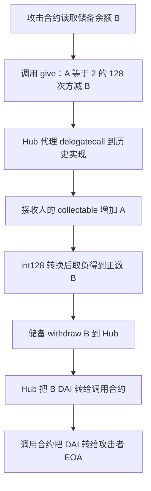

# Drips：把“我要付款”变成“储备给我付款”

旧版 DaiDripsHub 让用户给接收人记入可领取的 DAI。正常情况下，`give(receiver, amt)` 应当先给接收人记账，再从付款人的钱包收取同额 DAI。漏洞出在金额的类型转换：一个很大的 `uint128` 被直接解释为负的 `int128`，随后取负又变成正数，付款方向因此反转。合约替攻击者从储备提款，却没有向攻击者收款。

本例来自 2026-10-16 固定源表第 **123** 行，数据集日期保留源表的 **2026.07.15**。Ethereum 代表交易实际为 **2026-07-14 09:16:35 UTC**，区块 **25529927**。源表还列了 Polygon 参考交易，本例没有独立核查该交易，因此以下金额仅覆盖 Ethereum 这一笔。

## 合约和正常资金流

| 角色 | 地址或作用 |
| --- | --- |
| Hub 代理、保存业务状态 | `0x73043143e0a6418cc45d82d4505b096b802fd365` |
| 历史跟踪实际调用的实现 | `0x8d321e80487356c846f34456d31ce761776ef697` |
| DAI 储备 | `0xf9bbb2df44cfe46e501cf91c99b2f8fef9d9d44a` |
| 调用 `give` 并收取退款的攻击合约 | `0x00c64b5a926ba1fcec30efad88c344c619f54f12` |
| `give` 参数里的接收人 | `0x962f827743078b18cf437f1deea721b42dd19f8c` |
| 最终收款 EOA | `0x84da7a5e2315eb798f04b75554aeb15047269cce` |

接收人和收到储备提款的地址是两个不同角色。`give` 的 `receiver` 决定可领取余额记给谁；`_transfer(userOrAccount.user, …)` 的 `user` 则来自调用人，决定实际从谁收钱或向谁付款。这个参数连接是资金被攻击合约拿到的原因。

Hub 用有符号金额统一处理收付：`amt < 0` 时向用户 `transferFrom` 并存入储备；`amt > 0` 时由储备 `withdraw` 到 Hub，再由 Hub 转给用户。储备的 `onlyUser` 限制仍然生效，攻击者借助有资格提款的 Hub 进入这条正常提款路径。

关键原文见 [give 入口和 reserve 配置](../../dataset/benchmark_complete/20260715_Drips/source-bundles/implementation/DaiDripsHub.sol#L2074-L2144)、[_give 的状态写入与类型转换](../../dataset/benchmark_complete/20260715_Drips/source-bundles/implementation/DaiDripsHub.sol#L1376-L1389)、[储备的权限和提款](../../dataset/benchmark_complete/20260715_Drips/source-bundles/reserve/DaiReserve.sol#L224-L268)。

## 转换如何改变付款方向

历史内部跟踪中，攻击合约先读到储备余额 `B`，再提交 `give(address,uint128)`，selector 为 `0xcab4aac0`。原始参数和返回值复算如下，所有整数均为 DAI 最小单位：

| 项目 | 数值 |
| --- | --- |
| 储备当次返回的余额 `B` | `24882995421947667857715` |
| 传入的无符号金额 `A = 2^128 - B` | `340282366920938438580379185484100353741` |
| `int128(A)` | `-24882995421947667857715` |
| 实际交给 `_transfer` 的 `-int128(A)` | `+24882995421947667857715` |

`_give` 先执行 `_storage().receiverStates[receiver].collectable += A`，再调用 `_transfer(user, -int128(A))`。Solidity 0.8 的加减溢出检查并不会替这个显式类型转换拒绝所有超出 `int128` 正数范围的 `uint128`。本次参数也没有落在取负会溢出的 `int128` 最小值上，因此交易能继续执行。正数 `B` 让它进入提款分支，付款人没有提供对应的 DAI 入金。

触发仍需要 Hub 未暂停、储备已设置并允许 Hub 提款、储备有余额，且接收人的 `collectable + A` 不发生溢出。历史调用成功支持这些检查在当次调用中通过；本例没有另外读取攻击前区块的完整存储，也不把当前配置当作历史配置。

## 历史调用和实际金额

[代表交易](https://etherscan.io/tx/0xc38a6e2259a85ced94238a0b0a49697992f2a6b8140c28f3fd2343d3d8434130)的[完整内部跟踪](../../dataset_artifacts/benchmark_complete/20260715_Drips/evidence/raw-trace.json)共有 10 个调用记录。跟踪中的 delegatecall 目标对应本例取得的实现源码，后续调用接上储备提款和 ERC-20 转账。[交易记录](../../dataset_artifacts/benchmark_complete/20260715_Drips/evidence/transaction.json)可见三笔金额相同的 DAI 转账：储备 → Hub、Hub → 攻击合约、攻击合约 → EOA，每笔都是 **24,882.995421947667857715 DAI**。这三笔是同一笔资产在调用链中流转，不能相加当作损失。攻击合约另有 0.02 ETH 费用流，不计为本例 DAI 收益。

[复算结果](../../dataset_artifacts/benchmark_complete/20260715_Drips/evidence/recomputed.json)保留了原始整数、参数接收人和实现地址。CSV 保留源表约 **24,883 美元**的估值口径，即中文 **2.4883 万美元**、英文 **24.883 千美元**；链上核查的是 DAI 数量，没有独立重建当时的 DAI/USD 价格。

## 归档与核查边界

[完整版](../../dataset/benchmark_complete/20260715_Drips)保留实现、代理、储备的原始完整扁平化源码，三套源包分别保存，ABI、编译配置、原始来源响应在[配套目录](../../dataset_artifacts/benchmark_complete/20260715_Drips)。Sourcify 的 creation/runtime 匹配状态、下载地址、时间和逐文件 SHA-256 见[来源清单](../../dataset_artifacts/benchmark_complete/20260715_Drips/provenance.json)。公开验证源码与历史调用目标已对应，但本例没有逐一证明全部攻击时配置和部署字节码等价。

[精简版](../../dataset/benchmark_simplified/20260715_Drips)保留状态、金额类型、暂停门槛、入口、转换、储备权限和转账路径；每份文件都是连续原文切片，原路径、起止行和双向哈希见[切片清单](../../dataset_artifacts/benchmark_simplified/20260715_Drips/slice_manifest.json)。切片不作为独立编译单元。本例未本地编译、未分叉重放，也没有执行下载的攻击代码。

公开技术披露：[Verichains 分析](https://blog.verichains.io/p/drips-network-when-giving-became)。批次选行与跳过理由见[固定快照](../../dataset_artifacts/batches/20261016_x123_y5/snapshot.json)及[逐行结果](../../dataset_artifacts/batches/20261016_x123_y5/results.json)。
