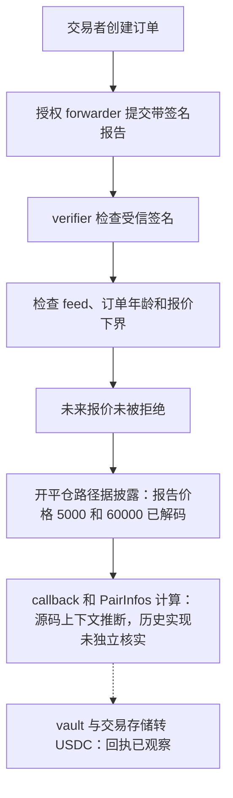

# Ostium：有签名的未来报价为何被当作当前成交价

Ostium 的永续交易需要链下价格报告来开仓和平仓。合约既要确认“是谁签的价格”，也要确认“这个价格适用于当前订单”。本例的价格入口检查了订单是否太旧、报价是否早于订单，却没有检查报价是否来自未来。拿到受信签名并走通授权转发路径后，未来时间戳的异常报价能进入结算，形成虚假的交易盈利。

本例来自固定源表第 **121** 行，日期 **2026.07.15**，链为 **Arbitrum**。这里只独立核查代表交易的 calldata 和回执，不把一笔交易的结果当作整个事件损失。

## 正常流程和权限条件

交易系统先登记订单、时间、交易对 feed 和订单类型。受信 forwarder 提交签名报告，`performUpkeep` 调 verifier 验签，再检查 feed 和时间。`fulfill` 按订单类型调用开仓或平仓 callback，最后删除该价格订单。正常平仓由成交价格与开仓价格计算盈亏，盈利部分由 oLP vault 支付。

| 角色 | 地址 |
| --- | --- |
| PrivatePrice upkeep 代理 | `0xb71ec9ebd8145dacacf6724363143cb5667a3d36` |
| 公开验证的 upkeep 实现 | `0x0aebc4094b60ea4e21e937e80dafdd58c07c5ebb` |
| 价格 verifier | `0xd456939e54f68ef9b0be62abb2ec4a37397cb814` |
| oLP vault 代理 | `0x20d419a8e12c45f88fda7c5760bb6923cee27f98` |
| 交易者、最终 USDC 收款人 | `0x321df194646029e7a6193ea05573d4b9c398bfd9` |
| 交易入口所用 relay | `0xd1794196f0fc99c7f27970e661597d77d9a85869` |
| 批量执行目标 | `0xfe12f6360000de49d5506d52ee5ac4bc9dd5bd2e` |

`performUpkeep` 开头要求 `isForwarder[msg.sender]` 为真；登记 forwarder 需要 timelock。`OstiumVerifier.verify` 用 `ecrecover` 恢复签名者，并检查其在 `authorizedSigners` 中。因此，缺少时间上界不等于普通用户能随便签一个价格。攻击链还依赖有效受信签名、合格订单和授权转发通路；本例没有独立恢复签名者或重读攻击时的权限映射，异常报告的签发原因仍属披露归因范围。

关键源码：[订单与时间检查](../../dataset/benchmark_complete/20260715_Ostium/source-bundles/upkeep/src/OstiumPrivatePriceUpKeep.sol#L76-L161)、[verifier 原始实现](../../dataset/benchmark_complete/20260715_Ostium/source-bundles/verifier-and-context/src/OstiumVerifier.sol#L1-L65)。实际函数拼写是 `performUpkeep`。

## 缺少哪一条时间检查

`performUpkeep` 拒绝三类报告：feed 不符、`block.timestamp > order.timestamp + maxOrderAgeSeconds`、`report.timestamp < order.timestamp`。第二项只限制订单年龄；第三项只限制报价下界。代码没有要求报价时间不晚于当前区块时间，也没有给未来偏移设置容忍上限。verifier 核实签名，并未补充这个时间约束。

[原始交易输入](../../dataset_artifacts/benchmark_complete/20260715_Ostium/evidence/transaction-rpc.json)可直接解出四步批量调用：交易请求、价格执行、平仓请求、价格执行。两次价格调用的 selector 都是 `0x4585e33b`，目标都是 upkeep 代理。

| 次序 | 价格订单 | report timestamp | 原始 price（18 位精度） | 换算价格 |
| --- | --- | --- | --- | --- |
| 开仓价格执行 | `2157519` | `2000000000` | `5000000000000000000000` | 5,000 |
| 平仓价格执行 | `2157520` | `2000000000` | `60000000000000000000000` | 60,000 |

`2000000000` 对应 **2033-05-18 03:33:20 UTC**，显著晚于这笔 2026 年交易。两份报告使用相同 feed，bid/ask 与各自 price 相同，`isMarketOpen=true`。完整 feed、r/s/v 原始签名和偏移解码结果保存在[复算文件](../../dataset_artifacts/benchmark_complete/20260715_Ostium/evidence/recomputed.json)。公开分析把这笔过程描述为 120,000 USDC 抵押、1 倍杠杆的开平仓；本例独立确认了提交的两份报告和回执中的付款，没有重建全部历史订单存储。

## 从异常价格到 USDC 付款

已归档的 callback 上下文把报告的 `a.price` 送入 `TradingCallbacksLib.getTradeAndPriceData`，再按价格影响后的价格计算 `profitP` 和 `tradeValue`。该库的基本盈亏公式是：多头用 `(currentPrice - openPrice) / openPrice`，空头方向相反，再乘精度和杠杆，并应用最大收益上限。5,000 到 60,000 的裸价格比为 12，未计费用的多头回报率为 1,100%；实际付款仍经过价格影响、收益上限、费用和抵押返还，不能只凭这条比例直接写出最终收益。

`OstiumPairInfos.getTradeValuePure` 将收益率转换为应付金额：`value = collateral + collateral * percentProfit / 1e6 / 100 - rolloverFee - fundingFee`，负值截断为零。这里的 collateral 和返回值都以 USDC 的 6 位精度计量，`percentProfit` 采用放大 1e6 的百分数，先后两个除法保留 Solidity 整数截断顺序。见[完整金额公式](../../dataset/benchmark_complete/20260715_Ostium/source-bundles/verifier-and-context/src/OstiumPairInfos.sol#L861-L875)。精简版同时保留它的精度常量、费用计算和 `getDynamicTradePriceImpact` 的实际实现：静态分支从 bid/ask 选择价格，动态分支依据交易量和 spread 修改 `priceAfterImpact`，callback 再用该值重新计算最终收益率。没有独立重建本次历史 spread 配置，故不声称裸价格比例可直接复算全部结算细节。

随后 `unregisterTrade` 调 `executeUnregisterTrade`；当应付额超过交易系统保存的抵押时，经 vault 的 `sendAssets` 补足差额。`sendAssets` 更新 vault 盈亏会计并向接收人转 USDC，保留 `onlyCallbacks` 权限。见[平仓参数传递](../../dataset/benchmark_complete/20260715_Ostium/source-bundles/verifier-and-context/src/OstiumTradingCallbacks.sol#L244-L390)、[利润计算](../../dataset/benchmark_complete/20260715_Ostium/source-bundles/verifier-and-context/src/lib/TradingCallbacksLib.sol#L56-L79)、[vault 付款](../../dataset/benchmark_complete/20260715_Ostium/source-bundles/verifier-and-context/src/OstiumVault.sol#L649-L680)。这些 callback、PairInfos 和 vault 实现来自 verifier 完整编译源包，是业务上下文；本例没有把每个文件都认定为攻击时各代理实际使用的实现。

## 回执金额与整体损失口径

[代表交易](https://arbiscan.io/tx/0xfaf6d3d4d7f1a75bfc11fb4d36d0525791546267fda1cdd371703ce03ae8ba8c)区块为 **484138330**，成功[回执](../../dataset_artifacts/benchmark_complete/20260715_Ostium/evidence/receipt-alt.json)中，USDC 合约是 `0xaf88d065e77c8cc2239327c5edb3a432268e5831`，精度 6。按指定地址的全部 Transfer 加减：

| 口径 | USDC |
| --- | --- |
| vault 毛支出 | 1,078,439.5804 |
| vault 收入 | 36 |
| vault 净流出 | **1,078,403.5804** |
| 交易者总支出 | 120,000.1 |
| 交易者总收入 | 1,198,319.5804 |
| 交易者净流入 | **1,078,319.4804** |

两种净额相差 **84.1 USDC**，对应这笔交易中其他地址留存的差额，不应把 vault 毛支出全当作交易者净盈利。源表 `lost/lost_u` 为 2,400 万美元，描述却写约 1,186 万美元，并含日期笔误；本例没有取得足以统一整个事件口径的证据，故中英文 CSV 损失列都留空。

## 源码范围与证据边界

[完整源码](../../dataset/benchmark_complete/20260715_Ostium)、[ABI/配置/来源记录](../../dataset_artifacts/benchmark_complete/20260715_Ostium/provenance.json)分开保存。upkeep、verifier 和 vault 代理的原始源包各自保留，不能将不同编译源包里的同名文件混为一个历史部署。核心缺陷所在 upkeep 与 verifier 有公开原始 Solidity，不需要反编译才能理解这项缺陷。

已独立核查 calldata、成功回执、USDC 收支；**没有取得完整内部跟踪**，没有独立核查所有代理实现、签名恢复、攻击前权限映射、完整开仓状态或事件总损失。没有本地编译或分叉重放。[精简切片清单](../../dataset_artifacts/benchmark_simplified/20260715_Ostium/slice_manifest.json)保留入口、状态、权限、验签、盈亏和付款上下文，每片与完整版连续原文逐字节一致，并非独立工程。

公开分析：[Anomly 原文](https://anomly.rs/ostium-future-dated-price-report-exploit)；选行依据见[批次结果](../../dataset_artifacts/batches/20261016_x123_y5/results.json)。
