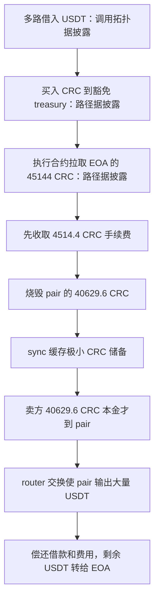

# CrowdRingCircle：卖出时先烧池子，AMM 为何付出过多 USDT

CRC 代币在用户向交易池卖币时，除了扣卖方手续费，还会烧毁交易池原本持有的 CRC，并立刻调用 `sync()`。卖方真正转入的净 CRC 要到这之后才记入池子。这样，AMM 缓存的 CRC 储备先被压到极小值，随后到达的 CRC 被当作相对巨大的输入，能换出过多 USDT。

本例来自固定源表第 **117** 行，数据集日期保留 **2026.07.17**；实际 BSC 代表交易发生于 **2026-07-16 09:44:27 UTC**，区块 **110301524**。以下金额使用原始交易回执，未采用第三方复现交易的数字。

## 正常交换和本次特殊转账

普通恒定乘积 AMM 根据两种资产的缓存储备计算输出，再用转账后的实际余额核查输入与乘积约束。`sync()` 会把当前实际余额写成新的缓存储备。代币转账若在卖方本金到达前，直接烧掉池子旧余额并同步，便改变了 AMM 计算这一笔交换所用的基准。

| 角色 | 地址 |
| --- | --- |
| 有缺陷的 CRC 代币 | `0x8581433150f2c48ff2efe5a22b17c7d405054509` |
| CRC/USDT pair | `0xd8799a644850c065388c22df4ee0c28472922526` |
| 执行本次核心调用的合约 | `0x2eadbcdcd4ab4bb7f8b01610794ea09a64cd5da1` |
| 攻击 EOA | `0x34579ea92a07a88f5505dfaa4d99ab94b2784087` |
| 大额买入 CRC 的豁免 treasury | `0xa5341a83807503ed8decb8534605494551c2a196` |
| 本次卖出费用接收人 | `0xd89e4e97345fa350462ab24d826c8160acbee030` |

代币限制普通地址从交易池买入，也要求非豁免发送人在转账后保留最低余额。公开跟踪分析把大额买入的 CRC 接收人定位到豁免 treasury；不能把过程简写成“攻击者直接买走全部 CRC”，否则会跳过买入限制。随后执行合约按既有 allowance 从 EOA 拉取卖出所需 CRC。豁免、最低持仓、黑名单、`isDexPair`、`sellDestroyEnabled` 和非零销毁额，都是触发相关分支的条件；本例没有独立重读全部攻击前权限状态。

## 错误操作顺序

[CRC `_update` 原文](../../dataset/20260717_CrowdRingCircle/source-bundles/token/contracts/CrowdRingCircle.sol#L146-L203)依次执行：

1. 核查黑名单、买入限制和最低保留余额。
2. 卖出收费：`fee = amount * sellFeeRate / 10000`，从卖方转 fee 给费用接收人，并减少待转本金。
3. 卖出销毁：取 pair 当前余额，用 `_safeDeductBalance` 得到 `min(pairBalance, netAmount)`，执行 `super._update(pair, address(0), burnAmount)`，实际减少 pair 余额和总供应。
4. 立即调用 pair 的 `sync()`。
5. 最后才执行 `super._update(from, pair, netAmount)`，把卖方净本金记入 pair。

`_safeDeductBalance` 只算可扣数量，不自行改变余额；实际烧毁发生在后面的父类 `_update`。父类来自本源包内 [OpenZeppelin ERC20 原文](../../dataset/20260717_CrowdRingCircle/source-bundles/token/@openzeppelin/contracts/token/ERC20/ERC20.sol)，同时保存了 `transferFrom` 的授权扣减路径。错误的关键是第 3–5 步的对象和顺序，不能仅把它归类成“税率太高”。

## 原始交易中的数值

[代表交易](https://bscscan.com/tx/0xeaef22325e02ac65a8e1f2e1a3a43f7b7ac8d2323ce6f698a90813e77017c834)的[成功回执](../../dataset_artifacts/20260717_CrowdRingCircle/evidence/receipt-alt.json)含 `BurnFromPair`，事件 log index **150**。对原始整数按 18 位精度换算：

| 项目 | 数量 |
| --- | --- |
| 卖方转出 CRC | 45,144 |
| 卖出手续费 CRC | 4,514.4 |
| 卖方净本金 CRC | 40,629.6 |
| 销毁前 pair 的 CRC 余额 | 40,629.6000000001 |
| 从 pair 烧毁的 CRC | 40,629.6 |
| 同步时 pair 剩余 CRC | **0.0000000001** |
| 先前大额买入向 pair 支付的 USDT | 184,995,877.105807691589020575 |
| 后续卖出由 pair 支付的 USDT | 185,204,938.738075562615076319 |

同步时的余额不是零，原始值为 `100000000` wei CRC。其后净本金 `40629600000000000000000` 才入账，实际余额与刚缓存的储备形成巨大差距。公开分析显示后续使用支持转账收费代币的 router 交换路径，不能把第三方复现中的低层直接 swap 调用当成原始调用。

逐笔 Transfer 加减后的 [复算记录](../../dataset_artifacts/20260717_CrowdRingCircle/evidence/recomputed.json)显示，pair **净流出 209,061.632267871026055744 USDT**；EOA **净流入 201,359.472267252045095696 USDT**。两者相差 **7,702.160000618980960048 USDT**，对应交易链中借款费用等差额；借来的约 1.85 亿 USDT 本金不能当成利润。CSV 保留源表约 **201,400 美元**，即中文 **20.14 万美元**、英文 **201.4 千美元**，同时在详情中保留精确链上值。

## 源码资格和核查边界

CRC 原始源码包由 Sourcify 返回 creation/runtime `exact_match`，共 26 个文件，原始路径、匹配状态、ABI、编译配置及响应哈希见[来源清单](../../dataset_artifacts/20260717_CrowdRingCircle/provenance.json)。[完整源码目录](../../dataset/20260717_CrowdRingCircle)另保存一份既有归档中的 PancakePair 原始源码，供说明正常 `swap/sync/_update` 算术；**没有声称这份参考 pair 与 CRC pair 部署逐字节等价**。缺陷本体位于已有公开原始源码的 CRC 代币，不依赖反编译关键模块。

本例独立核查交易、回执、销毁事件、USDT 转账和净额；**未取得完整内部跟踪**。多路借款的调用拓扑、豁免 treasury 的利用和既有 allowance 的准备由[公开技术分析](https://anomly.rs/crowdringcircle-sell-destroy-amm-sync-exploit)支持，不能据此声称独立重建了完整攻击前状态。核心转账、限制、状态和 AMM 参考函数见[完整源码](../../dataset/20260717_CrowdRingCircle)。未本地编译或分叉重放。
