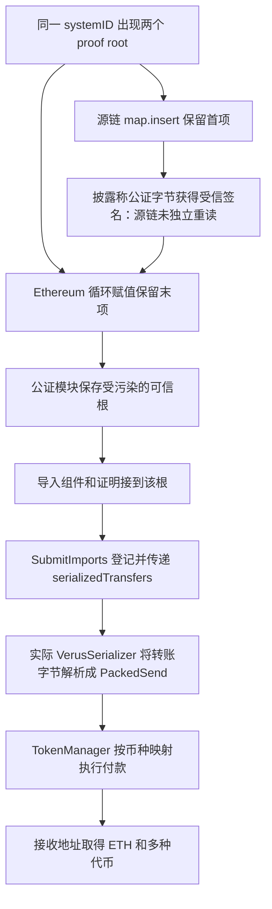

# Verus：两边对重复根的理解不同，桥接受了错误的可信根

Verus 的 Ethereum 桥按源链公证记录保存可信状态根，再校验导入证明并释放 Ethereum 上的资产。2026 年 7 月这起事件中，公证字节含重复的 `systemID`：源链 C++ 用 map 插入，保留第一个根；Ethereum 的循环却让后面的同 ID 根覆盖前值。同一份带签名的字节，因此在两边得到不同的可信根。后续证明即使能在数学上接到 Ethereum 保存的根，也不再代表应被信任的源链状态。

本例来自源表第 **107** 行，日期 **2026.07.23**。这里记录的是 7 月重复根覆盖路径；证明源包内已有的头部和输出验证不能被忽略，也不能把较早的桥漏洞叙事直接套到这次交易上。

## 正常职责与实际模块

正常公证流程先确认 notary 签名、身份和法定数量，再反序列化状态根、保存确认分支。导入流程验证 export、transfers 哈希和证明根，经重放/顺序检查后，由 TokenManager 按币种映射执行真实付款。网关通过 `contracts[]` 分派模块并 delegatecall，共享网关存储；它不是简单的一组 EIP-1967 代理槽。

| 历史调用角色 | 地址 |
| --- | --- |
| 桥网关、主要资产保管地址 | `0x71518580f36feceffe0721f06ba4703218cd7f63` |
| 公证模块 | `0x9ce91aa0f6d1d316a9535a36951143bc141318b8` |
| 公证反序列化模块 | `0x95b8005c4d9fe80f0aee5b7adce53766080600fb` |
| SubmitImports | `0x27c76df6912698e6d4c55aaa87cf88c30db90cf7` |
| 实际证明模块 | `0x54e03a1682fd0bb065b669f6296f97028dcfd4ce` |
| 主导入路径 Blake2b / MMR | `0xdd5cfb77a89a5fb082fa08fd1cac1d7857bb5752` / `0xf25b678b730fb1a565c426e29b599ad154cd9ba0` |
| TokenManager | `0xc45eedc99a98bc2e5ce717bb3ba16bde1725730a` |
| 实际转账字节解析器 | `0x747d5eed7aa4436b3d7a6cf2db7d78b8e93600fc` |
| 提交交易的 EOA / 接收资产地址 | `0xbda71b58cec0b1c20a8f87ccd52fa0679747855c` / `0xcfd0a20703cd11e0b9f665e1c3f1ef989c142d54` |

完整源包里多个版本都有同名 `VerusProof.sol`。本例证明逻辑使用 **proof** 源包中的文件，对应实际调用的 `0x54e0…d4ce`；其他模块携带的同名依赖是各自编译上下文，不能替代它。

## 重复键如何跨过信任边界

源链原始源码固定在 VerusCoin 提交 `a10e2fb39e42a7c31d4e447c9e152090a562a57f`。[pbaas.h 的反序列化](../../dataset/benchmark_complete/20260723_Verus/source-chain/pbaas.h#L438-L446)读取 proof-root 向量，对每个元素执行 `proofRoots.insert(std::make_pair(oneRoot.systemID, oneRoot))`。同一个 map 键再次 insert 时不会替换已存在项，所以语义上保留首项。

Ethereum 的 [deserializeProofRoots](../../dataset/benchmark_complete/20260723_Verus/source-bundles/notarization-serializer/contracts/VerusNotarizer/NotarizationSerializer.sol#L269-L309)每次遇到 `systemID == VERUS` 都赋值 `stateRoot = tempStateRoot`，没有拒绝重复，也没有保留首项，循环结束留下末项。[setLatestData](../../dataset/benchmark_complete/20260723_Verus/source-bundles/notarizer/contracts/VerusNotarizer/VerusNotarizer.sol#L49-L107)核验签名覆盖的原始 notarization 哈希及 notary 状态和数量；[checkNotarization](../../dataset/benchmark_complete/20260723_Verus/source-bundles/notarizer/contracts/VerusNotarizer/VerusNotarizer.sol#L110-L132)随后 delegatecall 反序列化，将返回的根送入 `setNotarizationProofRoot`。后者把 root 写入 `proofs[...]`，并维护确认分支。

因此，签名检查通过并不能保证两端对“被签字节所代表的根”解释一致。关键前提是能让含重复根的公证字节进入受信的签名、公证提交和确认流程。本例没有证据证明 notary 私钥泄露或 Merkle 哈希被破解。公开披露说明了源链验证仍看首项、Ethereum 却接受末项的过程；本例归档了两笔 Ethereum 公证调用，但未从 Verus RPC 独立重读它们的全部源链公证材料，也没有独立验证历史 notary 可执行文件与这份 C++ 提交完全相同。

## 从受污染的根到资产释放

两笔准备交易分别是 [`0x8f21…8d8f`](https://etherscan.io/tx/0x8f21bd8f0fce72ac959caa93a9923d85f902dfc6eddac2785ac5bc49c3b28d8f)（03:23:35 UTC）和 [`0x51b1…f0c9`](https://etherscan.io/tx/0x51b1c8341da4092b7d1e0e4865f7b318de4e96245358b05b2bff2df50adaf0c9)（03:41:47 UTC）。[准备跟踪 1](../../dataset_artifacts/benchmark_complete/20260723_Verus/evidence/prep1-trace.json)和[准备跟踪 2](../../dataset_artifacts/benchmark_complete/20260723_Verus/evidence/prep2-trace.json)保留公证模块、实际 serializer 和公证路径 Blake2b 的调用目标。公证路径 Blake2b 为 `0x5951a800712b5f2c448a175e30b428faaea87b1a`，与主导入路径 Blake2b 分开归档。

主攻击 [`0xa1f1…b099`](https://etherscan.io/tx/0xa1f1e65c1cea4dba4ae439cd4dcdba6cc2dbda0ed1228e61f29ae9c9324eb099)发生于 **03:45:59 UTC**，区块 **25592836**。[SubmitImports._createImports](../../dataset/benchmark_complete/20260723_Verus/source-bundles/imports/contracts/VerusBridge/SubmitImports.sol#L184-L266)对 `serializedTransfers` 求哈希，把导入和头部计数传给实际 VerusProof，再做顺序/重放登记，最后将同一份 `serializedTransfers` 和转账数传给 `TokenManager.processTransactions`。这连接了被验证的输入与实际付款参数。

[VerusProof.proveImports](../../dataset/benchmark_complete/20260723_Verus/source-bundles/proof/contracts/MMR/VerusProof.sol#L686-L753)包含 `_validateHeaderProof`、`checkExportAndTransfers`、组件证明和根比较：算出的 `retStateRoot` 必须等于 `getLastConfirmedVRSCStateRoot()`。这里的根来自前述公证存储；可信根已被污染时，单纯与这个根相等不能恢复源链真实性。公开分析同时指出导入价值约束不足，使小额源链导出与大额合成转账可被组合；代码确实还有 flags、链标识、transfer hash 等检查，不能笼统写成“导入完全不检查金额或证明”。本例没有独立逐字段重建源链金额守恒证明，具体伪造材料的来源由披露支持。

`TokenManager.processTransactions` 先把相同的转账字节送给 `VerusSerializer.deserializeTransfers`，才得到 `PackedSend[]`。主跟踪的 `traceAddress=[0,1,0]` 是对 `0x747d…00fc` 的 staticcall，selector 为 `0x9d56cf89`。本批另行取得该实际地址的 Sourcify creation/runtime `match` 原始源码（2026-07-10 验证），独立源包标为 **transfer-serializer**，不再以 TokenManager 附带的同名依赖默认代表实际部署。

[实际解析器原文](../../dataset/benchmark_complete/20260723_Verus/source-bundles/transfer-serializer/contracts/VerusBridge/VerusSerializer.sol#L344-L466)检查 transfer 版本为 1，读取币种地址、varint 数量和目的地址；把数量左移 160 位、币种地址放入低 160 位，形成 `currencyAndAmount`，再将目的地址放入 `destinationAndFlags`。精简版保留此实现、varint/compact-size 辅助函数、状态常量和 packed 结构。历史输入、返回数组及付款量的[独立核对记录](../../dataset_artifacts/benchmark_complete/20260723_Verus/evidence/transfer-parameters.json)显示 890 字节转账流返回 8 项，全部目的地址都是本次收款地址。公开源包匹配加上历史 staticcall 目标对应，不等于逐字节重建了攻击区块的全部依赖和存储。

[TokenManager 付款路径](../../dataset/benchmark_complete/20260723_Verus/source-bundles/token-manager/contracts/VerusBridge/TokenManager.sol#L121-L270)再从这些 packed 字段取币种、金额和收款地址：ETH 用 8 位源链精度乘 `10^10` 转成 wei；普通 ERC-20 根据 decimals 转换单位并调用 transfer/mint；成功付款后减少对应 `tokenIndex`。DAI 另走 `VerusCrossChainExport.exit`，实际 Transfer 事件的 from 是零地址，实际到账比传入 exit 的换算值多 1 wei DAI，作为该路径的观察结果单列。不能把 DAI 这项写成“桥钱包直接 ERC-20 转出”。

## 主交易实际收到的资产

[完整主跟踪](../../dataset_artifacts/benchmark_complete/20260723_Verus/evidence/trace.json)共 **55** 个调用记录；[交易记录](../../dataset_artifacts/benchmark_complete/20260723_Verus/evidence/transaction.json)和[逐币复算](../../dataset_artifacts/benchmark_complete/20260723_Verus/evidence/recomputed.json)给出下表。这是代表交易付款清单，不是将所有资产按面值折成美元。

| 资产 | 收款数量 | 观察口径 |
| --- | --- | --- |
| ETH | 1,137.45281584 | 网关 → 收款地址，原生 value 调用 |
| TBTC | 71.5045915 | ERC-20 Transfer |
| DAI | 220,357.027072980000000001 | exit 路径后的零地址 Transfer |
| MKR | 59.42954384 | ERC-20 Transfer |
| USDC | 149,275.074098 | 6 位精度 |
| USDT | 78,300.537681 | 6 位精度 |
| EURC | 31,475.664323 | 欧元资产，不能当作同量美元 |
| SCRVUSD | 92,784.36027725 | 份额资产，不能当作同量底层美元 |

源表约 760 万美元，CertiK 披露约 744 万美元，其他同时期口径约 754 万美元。本例未独立取得统一历史价格和完整估值规则，故两份 CSV 的损失列留空，保留逐币数量和差异说明。

## 归档和尚未证明的部分

[完整版](../../dataset/benchmark_complete/20260723_Verus)保存实际核心模块的独立源包、网关原始源码、源链 C++ 上下文；[来源清单](../../dataset_artifacts/benchmark_complete/20260723_Verus/provenance.json)区分 Sourcify 匹配、Blockscout 验证和固定提交上下文。网关与公证 Blake2b 的 Sourcify 查询没有返回源码，已用公开浏览器服务的 verified original source 补齐，未用反编译代替。TokenManager 源包里的 DAI exit 作为上下文保留，未单独证明其历史部署等价。

核心 delegatecall 目标可由历史完整跟踪确认，源码公开验证状态可由归档响应确认；两者不能合并成“所有攻击时源码与字节码已经逐一重建”。历史完整存储、源链独立公证复算、全部签名恢复、全部外部资产实现和重放都未完成。本例未本地编译。[精简版与切片记录](../../dataset_artifacts/benchmark_simplified/20260723_Verus/slice_manifest.json)保留首项/末项差异、公证状态写入、证明比较和付款调用，全部为完整版连续原文；C++ 文件用于源链逻辑上下文，并非可单独构建的项目。

主要披露：[CertiK Verus Incident Analysis](https://www.certik.com/blog/verus-incident-analysis)。固定行号、源表原文和处置见[批次快照](../../dataset_artifacts/batches/20261016_x123_y5/snapshot.json)。
