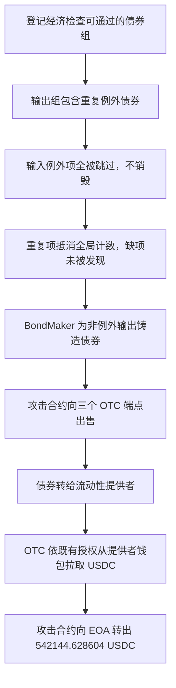

# Lien Finance：总数相等，不能证明每种债券都被正确保留

Lien 的 BondMaker 允许用户把一组债券换成经济上等价的另一组。两组都包含的债券可以列入 `exceptionBonds`，免去先销毁再铸造的往返操作。但实现只核对例外项的累计匹配数，没有逐个 bondID 检查出现次数。攻击者构造含重复项的输出组，用一种债券的重复匹配抵消另一种债券的缺失，在没有提供对应输入债券的情况下铸出新债券，再卖给 OTC 流动性提供者换取 USDC。

本例来自源表第 **106** 行，日期 **2026.07.24**。代表交易发生于 **2026-07-24 01:26:47 UTC**。源码和完整调用跟踪确认涉及两套独立 BondMaker，不能把它们误写为代理与实现。

## 正常债券兑换和付款关系

BondMaker 按到期日和收益曲线登记债券组。正常 `exchangeEquivalentBonds(inputGroup, outputGroup, amount, exceptions)` 对非例外输入调用 `_burnBond`，对非例外输出调用 `_mintBond`；例外债券应在两边逐种等量存在。债券由 BondMaker 拥有的 BondToken 铸造，攻击者没有直接调用任意 token mint 的管理权限。

| 角色 | 地址 |
| --- | --- |
| BondMaker A | `0xda6fc5625e617bb92f5359921d43321cebc6bef0` |
| BondMaker B | `0x843225cf6e663e4454732d6b551a737ac7b47de0` |
| OTC 端点 A / B | `0x656e5e976d523a427f05b0c212a22a89ccd9ef18` / `0x7db84492cfd27e47c39499d852decc2a01476a75` |
| OTC 端点 C | `0x0949c77ad52602ac61b42d2de0eeb1b7cc79250f` |
| 持有并授权 USDC 的流动性提供者 | `0xa961684a3a654fb2cca8f8991226c0cefc514d80` |
| 攻击合约 / 最终收款 EOA | `0xe74d17c1be3721e65e0af286d47b3ba58b08062e` / `0x0d7d9023531ad1a88414e216ee2715f63561808a` |

OTC 卖出债券时，正常路径从买币者取得债券，交给流动性提供者，再以该提供者预先授权的 USDC 付款。因此真正被扣 USDC 的是提供者钱包，不是必须先把 USDC 存在 OTC 合约里的资金池。

## 计数漏洞在源码中的位置

[BondMaker A 的 exchangeEquivalentBonds](../../dataset/benchmark_complete/20260724_LienFinance/source-bundles/bondmaker-a/BondMakerCollateralizedEth.sol#L2078-L2153)首先检查输入、输出组非空，到期日相同且尚未到期。输入循环遇到例外 bondID 时跳过 burn，并增加一个全局 `exceptionCount`，之后要求这个总数等于 `exceptionBonds.length`。输出循环遇到例外 bondID 时跳过 mint，并减少同一个总数，最后要求为零。它没有为每个 bondID 保存独立计数。

设输入组为 `[A,B]`，例外列表为 `[A,B]`，输出组为 `[X,A,A]`：输入累计两次匹配，A、B 都不烧；输出遇到 X 时铸造 X，随后 A 两次匹配将总计数减到零。B 从未出现在输出组，却被 A 的重复项掩盖。**重复的是输出组里的 A，不是例外列表里的 A/B**。只说“传了重复 exceptions”会与真实 calldata 冲突。

`registerNewBondGroup` 允许外部登记组，但会执行 `_assertBondGroup` 对曲线的经济等价性检查。攻击组通过了现有登记条件，再利用兑换时错误的多重集核对；不能把根因写成“登记完全没有经济检查”。[BondMaker B 对应实现](../../dataset/benchmark_complete/20260724_LienFinance/source-bundles/bondmaker-b/BondMakerCollateralizedEth.sol#L2008-L2075)有同类全局计数问题。BondToken 的 `mint` 受发行方权限限制，`_mintBond` 是把这个逻辑错误变成新增可交易债券的实际调用点。

## 历史参数与调用先后

[代表交易](https://etherscan.io/tx/0xb96d572b557a12f5ef193e88cca86123a6ae1b6e98b0eeee265870c85848e0e7)的[完整跟踪](../../dataset_artifacts/benchmark_complete/20260724_LienFinance/evidence/trace.json)有 **142** 个调用记录，能解出组登记、返回组号和两次 `exchangeEquivalentBonds`。后者的 selector 是 **`0x529aa16b`**，不是 `issueNewBonds` 的 selector。

| 部署 | 输入组 | 输出组 | 例外项 | 原始兑换 amount | traceAddress |
| --- | --- | --- | --- | --- | --- |
| A | 36 = `[A,B]` | 37 = `[X,A,A]` | `[A,B]` | `6968565865905` | `[9]` |
| B | 2 = `[A,B,C]` | 3 = `[A,B,B,X]` | `[A,B,C]` | `44979960202` | `[20]` |

表中字母仅在各自部署内有效，A 部署的 A 与 B 部署的 A 不是同一个 bondID。A 组的 A/B/X 前缀分别是 `0x07be1697`、`0x3a9430a0`、`0xb14ded15`；B 组的 A/B/C/X 前缀分别是 `0x306a2880`、`0x58e11d7e`、`0x0a2ca8e9`、`0x303ac230`。完整 32 字节 ID、登记返回组号及相同到期时间 `1792112400` 保存在[直接解码结果](../../dataset_artifacts/benchmark_complete/20260724_LienFinance/evidence/recomputed.json)。B 部署还登记组 4 `[Y,X]`，见同一记录，不把后续正常兑换/出售步骤混成第三次同 selector 漏洞调用。

输入组、输出组和对应的 exception 参数来自实际内部 calldata，并非只根据 PoC 的函数名猜测。组 A 的全局计数从 0 增到 2，再由重复的 A 减回 0；组 B 从 0 增到 3，再由 A/B/B 减回 0。这样可以解释为什么没有烧毁相应输入债券，也能出现新债券 mint。

## 债券如何换成真实 USDC

[GeneralizedDotc._exchangeBondToErc20](../../dataset/benchmark_complete/20260724_LienFinance/source-bundles/otc-a/GeneralizedDotc.sol#L2178-L2290)读取 pool 的提供者 `seller`、计价代币、oracle 和 pricer；按债券报价和计价币价格求 `rateE8`，结合债券和 USDC 的精度求实际付款。然后执行 `bondToken.transferFrom(buyer, seller, bondAmount)`，紧接着执行 `swapPairToken.safeTransferFrom(seller, buyer, swapPairAmount)`。所以正常定价和授权付款路径把缺少真实投入却铸出的债券兑换成了提供者钱包的真实资产。第三个 DecentralizedOTC 端点使用 `exchangeLBT2ERC20/_exchangeLBT2ERC20`，也保留了该版本实际付款源码。

[历史交易转账记录](../../dataset_artifacts/benchmark_complete/20260724_LienFinance/evidence/transaction.json)中，提供者向攻击合约的三笔 USDC 分别为 **532,070.026484**、**74.602120**、**10,000**，合计 **542,144.628604 USDC**；随后攻击合约将相同总量转给 EOA。该焦点交易跟踪没有显示需要写入叙事的闪电贷偿还步骤。本例也不把 2020 年其他 Lien 故事混入这条 2026 年调用链。

CSV 保留源表约 **542,000 美元**，即中文 **54.2 万美元**、英文 **542 千美元**；精确 USDC 收支单列，没有将近似美元估值替换成未经统一的价格计算。

## 文件与核查边界

[完整版](../../dataset/benchmark_complete/20260724_LienFinance)分别保存两套 BondMaker、三个 OTC 端点、BondToken 和定价上下文的公开原始完整源包，具体链、地址、编译版本、匹配状态和哈希见[来源清单](../../dataset_artifacts/benchmark_complete/20260724_LienFinance/provenance.json)。每套都是独立部署的来源记录，原缓存文件名里的 proxy 字样不作为代理关系证据。攻击合约未验证的编排逻辑没有成为本例关键缺陷的替代源码；全部核心缺陷实现已有原始源码，实际参数由完整内部跟踪补充。

[精简切片清单](../../dataset_artifacts/benchmark_simplified/20260724_LienFinance/slice_manifest.json)保留组注册与经济检查、等价兑换的两个循环、mint/burn、期限检查、OTC 定价和付款路径，连续行和 SHA-256 均可回到完整版。已独立核查这笔交易的调用和资产数量；未独立重建全部攻击前存储、历史 allowance 来源、各 BondToken 的全量版本及完整部署字节码等价性，未本地编译或分叉重放。

公开披露：[Verichains Lien Finance 分析](https://blog.verichains.io/p/lien-finance-hack-analysis)。选行与源表口径见[批次结果](../../dataset_artifacts/batches/20261016_x123_y5/results.json)。
