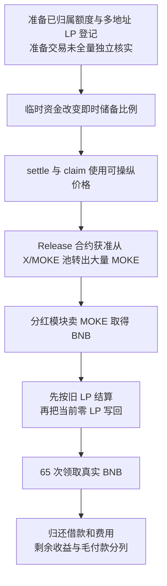

# MOKE：同一份 LP 被多次登记，错误释放量又变成可领取的 BNB

源表日期为 **2026-08-03**，源表第 **101** 行；BNB Chain 交易实际发生在 **2026-08-02 20:50:11 UTC**，北京时间为 8 月 3 日 04:50:11。目录保留源表日期。代表交易见 [BscScan](https://bscscan.com/tx/0x0776048b1b58064fb31b6513721811e7b44d6bdbe7bf5833158b241ca6756a8f)，公开原始披露见 [BlockSec](https://blocksec.com/blog/web3-security-moke-token-lpdfi-exploits)。

## 背景和正常业务

MOKE 把用户的入金权益记成按时间释放的 USDT 额度，再按 MOKE 价格换成可领的代币。LP 是用户向交易池提供两种资产后取得的份额凭证；另一模块把收到的 MOKE 卖成 BNB，再按 LP 份额发分红。

| 角色或合约 | 正常职责 |
| --- | --- |
| MokeRelease，0x684d…02a7 | 管理已归属额度、结算价格、执行领取 |
| MokeToken，0x1a35…1b2a | 记录代币余额，允许指定释放合约从 X/MOKE 储备池转出 MOKE |
| MokeLPDividend，0x5ae5…a377 | 记录 LP 份额和分红债务，把收到的 MOKE 换成 BNB 后付款 |
| MOKE/WBNB 池，0xba6a…e6b8 | 兑换 MOKE 与 WBNB，发行自己的 LP 代币 |
| X/MOKE 池，0x8971…9b5a | 为释放路径储备代币；与普通买卖池是不同的池子 |

正常流程是：用户取得额度 → 随时间归属 → 按合理价格领取 MOKE → 收益进入分红模块 → 按当时实际持有的 LP 领取 BNB。应当保持两条关系：领取代币量与真实价格相符，同一份 LP 不能同时替多个旧持有人挣取分红。

## 具体错误

**价格容易被短时交易改变，LP 记账又没有随 LP 转移及时失效，两者合起来把错误的代币释放变成重复付款。**

[MokeRelease.sol](../../dataset/benchmark_complete/20260803_MOKE/source-bundles/moke-release/project/contracts/MokeRelease.sol#L318-L487) 的 `settle` 允许设置的结算者、owner，或 `msg.sender == tx.origin` 的调用者结算；还有冷却条件。攻击者没有因此获得 owner 权限。`getMokeUsdtPrice` 从两个即时储备比相乘取价，`claim` 用 `pendingUsdt * 1e18 / settledMokePrice` 算领取量。代码比较当前价与已结算价的偏离，但两者都能来自同一轮被改变的储备，不能作为独立的价格保护。价格函数见[原文 522–546 行](../../dataset/benchmark_complete/20260803_MOKE/source-bundles/moke-release/project/contracts/MokeRelease.sol#L522-L546)。

分红的根本错误在 [MokeLPDividend.sol 131–150 行](../../dataset/benchmark_complete/20260803_MOKE/source-bundles/moke-token/project/contracts/MokeLPDividend.sol#L131-L150)。设旧登记份额为 R，当前实际 LP 为 B，累计每份收益为 A，已记收益债务为 D：同步时先把 `R*A/1e18-D` 加入待领余额，**随后**才把登记份额替换为 B。将 LP 转给下一地址并不会自动执行旧地址的这个同步。

攻击者可以让同一份 LP 依次经过多个地址，在每个地址持有时登记份额。等到 BNB 入账，旧地址虽然已经没有 LP，仍先按旧登记数获得新分红。`claimDividend` 调用同步后清零待领余额，再用原生 BNB `call` 付款，见[180–191 行](../../dataset/benchmark_complete/20260803_MOKE/source-bundles/moke-token/project/contracts/MokeLPDividend.sol#L180-L191)。

原生 BNB 的接收入口也属于这条资金链。[`receive` 259–263 行](../../dataset/benchmark_complete/20260803_MOKE/source-bundles/moke-token/project/contracts/MokeLPDividend.sol#L259-L263)允许合约接收 BNB；非 `_swapping` 状态时还会把 `msg.value` 写入 `unprocessedBNB`。卖 MOKE 时由 `_swapMOKEForBNB` 临时设置 `_swapping`，随后根据真实余额差额计算分红。精简版同时保留接收入口、交换状态切换、分红记账和领取付款。

**教学示例：**总 LP 为 100，一人持有 10 份，先给地址 A 登记，再转到 B 登记而没有清掉 A。发入 100 BNB 后，A、B 各按 10 份领取 10 BNB；同一份资产被当作两份权益。示例数字不是本案实际数量。

## 利用条件与核实状态

- **源码要求：**调用释放路径需要已归属额度、领取间隔、费用、合理偏离检查和足够储备，不能凭空领取任意数量。
- **回执可见：**`PriceSettled` 为 `594140821297791`，即约 0.000594140821297791 USDT/MOKE；四次 `Claimed` 成功。
- **回执可见：**65 次 `UserLPSynced` 的新余额均为零；其中 64 笔旧余额为 `1334183807563777105758`，另一笔为 `985789028950366818528`，并跟随 65 次 `DividendClaimed`。不能把 65 笔都写成相同份额。这直接支持陈旧 LP 记录在实际结算时仍被使用。
- **未完全核实：**各地址最初取得额度和循环登记 LP 的全部准备交易、历史授权和结算前冷却状态。成功事件证明本次执行通过了检查，不代替每个历史存储槽的重建。

## 攻击步骤和资金为什么能流出

1. 公开披露描述攻击者先建立释放额度，再把同一 LP 在多地址间转移和登记。源码支持这种登记方式，代表交易回执证实付款前这些旧记录仍然存在；本批没有独立重读全部准备调用。
2. 主交易中先移除已有 LP，并临时调动大量资金改变交易池比例。随后释放价格被结算；具体跨池借还顺序依公开披露，本批没有获得完整内部跟踪。
3. 四次领取按低价把 USDT 额度换成大量 MOKE。源码允许指定释放合约调用 `releaseFromPair`；该函数不需要储备池另行给攻击者授权，见 [MokeToken.sol 354–368 行](../../dataset/benchmark_complete/20260803_MOKE/source-bundles/moke-actual-token/project/contracts/MokeToken.sol#L354-L368)。回执显示 X/MOKE 池净转出 **43,860,308.980417278429035188 MOKE**，并按比例烧掉 X。
4. MOKE 被送入分红模块并换成 BNB。`DividendDistributed` 记录输入 **1,664.616180024096154954 BNB**、总 LP `86373552713032101587040`，每份指数增量 `19272290275642878`。这里才把代币账面权益变成真实可付的 BNB。
5. 65 个陈旧地址分别调用领取。合计 `DividendClaimed` 为 **1,664.616180024096093973 BNB**，与本次分配相差仅 **0.000000000000060981 BNB**。新 LP 余额为零并未使已按旧份额算出的待领余额归零，因此实际付款仍然被允许。
6. 临时贷款的归还、兑换价差、费用和其他支出会减少最后收益。回执可独立确认 MOKE/WBNB 池净少 **1,692.745266365074783560 WBNB**，攻击账户额外付出 **2,989.298504704445542912 USDT**；不能把借款本金或分红毛付款直接记成净利润。

## 证据、金额与限制

[完整来源清单](../../dataset_artifacts/benchmark_complete/20260803_MOKE/provenance.json)、[切片清单](../../dataset_artifacts/benchmark_simplified/20260803_MOKE/slice_manifest.json)、[原始回执](../../dataset_artifacts/benchmark_complete/20260803_MOKE/evidence/moke-receipt.json)和[离线解码](../../dataset_artifacts/batches/20261021_x112_y5/decoded_evidence.json)可交叉检查上述数字。回执日志证明事件与代币转移；它不等于完整内部调用跟踪，原生 BNB 成功付款还依赖源码中的失败回滚语义及成功回执。

关键原始源码均已取得。公开分析曾称释放合约未验证，本批 Sourcify 实际返回该地址原始源码 `exact_match`，因此没有用未验证重建代码代替它。普通 PancakePair 源码来自另一个明确标识的验证池；另取本案两个池的当前运行字节码，均与参考池的完整 14,981 字节逐字节相同，见[当前代码比对](../../dataset_artifacts/benchmark_complete/20260803_MOKE/evidence/pool-runtime-comparison.json)。只核对了 `eth_getCode latest`，没有取得攻击区块代码，不将当前一致当作历史部署绑定证明。

源表估计 907,700 美元；BlockSec 和其他公开复算使用约 906,000 或 906,810 美元口径。不同估值和净额口径未统一，两份 CSV 损失列留空，保留币量。未本地编译、未分叉重放、未运行本地反编译，也没有重建全部攻击前状态。
