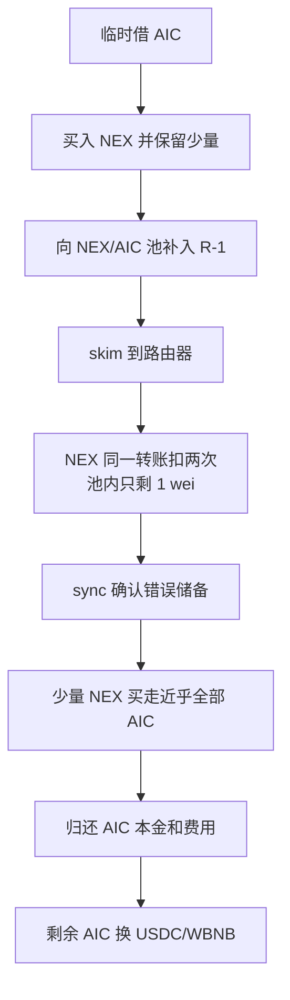

# NEX/AIC：请求转一次，池子却被扣了两次

本例来自新快照第 **100** 行，目录日期保留 **2026-08-04**。BNB Chain [代表交易](https://bscscan.com/tx/0x905cc861bcc525d3a8e699583943831b97500bbac11c92dc20ed6edbddd69f87)在 **2026-08-03 13:03:53 UTC** 执行，北京时间同日 21:03:53；源表日期更晚，不能仅以时区解释这一天差异。原始披露入口为 [TenArmor](https://x.com/TenArmorAlert/status/2084461507312857521)。

## 背景和正常流程

NEX 和 AIC 在 BNB Chain 的交易池中互相兑换。交易池保存两种代币，并把用于计算价格的余额记为“储备”。正常兑换是用户转入一种资产，池子按储备和手续费计算另一种资产的付款数量。

池子的 `skim(to)` 用来清走“实际余额超过已登记储备”的多余代币；`sync()` 则把储备更新为当前实际余额。这两项都是公开操作，本来不应允许调用者取走已登记的储备。它们依赖一个前提：请求代币转出 S，发送方余额只能减少 S。

| 角色 | 地址与作用 |
| --- | --- |
| 缺陷所在 NEX | 0xae04ae29bdb7ab7eb249d3afa7bc3d37564e8cf9，覆盖普通 ERC-20 转账逻辑 |
| NEX/AIC 池 | 0x974c0078740480ae830d379fdb8d5f441c9ddc75，真实资产损失发生处 |
| AIC | 0xc0dc449de632586a00409873521afc251ac5ce74，被换走的另一侧资产 |
| USDC/AIC 池 | 0xe89636fb73d04db51e5fbd0ce1379fb8d2b96415，提供临时 AIC，并非本例根因 |
| 正常 Pancake 路由器 | 0x10ed43c718714eb63d5aa57b78b54704e256024e，成为两次转出的收款地址 |

## 具体错误

**NEX 的“涉及路由器”分支转过一次以后，没有结束函数，函数末尾又执行了一次相同转账。**

原始 [nexus_nex.sol 1707–1754 行](../../dataset/benchmark_complete/20260804_NEX_AIC/source-bundles/nex-token/contracts/flatten/nexus_nex.sol#L1707-L1754)先判断 `isRouter`，在该分支调用父类 `_transfer(from,to,amount)`；经过 `if/else` 后，无条件再次调用父类转账。父类实际扣余额、加收款余额、发 `Transfer` 的代码见[451 行起](../../dataset/benchmark_complete/20260804_NEX_AIC/source-bundles/nex-token/contracts/flatten/nexus_nex.sol#L451-L480)。

卖入池子的分支还按 `daoFee`、`nodeFee` 收费。本案这种卖出税帮助精确布置了多余余额；真正的根本缺陷是路由器分支重复扣账。`skim` 和闪电借款本身没有违反权限。

## 条件与计算为什么成立

需要一个持有 NEX 的真实池子、正常工作的公开 `skim/sync`、能涉及路由器地址的转账，以及足够的临时资金。无需 NEX owner 权限。费率可以由 owner 设置，不能把设置费率的权限写成攻击者权限。

回执显示第一次兑换后 NEX 储备为原始整数：

`R = 31,739,425,952,813,599,235,352,141`。

随后净补入 NEX 为 `D=R−1`，余额成为 `2R−1`。`skim` 原本只应清走 `D`，但因为收款方为路由器，NEX 连续转出两笔 D，池内只剩 **1 wei NEX**。这是实际原始整数，不是教学示例。相关 `Transfer` 日志序号为 **9、10**，`Sync` 序号 **12** 的 `reserve0` 确为 1。

## 历史步骤与付款路径

1. 攻击辅助合约临时借出 **42,982,239.623681550888856012 AIC**，转入 NEX/AIC 池换出 NEX。回执的 `Swap` 记录了输入和输出；内部闪电回调调用名由公开分析和标准池源码连接，本批未取得完整内部跟踪。
2. 攻击者把获得的大部分 NEX 转回该池。卖出费用扣掉后，池子实际收到上面的 D，而攻击者保留少量 NEX。
3. `skim` 向路由器清理多余余额。NEX 的重复父转账使该池两次付出 D；随后 `sync` 将 NEX 储备写成 1，而 AIC 储备仍为 **83,261,448.443378062678942187 AIC**。
4. 再转入净 **18,193.134265378227345552 NEX**。对一个 NEX 储备几乎为零的池子，这笔输入极大。标准恒定乘积公式把它视为足以买走几乎全部 AIC 的输入，最终支付 **83,261,448.443378062678937598 AIC**，只留下 4,589 wei AIC。错误储备因此被转换成真实付款。
5. 借款池收到 **43,093,993.446703122921167038 AIC**，包括本金和费用。其余 AIC 通过 USDC/WBNB 路径退出，回执显示 **32.361267289208020008 WBNB** 到达路由器的解包路径。本批没有把这笔 WBNB 兑换量写成完整的 EOA 原生 BNB 净收益证明。

## 证据和限制

[完整来源](../../dataset_artifacts/benchmark_complete/20260804_NEX_AIC/provenance.json)保存 NEX、AIC 原始验证源码；[精简清单](../../dataset_artifacts/benchmark_simplified/20260804_NEX_AIC/slice_manifest.json)把每段原文绑定到路径、行号和 SHA-256。[原始回执](../../dataset_artifacts/benchmark_complete/20260804_NEX_AIC/evidence/nex-receipt.json)与[离线解码](../../dataset_artifacts/batches/20261021_x112_y5/decoded_evidence.json)证明相同两笔转出、储备变为 1、巨额 AIC 输出，以及借还金额。

NEX/AIC 池净流出 **40,279,208.819696511790081586 AIC**。另一兑换池付出的 BSC USDC 为 **21,503.921643594504179252**，与源表 19,000 美元估计不同；两份 CSV 金额留空。借出的四千多万 AIC 是周转本金，不能记成损失或获利。

源码可以确认重复转账逻辑；事件可以确认实际扣账和付款；未归档完整内部跟踪，也未独立重建全部攻击前配置。普通 PancakePair 源包是明确标识的公开参考版本；本案主池和闪贷池的当前运行字节码均与该参考池的完整 14,981 字节逐字节相同，见[当前代码比对](../../dataset_artifacts/benchmark_complete/20260804_NEX_AIC/evidence/pool-runtime-comparison.json)。只核对了 `eth_getCode latest`，没有把当前代码一致当作攻击区块的历史绑定证明。未本地编译、未重放、未本地反编译。
