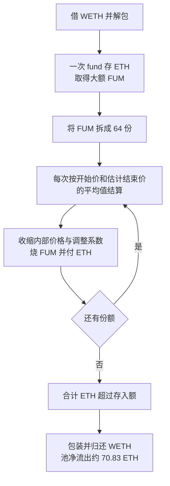

# USM/FUM：把同一份赎回拆成 64 次，为什么能多拿 ETH

源表第 **98** 行，日期保留 **2026-08-10**。[Ethereum 代表交易](https://etherscan.io/tx/0xfae5e751b8ce01457cbb6b529839f24a0cff50faaabcbd0fd02ca0cf559b050e)实际发生于 **2026-08-09 08:12:47 UTC**，北京时间同日 16:12:47。日期差异不全部来自时区。原始披露入口为 [TenArmor](https://x.com/TenArmorAlert/status/2086627835360456784)。

## 背景和正常业务

USM 是用 ETH 支撑的美元计价稳定币。FUM 是另一种份额：可以把它理解成扣掉稳定币债务后、由资金提供者承担风险的权益。USM 合约持有真正的 ETH；FUM 自身记录份额，并把 `fund`、`defund` 请求连接到 USM。

正常流程是：存入 ETH → `fund` 按资金池和债务状态计算 FUM → FUM 记给存款人 → 持有人 `defund` 销毁 FUM → USM 按曲线付出 ETH。外部预言机提供 ETH/USD 参考价；协议还维护自己的 ETH 价格、买卖调整系数和债务比例，三者不是同一个数。

| 角色 | 地址和职责 |
| --- | --- |
| USM，受害资产池 | 0x2a7fff44c19f39468064ab5e5c304de01d591675，负责定价、烧份额和付 ETH |
| FUM，份额代币 | 0x86729873e3b88de2ab85ca292d6d6d69d548edf3，只允许对应 USM 铸造和销毁 |
| 攻击合约 | 0x5a5e29ba89663a3558273354e990426f3cac7de7，连续执行存入和小额赎回 |
| Morpho Blue | 0xbbbbbbbbbb9cc5e90e3b3af64bdaf62c37eeffcb，提供 WETH 周转资金，正常归还 |

## 具体错误与原始公式

**每次赎回都用一个近似的平均价，又改变下一次赎回使用的内部状态，结果相同份额拆开赎回的总付款与一次赎回不一致。**

[USM.sol 710–763 行](../../dataset/benchmark_complete/20260810_USM_FUM/source-bundles/usm/contracts/USM.sol#L710-L763)的 `ethFromDefund` 先用当前内部价格得到开始卖价 P0，再估计赎回后的状态和卖价 P2，最后执行：

`avgFumSellPrice = floor((P0 + P2) / 2)`；

`ethOut = floor(fumIn * avgFumSellPrice / 1e18)`。

P2 不是独立市场报价，而是结合预计 ETH 剩余量、债务比例与 `adjShrinkFactor` 计算的结束价格。复杂的上下取整、平方、幂函数来自 [WadMath.sol](../../dataset/benchmark_complete/20260810_USM_FUM/source-bundles/usm/contracts/WadMath.sol)，本批精简版保留原文，没有把整数算法改写成浮点公式。

一次付款完成前，[`_defundFum` 259–289 行](../../dataset/benchmark_complete/20260810_USM_FUM/source-bundles/usm/contracts/USM.sol#L259-L289)把内部 `bidAskAdjustment` 和 `ethUsdPrice` 都按 `adjShrinkFactor` 向下取整更新，再检查剩余债务比例、烧 FUM、保存状态并付款。下一次赎回会读取已经改变的余额、FUM 总量和这些内部状态。近似定价因此可以沿不同分段路径得到不同的累计付款。

**教学示例：**同一份权益，一次算账的近似公式付 99，而拆成若干次重新估价合计付 101，资金池就多付了 2。本例的实际资金规模和整数结果见下文，示例数字不是链上数据。本批没有重新执行“整额赎回一次”的反事实交易，不声称每一种状态下拆分都一定更有利。

## 利用条件

`fund` 和 `defund` 是公开入口，不要求管理员或签名人。攻击者需要临时 ETH、足够的 FUM、允许赎回的债务比例，以及每次的最小输出条件能通过。历史跟踪中 64 次 `defund` 的 `minEthOut` 均为 0。

外部 ETH/USD 报价读取与协议自己的内部状态变化要分开。本交易没有显示攻击者先去操纵外部 Chainlink 报价；本批保存的完整跟踪可检查 `latestPrice()` 返回值。不能因为使用了闪电贷就把根因改写为外部预言机操纵。

## 历史攻击步骤、状态变化和真实付款

1. 攻击合约取得 **11,579.978354608392803524 WETH** 周转资金并解包成 ETH。Morpho 在本例作为普通借款来源，未被列为漏洞合约。
2. 一次 `fund` 把同额 ETH 送入 USM，协议根据原始 `fumFromFund` 曲线铸 FUM，返回值和实际付款均在完整跟踪中。源码见[228–257 行](../../dataset/benchmark_complete/20260810_USM_FUM/source-bundles/usm/contracts/USM.sol#L228-L257)。
3. 攻击合约执行 **64 次** `defund`。每次烧 **971,629.672368796643705078 FUM**，同时改变后续计算所读的状态。第一笔调用位于 `traceAddress=[2,1,4]`；原始参数和每次返回值见批次离线解码记录。
4. 每次付款不是“账上多了一个数字”：`fum.burn` 后，USM 执行 `to.sendValue(ethOut)`，从自身 ETH 余额向攻击合约转出真实 ETH。完整跟踪合计输出 **11,650.809331976090511896 ETH**。
5. 重新包装 WETH，归还借入本金后，USM 本次净流出 **70.830977367697708372 ETH**。这由 `输出总 ETH−fund 输入 ETH` 的原始整数复算得到；没有把一万多 ETH 的周转本金算作获利。交易 gas 和之后转移不包含在这个池子净流出口径中。

## 证据与限制

[完整来源](../../dataset_artifacts/benchmark_complete/20260810_USM_FUM/provenance.json)、[原始完整跟踪](../../dataset_artifacts/benchmark_complete/20260810_USM_FUM/evidence/usm-trace.json)、[精简切片清单](../../dataset_artifacts/benchmark_simplified/20260810_USM_FUM/slice_manifest.json)、[离线解码](../../dataset_artifacts/batches/20261021_x112_y5/decoded_evidence.json)分别记录源码、925 条跟踪记录、原文区间和整数收支。

代币转账与内部交易的分页响应只作辅助；它们仍有分页游标时，不声称已经枚举全部页面。上面的全部原生 ETH 收支和 64 次调用计数来自完整 raw-trace，而不是只加总第一页。

原始源码是 Sourcify `exact_match`；本批没有另行编译或做历史字节码逐字节比对。完整跟踪直接确认实际 USM 调用目标、存入、烧份额路径和付款，但不等于完整攻击前存储已重建。公开 PoC 固定到提交 `d4d26edbf1393537f6166523a21368b1a34499c8`，只作参考，未执行，也未将其“已复现”结论冒充本批执行结果。

源表 160,000 美元与公开约 136,124 美元估值没有统一历史计价时点，因此两份 CSV 金额留空。保留精确 ETH 数量，未本地编译、未分叉重放、未本地反编译。
