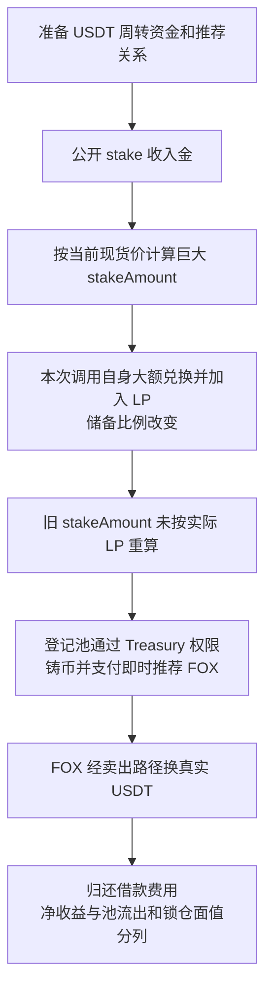

# Fox LP Bonds：按交易前的便宜价格记大额债券，再立即支付推荐奖励

本例是源表第 **90** 行，日期保留 **2026-08-17**。[BNB Chain 代表交易](https://bscscan.com/tx/0x8e1775cbfd44db29744cc6687ff1822d2c47321de6e94062f789ad6181ad5514)实际发生于 **2026-08-15 23:32:59 UTC**，北京时间为 8 月 16 日 07:32:59。源表 8 月 17 日更接近披露日期，不能静默替换。原始披露入口为 [TenArmor](https://x.com/TenArmorAlert/status/2089170318049132843)；[独立链上分析](https://yinhui1984.github.io/fox-attack-analysis/)给出了代理、实现和本笔事件的对应关系。

## 背景和正常业务

Fox 的 LP Bonds 是一种入金、做市和锁仓产品：用户存入 USDT，协议把一半换成 FOX，再把两种资产放进 FOX/USDT 池子，取得 LP。系统按入金额度给用户记一份随锁仓时间释放的权益；满足条件时，还立即给推荐人支付 FOX。

应当保持的关系是：用户登记的债券权益与真正收到的 LP 价值相符，推荐奖励不能由一笔自己改变市场价格的交易凭空放大。Treasury 是有铸币权的资金管理模块，普通攻击者没有直接铸币权。

| 角色 | 地址与权限 |
| --- | --- |
| FoxLpBondsPool 代理 | 0x9fa6d8a13b35e051bfc145918db0111dec13d1a0，接收 USDT、发起兑换和记录权益 |
| 公开分析所指池实现 | 0x58e2a853bb14e46befd3148bd4280370fea4655a，保存 `stake` 逻辑 |
| Treasury 代理 | 0x361d08ff43761e6a7e8fcabe48048ae9010801cc，只接受登记质押池调用 |
| 公开分析所指 Treasury 实现 | 0x87614d97808dcdecb069fe8489848fa1c001e04d，接收 LP、铸 FOX 和付推荐奖励 |
| FOX 代币 | 0xdf81d50c6657487d19b66a1b5375e35a804abb93，只允许配置的 Treasury 铸币 |
| FOX/USDT 池 | 0xaab18bcdee287aea288c0560612caadf7c328803，实际支付 USDT 的兑换池 |

## 具体错误

**合约先用即时价格决定该给多少权益，随后自己的巨额兑换又改变了这个价格，却继续按旧数量铸币和发推荐奖励。**

[`getSwapPrice` 124–133 行](../../dataset/benchmark_complete/20260817_Fox/source-bundles/fox-bonds/project/contracts/FoxLpBondsPool.sol#L124-L133)通过路由器 `getAmountsOut(1e18, foxToUsdtPath)` 查询卖一 FOX 能拿多少 USDT，并应用折扣。它是当前储备决定的报价，没有独立时间平均来源。

[`stake` 136–169 行](../../dataset/benchmark_complete/20260817_Fox/source-bundles/fox-bonds/project/contracts/FoxLpBondsPool.sol#L136-L169)依次执行：收 USDT → 读取上述价格 P → `stakeAmount=USDT*1e18/P` → 把一半 USDT 换 FOX → 加 LP → 计算推荐奖励 → 调 Treasury。读价时点与真正铸 LP 的时点之间发生了一笔会强烈改变池比例的交易。代码没有用实际取得的 LP 再计算债券价值。

用户传入的 `_swapPrice` 只是与同一个现货报价比较的保护参数，并不提供独立公允价格。Treasury 的 [`lpBonds` 176–186 行](../../dataset/benchmark_complete/20260817_Fox/source-bundles/fox-treasury/project/contracts/Treasury.sol#L176-L186)信任登记池提交的 `_stakeAmount`，据此铸 FOX、StakedFox、RewardFox，再把即时推荐奖励 FOX 转给推荐人。

## 利用条件与权限

- **源码要求：**调用者需要 USDT 和授权、已经登记的推荐人、达到最小金额，以及足够长的锁仓期限；`stakeDays >= 180` 才启用这条推荐奖励。
- **真实权限：**`Treasury.onlyStakingPool` 要求调用地址位于 `stakingPoolMap`；FOX `mint` 要求 `msg.sender == treasury`。攻击者走已获授权的质押池，不能直接跳过这两层权限。
- **事件可见：**本次用户是 `0x7da2…fee4`，登记期限为 **540 天**；权益和推荐数量出现在 `UserStake` 中，FOX 的零地址铸币事件也能独立核对。
- **尚未完全核实：**攻击前推荐映射、池子登记配置，以及两组代理攻击时的实现槽。历史 `eth_getStorageAt` 返回 `missing trie node`，当前实现信息或公开分析不能替代历史槽证明。

## 历史攻击步骤与资金流出

1. 主攻击合约 `0x3a82…d2da` 调动大量临时资金。精确借款组合和全部内部调用顺序来自公开分析；本批未取得完整内部跟踪。
2. 通过池的 `stake` 路径入金并取价。回执 `UserStake` 序号 **79** 记录实际使用 USDT 数量约 **481,974,785.536796421654333021**，登记价格为 **5.436258687853353081 USDT/FOX**。这笔几亿美元的周转规模不是损失。
3. 同一业务调用内部做大额兑换并铸 LP，之后仍把旧价算出的 **88,659,280.805328378079051095** 记成债券份额。事件中的 `_usdtAmount` 是退款后的数量，因此不能直接用该事件字段反推最初取价时的全部输入。
4. Treasury 按有权质押池提交的数量铸币。推荐奖励为 **2,659,778.424159851342371532 FOX**，即登记权益的 3% 按整数截断；这部分即时可用，540 天锁仓并没有锁住它。
5. 推荐 FOX 经后续路径回到卖出流程，被换成真实 USDT。回执显示 FOX/USDT 池本笔净流出 **677,549.050517106599255604 USDT**。原始代币 `_update`、卖出税以及标准池付款路径均保留在精简源中。
6. 大量临时资金及费用需要归还。主攻击合约本笔净增加 **112,976.118753142627232237 USDT**、**1,232.412948351153326806 USDC**、**0.163248580071727085 WBNB**，另有其他代币余额变化。不能把单个池的 677,549 USDT 净流出或未解锁债券面值全部叫作攻击者净利润。

## 证据、损失和限制

[完整来源](../../dataset_artifacts/benchmark_complete/20260817_Fox/provenance.json)、[精简切片](../../dataset_artifacts/benchmark_simplified/20260817_Fox/slice_manifest.json)、[原始回执](../../dataset_artifacts/benchmark_complete/20260817_Fox/evidence/fox-receipt.json)与[整数解码](../../dataset_artifacts/batches/20261021_x112_y5/decoded_evidence.json)分别记录源码、行号、事件和收支。代理源码、公开分析所指实现源码都已取得 `exact_match`，这证明这些地址公开代码的匹配状态，不等于已经独立证明代理在攻击区块一定指向该实现。

本批确认的是代码中的定价和铸币链、实际 `UserStake`、代币铸造与资产转移；`lpBonds` 的完整内部执行和准备状态仍需历史跟踪补强。标准 PancakePair 为公开参考上下文；另取本案 FOX/USDT 池的当前运行字节码，与参考池的完整 14,981 字节逐字节相同，见[当前代码比对](../../dataset_artifacts/benchmark_complete/20260817_Fox/evidence/pool-runtime-comparison.json)。只核对了 `eth_getCode latest`，没有取得攻击区块代码，不将当前一致当作历史验证。

源表约 120,000 美元、公开分析的多资产净获利、池子 USDT 流出和长期债券面值各不相同，两份 CSV 金额留空，并保留币量。未本地编译、未重放、未本地反编译。
