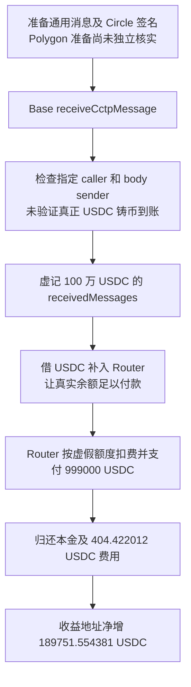

# Allbridge CCTP：消息有真实签名，却没有真正存入 USDC

源表第 **88** 行，目录日期保留 **2026-08-20**。Base [代表交易](https://basescan.org/tx/0x9f906fcd8fceaa6745e8d1c004861dcfa9b5e6a893fe1e8c5d0013a4e982e6a8)实际发生于 **2026-08-19 01:47:17 UTC**，北京时间同日 09:47:17。源表与链上日期并非单纯时区转换。原始披露见 [Defimon](https://defimon.xyz/blog/allbridge-hack-august-2026)及[源表披露入口](https://x.com/DefimonAlerts/status/2090369928494719263)。

## 背景、角色和正常业务

Allbridge 的 Router 是跨链到账后向用户付款的资金入口。CCTP 是 Circle 的跨链消息和 USDC 销毁、重铸体系：正常存入路径应在源链真的销毁 USDC，再由目标链真正铸出 USDC，之后路由器才能付款。

Circle 的底层 MessageTransmitter 同时也是通用消息工具。它可以替任何调用者传递消息体，签名证明的是“这条消息确实被发送并通过签名检查”；只有合法 TokenMessenger 的销毁/铸造路径才赋予它“真实 USDC 到账”的业务含义。

| 合约或角色 | 职责与边界 |
| --- | --- |
| Allbridge Router，0xaa11…24ff | 持有 USDC，根据已收消息的金额计算手续费和付款 |
| Allbridge CCTPTokenMessenger，0xf9b7…b577 | 接收 CCTP 消息，维护 `receivedMessages` 账目 |
| Circle MessageTransmitterV2 代理，0x81d4…4b64 | 检查 Circle 签名并把消息交给 header 指定接收合约，属于正常外部协议 |
| Aave V3 | 为主交易提供 USDC 临时资金；本金和费用均需归还 |
| 攻击方接收地址 | 回执最终收益地址为 0xb6fbdfa5f3cbeb139d4cce86d92f4ac8687b16c0，不能照抄源表全部 malicious_address 当作受害合约 |

正常流程应为：真实销毁 USDC → 有效跨链消息 → 目标链合法接收者铸币到账 → 消息中记入真实到账额 → Router 扣费并向用户付款。

## 具体错误

**Allbridge 把“底层接受了一条有签名的通用消息”直接当成“USDC 已经到账”，并从攻击者可构造的消息体读取入账金额。**

[`receiveCctpMessage` 146–183 行](../../dataset/benchmark_complete/20260820_Allbridge_CCTP/source-bundles/allbridge-messenger/src/CCTPTokenMessenger.sol#L146-L183)读取固定位置：

- 头部 `[4:8]` 是源 domain，`[108:140]` 是指定调用者，必须等于 Allbridge messenger。
- 消息体 `[216:248]` 是声明金额，`[312:344]` 是执行费，`[248:280]` 是声称的远端发送人。
- `[376:408]` 是 Allbridge 付款用的消息 hash。

代码检查已配置源 domain 和消息体中的远端发送人，再调用 Circle 的 `receiveMessage`。成功后直接执行 `receivedMessages[messageHash]=amount-feeExecuted`。它没有验证 header 中的真实发送人和接收者确实属于合法 TokenMessenger 路径，也没有按 USDC 余额增量确认真的铸币到账。

Circle 当前公开实现的 [`sendMessage`、`receiveMessage` 和 `_validateReceivedMessage`](../../dataset/benchmark_complete/20260820_Allbridge_CCTP/source-bundles/allbridge-circle-implementation/src/v2/MessageTransmitterV2.sol#L135-L322)说明这个边界：`sendMessage` 允许普通调用者提交 body；`receiveMessage` 验签后把 body 交给 header 的 `_recipient`，并不是每条合法消息都会铸 USDC。本批该实现只作为公开机制上下文，未拿当前代理实现自动证明攻击时实现。

[`Router.receiveToken` 226–289 行](../../dataset/benchmark_complete/20260820_Allbridge_CCTP/source-bundles/allbridge-router/src/Router.sol#L226-L289)再取 `receivedTokenAmount(messageHash)`，计算目标付款金额，标记已处理并执行 USDC `safeTransfer`。因此错误账目沿着真实的资金付款接口被兑现。相关金额规格化、消息 hash 和小数转换也保留在[324–372 行](../../dataset/benchmark_complete/20260820_Allbridge_CCTP/source-bundles/allbridge-router/src/Router.sol#L324-L372)。

## 条件、检查为什么仍会通过

攻击者不需要 Allbridge owner 权限，也不需要伪造 Circle 私钥。需要取得一条确实经过 Circle 签名的通用消息、把 body 做成存款格式、填入公开可查的 remote messenger 字段，以及让消息 hash 对上自己要执行的 Router 付款参数。

Router 并非完全没有调用者检查：它要求已登记 relayer，或 `msg.sender == recipientAddr`。攻击者把接收人设为自己即可走第二条；这不赋予攻击者管理员或任意替别人收款的权限。消息还必须未被 `usedMessages` 消费，攻击使用此前未消费的 hash。

`destinationCaller` 和消息体 sender 并非完全没检查；问题是这些检查没有把消息绑定到真实销毁和目标铸币。Router 的真实 USDC 余额仍必须足够，否则正常 ERC-20 付款会失败。攻击者用闪电贷补足这一步，不是靠错误账目就能生成 USDC。

## 历史步骤与资金流出

1. 原始披露把准备交易定位到 [Polygon 交易](https://polygonscan.com/tx/0x2a88d79756b4547b33fea7b3c1420793680e2b8952bef4c65e99879e16b22140)，称攻击者提前约 24 天发出仿造存款格式的通用消息并取得签名。**本批未独立取得该 Polygon 交易和签名服务历史记录**，不能把准备细节写成已完整复核。
2. 在 Base 主交易中，Circle `MessageReceived` 与 Allbridge `MessageReceived` 事件依次出现。回执证明有效消息被接收及 Allbridge 账目被接受；完整内部调用跟踪本批未取得。
3. Router 的 `TokenReceived` 事件记录规范化入账 **1,000,000 USDC**、手续费 **1,000 USDC**、实际付款 **999,000 USDC**。USDC 在 Base 使用 **6 位小数**，不能按 BSC USDT 的 18 位小数解码。
4. 原始 Transfer 日志显示攻击流程先给 Router 补入 **808,844.023607 USDC**，然后 Router 支付 **999,000 USDC**。补入资金用于填平虚假到账额与已有真实余额的差距，付款才能成功。
5. 本笔 Router 净流出 **190,155.976393 USDC**。其中 Aave 费用收款合约净增加 **404.422012 USDC**，最终收益地址净增加 **189,751.554381 USDC**，三者按整数准确相等。闪电贷本金已通过同笔其他转账回到借款体系，不计入获利。
6. 公开复算指出交易前 Router 有 **191,155.976393 USDC**，交易后留下 1,000 USDC 手续费。本批没有独立重读全部攻击前余额；该前余额口径与主交易已复核的净转账必须分开标记。

## 证据、金额和限制

[完整原始源码及来源](../../dataset_artifacts/benchmark_complete/20260820_Allbridge_CCTP/provenance.json)、[精简切片清单](../../dataset_artifacts/benchmark_simplified/20260820_Allbridge_CCTP/slice_manifest.json)、[原始回执](../../dataset_artifacts/benchmark_complete/20260820_Allbridge_CCTP/evidence/allbridge-receipt.json)、[原始交易](../../dataset_artifacts/benchmark_complete/20260820_Allbridge_CCTP/evidence/allbridge-transaction.json)与[离线解码](../../dataset_artifacts/batches/20261021_x112_y5/decoded_evidence.json)可交叉检查。

受害 Router 和 messenger 的原始源码均为 Sourcify `exact_match`。Circle 的代理和当前实现也分别归档；当前关系不能直接代替历史实现槽验证。本批核查了 calldata、成功回执、消息与付款事件和逐笔 USDC 收支，未取得完整内部跟踪，也未重建全部攻击前状态。

两份 CSV 保留源表约 **191,000 美元**的事件估计，按披露的 USDC 接近 1 美元口径记录，分别为中文 **19.1 万美元**、英文 **191 千美元**。它接近公开披露的付款前风险敞口，**不等于**999,000 USDC 毛付款、190,155.976393 USDC 池子净流出或 189,751.554381 USDC 净收益。公开参考 PoC 固定到提交 `b1f9489318ad9dbf5c9188a88f36e06415d1d91b`，只归档参考，未执行。未本地编译、未分叉重放、未本地反编译。
