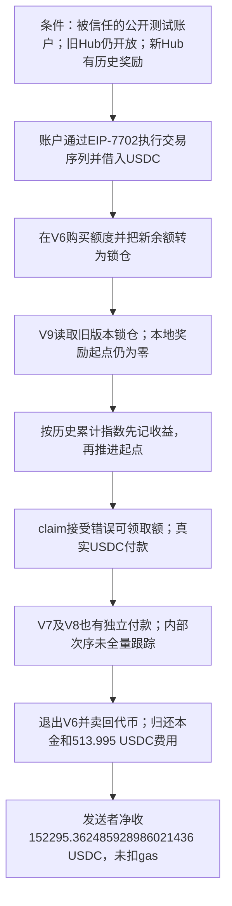

# AlpsCon AI Trade Hub：新存入的余额为什么领到了过去的奖励

AlpsCon 的多个奖励合约互相读取旧版本余额。新版本把一个刚刚在旧版本存入的余额当作可参加奖励的锁仓，却没有给它设置正确的奖励起点。计算时起点仍为零，于是新本金被算上了合约此前积累的全部奖励。

另一个条件让攻击者能够进入业务：系统仍信任一个私钥公开的标准测试账户。攻击者使用这个账户的执行身份进入白名单业务，再利用跨版本奖励记账错误，不能只把整起事件概括为私钥泄露。

源表第 **29** 条，`date` 为 **2026-10-19**。代表交易 [0x824b83f9…55fc2](https://bscscan.com/tx/0x824b83f94bdc2e69b81f1cb2dfdf9d4aeed066114e3de29e3af59bd2d9355fc2) 在 **2026-10-18 06:34:55 UTC**、北京时间 10 月 18 日 14:34:55，BNB Chain 区块 **128315188**。目录保留源表日期；这里同样是披露口径与执行日期的差异，不能静默替换。原始披露为 [Defimon / Decurity](https://x.com/DefimonAlerts/status/2112102178026308045)，另有 [Verichains 原始研究](https://blog.verichains.io/p/alpscon-exploit-analysis)说明公开测试账户与跨版本奖励问题。本批独立取得 V6–V9 原码并核对回执中的实际金额。

## 1. 背景与正常业务

用户购买业务代币后，可以在奖励 Hub 中建立服务额度或锁仓。协议把经营结果按每份锁仓的累计指数分配给用户。这个指数可以理解成“从系统开始至今，每一份有效锁仓总共应分到多少收益”。

为了让新加入的用户只领取加入后的收益，每个用户还需要保存自己的起点 `entryProfitPerShare`。如果系统已经累计了很多收益，新用户的起点应从其余额真正开始参加分配时算起。

| 角色 | 地址及作用 |
| --- | --- |
| V6 Hub | `0x74f091a719fdd47a95f378c7fb5c3d18a4582405`，本笔购买并锁定新余额的旧版本 |
| V7 Hub | `0x047284b1e752e39ae7a721d361ec0b0a554ef014`，回执显示独立 USDC 付款 |
| V8 Hub | `0xa58fbe390210460b7b07e52a29d4eb84308472e1`，回执显示独立 USDC 付款 |
| V9 Hub | `0x9b210da482217afc24074e57f6f8337fe07f0124`，主要错误奖励结算 |
| Swap / Vault | `0x7227…1721` 与 `0x7e84…fa0b`，兑换业务代币、保管和支付资产 |
| 业务代币 | `0x5870357dfa6a11d3fe45d775c21ed9ae60ac4bef`，源码沿用 TRAI 等变量命名，研究披露称 ALPS |
| 被信任测试账户 | `0xf39fd6e51aad88f6f4ce6ab8827279cfffb92266`，本笔接收 EIP-7702 委托执行 |
| 交易发送者 | `0x3d9df7d20d8296286383ffe475aa7b9e548946b2`，最终 USDC 收款者，不能填入受害合约列 |

正常流程应是：购买代币 → 存入旧或新 Hub → 确认哪些余额从何时开始参加奖励 → 把用户奖励起点设好 → 此后只领取新增收益 → 退出时扣减本金与费用。

## 2. 跨版本余额和奖励起点为何不一致

V9 的 [AITradeHubContract.sol:774](../../dataset/20261019_AlpsCon/v9/contracts/AITradeHub/AITradeHubContract.sol#L774) 中，`_getUserLockedAmount` 在用户尚未迁移时读取 V8 的余额，再加到 V9 本地锁仓里。旧版本又能继续读取更早余额，因此新存入 V6 的锁仓可以被新版本看见。

V9 的奖励计算见 [同文件:605](../../dataset/20261019_AlpsCon/v9/contracts/AITradeHub/AITradeHubContract.sol#L605)：

```text
L = 当前本地锁仓 + 尚未迁移的旧版本锁仓
gross = trunc(L × profitPerShare / 10^10)
claimed = trunc(L × entryProfitPerShare / 10^10)
收益 = gross − claimed
```

`trunc` 表示 Solidity 有符号整数除法向零取整，代码对两项分别计算，再求差；不能把分开取整与先求差后取整当作始终完全相同。`L` 变大时，代码没有保证该新增余额的奖励起点也同步变更。新账户的 V9 起点仍为零，这会把旧余额进入之前的累计指数也算进去。

举一个**教学示例**：合约早已累计每份 0.20 USDC，新用户刚被识别出 1,000 份旧版本余额。如果起点还是零，就得到 `1000 × (0.20 − 0) = 200 USDC`。这 200 是过去的收益，不是新本金刚刚赚到的钱。示例数字不是本笔交易参数。

`_updateUserProfitCheckpoint` 确实会更新起点，但顺序是“先按旧起点算收益并加到 earningAmount，再把起点推进到当前值”，见 [同文件:666](../../dataset/20261019_AlpsCon/v9/contracts/AITradeHub/AITradeHubContract.sol#L666)。所以这次起点更新阻止不了已经记入的虚假收益；后续 claim 对余额的检查也会接受这笔错误权益。

## 3. 白名单条件与代码错误怎样配合

公开研究指出，被保留在信任名单中的 `0xf39f…2266` 是常见开发工具的默认测试账户，其密钥是公开测试资料。控制这个账户无需窃取项目管理员的私钥。EIP-7702 又允许它把执行委托给合约，使一连串业务调用以已被信任的账户身份发出。

本批保留了交易的授权列表、交易接收地址和成功业务事件，没有独立恢复授权签名，也没有成功读出白名单设置的历史槽。因此，测试账户的历史白名单归属以原始研究与成功执行行为相互支持；不能宣称已独立验证其全部加入、删除记录。

奖励错误还要求：旧版本仍接受存入、新版本存在历史累计收益、该账户的新版本起点没有正确初始化，并且相关付款账户持有 USDC。这些是源码能够解释的必要条件；本批没有把当前指数代替攻击前指数，也没有运行重现测试。

只有公开测试账户的问题，不能自动产生不存在的奖励；只有奖励计算错误，没有可进入业务的账户和足够余额，也未必能在本笔完成提款。两者共同把“能调用业务”和“能多领钱”接起来。

## 4. 回执能确认的操作顺序

1. 委托账户收到 **1,027,990 USDC** 周转本金。本例 BSC 的 USDC 使用 **18 位小数**，不能套用 Ethereum/Arbitrum 常见的 6 位。
2. 它通过 Swap/Vault 换得 **9,970,024.02667504** 个业务代币，再在 V6 建立额度。扣除 8% 进入费用后，`Contribute/Migrated` 显示约 **9,172,422.1045410368** 个余额被纳入锁仓。V6 的 `purchaseServiceCredits`、`_migrate` 和检查代码完整保存，见 [V6 原码:461](../../dataset/20261019_AlpsCon/v6/contracts/AiTradeHubContract.sol#L461)。
3. V9 通过旧版本查询看到这个锁仓，并在 `claimServiceResults` 前执行错误起点的收益结算。日志 **124** 的 `ClaimServiceResults` 给出净付 **312,915.556577704966668487 USDC**，另列提现费 **16,469.239819879208772025 USDC**。其中的债务、费用字段也保留在解码文件，不能只看最大的一个数。
4. 日志 **133、136** 还显示 V8、V7 分别向发送者支付 **20,553.687620489351842211** 和 **1,966.067455522894785690 USDC**。这是独立观察到的两笔付款；没有完整调用跟踪，不能擅自说它们都由一次 V9 调用自动发起。
5. 退出 V6 后，扣除 5% 费用取得约 **8,713,800.99931398496** 个业务代币。经 Swap/Vault 换回 **845,364.045832211772725048 USDC**。
6. 本金与费用合计 **1,028,503.995 USDC** 由借款来源收回，其中费用为 **513.995 USDC**。委托账户另向发送者支付 **129,775.607409916739393535 USDC**；加上 V8/V7 收款，发送者本笔净收到 **152,295.362485928986021436 USDC**，尚未扣原生币 gas。

这些金额由原始 `Transfer`、业务付款事件及其整数求和得到。对未观察到的跨版本内部函数顺序，只按原码说明可行的逻辑连接。

## 5. 错账怎样经过付款检查

V9 的 `_claimServiceResults` 先更新用户收益和费用，再根据记账的可领取额安排 USDC 付款，见 [V9 原码:349](../../dataset/20261019_AlpsCon/v9/contracts/AITradeHub/AITradeHubContract.sol#L349)。它检查的是已被错误收益计算污染的 `earningAmount`，并没有重新判断每一段旧版本余额究竟从哪一刻开始参加该版本的奖励。

因此，旧版本突然可见的新余额 → 零起点乘上过去累计指数 → 产生虚假可领取收益 → 正常白名单及付款检查通过 → 真实 USDC 被转出。借款归还后还有余款，是因为系统支付的错误奖励超过了进入、退出、兑换和借款成本。



## 6. 影响与证据限制

本批归档 V6–V9、Vault、Swap 和代币完整编译来源包，共 **91 个原始源码文件**。关键的跨版本读取、用户收益指数、权限、费用、状态更新和付款路径都保留。

312,915.56 USDC 是 V9 的一笔净付款，152,295.36 USDC 是发送者本笔净收；再考虑各资金模块之间的存入、费用转回和借款成本，才可能讨论协议总净流出。这些量不能互换。源表约 152,000 美元未统一这些范围，本批两份 CSV 金额都留空，并保留原始币量。

未取得完整内部跟踪、攻击前白名单/收益指数槽、各版本的独立历史运行码绑定、全部后续处置。没有把未知委托实现的内部代码写成原码或反编译，也没有声称只凭 receipt 就恢复了每个内部调用。未本地编译、部署、执行 PoC 或分叉复现。

本地入口：[来源及哈希](../../dataset_artifacts/20261019_AlpsCon/SOURCE.md)、[完整回执与离线解码](../../dataset_artifacts/20261019_AlpsCon/evidence/alpscon-decoded.json)、[授权列表所在原始交易](../../dataset_artifacts/20261019_AlpsCon/evidence/transaction.json)、[批次快照与筛选](batches/20261110_latest5/README.md)。
