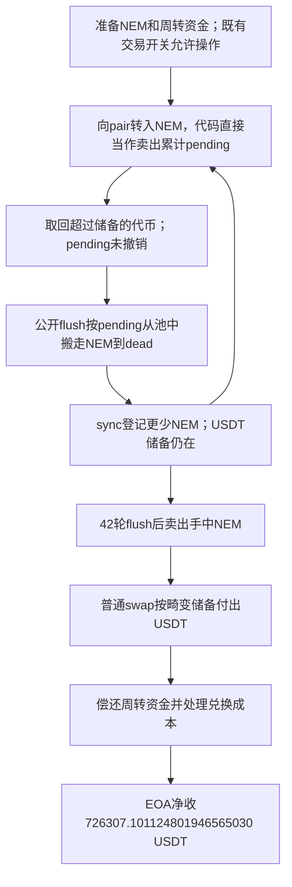

# NEM / NemTokenV2：没有真正卖出，为什么也能累计烧池子的额度

这份代币代码把“向交易池转入 NEM”当作已经卖出，并累计一笔以后可以从池子销毁 NEM 的额度。但普通交易池允许把尚未计入储备的多余代币拿回来。代币拿回来了，额度却还在。攻击者反复利用这个不一致，减少池中的 NEM 而保留 USDT，再用手上的 NEM 按被抬高的价格换走 USDT。

源表第 **26** 条，`date` 为 **2026-10-22**，目录保留该日期。代表交易 [0xfb093c96…23f91](https://bscscan.com/tx/0xfb093c96c0094cbcca10801f97ed2e5ed3d96550ce64b544df5a349545723f91) 的链上时间是 **2026-10-21 03:28:50 UTC**、北京时间 10 月 21 日 11:28:50，区块 **128866147**。两种时区都在 21 日，因此不能简单用时区把源表 22 日解释成交易日期；这里是源表/披露日期与执行日期的差异。[TenArmor 原始披露](https://x.com/TenArmorAlert/status/2113189949147435321)给出约 820,000 美元的事件估计。

## 1. 正常交易应该怎样工作

NEM 是 BNB Chain 上的代币，地址 `0x9cf0e3ad4efa7ab602d7b5a38c55795cfa777777`，以地址识别本例。它与 USDT 在 `0x840e19dcca541ee0b55a3c67e900a39d523b12b8` 的 PancakeSwap V2 池中交易。

池子维护两种数：真实代币余额，以及上次结算时登记的储备。用户通常先向池子转入代币，随后调用兑换；兑换完成后，池子根据实际余额检查乘积关系并更新储备。价格大体取决于两侧储备比例。

`skim(to)` 是池子的正常维护功能：把“真实余额超过已登记储备”的多余部分转走，**不表示发生了一笔兑换**。[PancakePair.sol:487](../../dataset/20261022_NEM/pancake-pair/PancakePair.sol#L487)保留了完整实现。`sync()` 则让登记储备跟上真实余额。

NEM 另外设计了卖出税和池内销毁机制。正常设计至少应保证：先确认一笔交易实际完成，再根据不可被撤回的交易量影响池子；不能让未成交又拿回的代币反复形成权利。

## 2. 具体错误和原始公式

入口是 [NemTokenV2.sol:999](../../dataset/20261022_NEM/token/NemTokenV2.sol#L999) 的 `_transfer`。当接收方是 `pair` 时，代码走卖出分支；`_sellWithTaxes` 扣税后把净代币转入池子，并累计：

```text
pendingLpSellRecycle += net
```

相关实现见 [同文件:1053](../../dataset/20261022_NEM/token/NemTokenV2.sol#L1053)。这里检查的是转账方向，不是兑换结果：没有验证随后是否调用 swap、实际换出多少资产，也没有在多余代币被 skim 回来时撤销 pending。

`flushLpSellRecycle()` 无管理员限制，见 [同文件:1069](../../dataset/20261022_NEM/token/NemTokenV2.sol#L1069)。其核心计算为：

```text
计划销毁量 = pending × lpSellDestroyRateBps / 10000
本次销毁量 = min(计划销毁量, pair实际NEM余额 × 2000 / 10000, pair实际NEM余额)
pending = 0
从pair扣走本次销毁量到dead地址
pair.sync()
```

本笔 **42** 条 `LpSellRecycleFlushed` 都记录 `rateBps=7000`，也就是按 pending 的 70% 计算；每次最多取池余额的 20%。上限阻止了一次取光，却不能阻止重复调用，池余额会一轮轮下降。

`skim` 从 pair 转回代币时，在代币看来是 `from==pair` 的买入分支，主要增加买入统计，不冲销先前的卖出额度。这就是“输入能撤回，权利不能撤回”的错误。

## 3. 需要的条件

| 条件 | 核实情况 |
| --- | --- |
| 能取得一定 NEM 并完成向池转账 | 成功回执包含相应转账；完整最初购币/授权路径未全量重建 |
| 买卖和白名单状态允许这些方向的转账 | 源码有开关、白名单及最低持币检查；成功执行说明本笔路径没有被阻止，但未单独读取全部攻击前权限槽 |
| `pendingLpSellRecycle` 产生正值，销毁比例不为零 | 42 条 flush 事件给出实际 pending、销毁量及比例 |
| 池子仍持有 USDT | 后续 Swap 和 USDT 转账直接证明 |

不需要管理员去调用公开的 flush。不过，不能把“参数是管理员设置的”改写成“攻击者可以任意设置参数”；本笔观察到的是既有 7000 比例被利用。

## 4. 这笔交易的顺序

1. 发送者 `0xfd929b0f270dfea6c4827262b4e2bf6ea50fe9b6` 调用攻击相关合约 `0x5e6d1f40be466dd2facc94a26818948ecd3b1ca2`。它通过多处外部池/借款来源取得周转资产。借入和偿还必须按原币分别核对，不能将所有中间大额转账相加称为损失。
2. 向 NEM 池转入代币，使 `_sellWithTaxes` 增加 pending。转入超过储备的部分可以由正常 `skim` 逻辑返还，卖出额度却没有撤销。这里的函数连接由原码与转账/事件模式支持；本批没有完整内部跟踪，不把每次 skim 的函数调用都说成直接读到。
3. 执行公开 flush：从池内扣走 NEM 到 dead，并 sync 更新较小的 NEM 储备。回执直接出现 **42 次 `SellRecycled` 和 42 次 `LpSellRecycleFlushed`**，每一轮的参数都保留在离线解码文件中。
4. 首条 flush 记录 `pendingBefore=32,631.980509965803490342 NEM`，按 70% 得到 `22,842.386356976062443239 NEM`。最后一条时池内只剩约 `36.796280761656843836 NEM`，本次受 20% 上限限制取走 `7.359256152331368767 NEM`。这些是真实事件值，不是教学示例。
5. NEM 储备变少而 USDT 仍在，最后的正常兑换愿意为少量 NEM 付出大量 USDT。主池最终净减少 **821,920.437218535429773209 USDT**。
6. 发送者本笔净收到 **726,307.101124801946565030 USDT**。两者相差 **95,613.336093733483208179 USDT**，分散在其他池或收款地址，不能不加核实地全部归为借款费用，也不能全部算攻击者利润。

## 5. 为什么普通池子的检查仍会放款

在每轮 sync 后，池子登记的 NEM 储备已经降低。后续 swap 是按这个新储备检查余额与乘积，并不知道代币代码刚才用错误的“卖出额度”搬走了旧储备。因此池子的正常数学检查可以通过。

用普通语言说，就是代币先把报价所依据的货架库存减少了，池子随后诚实地按这个稀缺程度付钱。NEM 的 pending/销毁逻辑是缺陷所在；skim、sync 和兑换本身是外部池子的正常功能。



## 6. 来源、金额和限制

完整 NemTokenV2 原始文件包含状态、权限、转账、税费、pending 更新、池内扣账和 sync 调用。普通 PancakePair 原码来自另一已验证实例；本批读取受影响 pair 的**当前**运行码，与该原码包的运行码逐字节相同，均为 14,981 字节。这可以绑定当前实例的正常池逻辑，**不能自动证明攻击时的代码也已核实**。

两份 CSV 以报道估值 **820,000 美元**填写，中文为 **82 万美元**，英文为 **820 千美元**。它是约数，和回执求出的 USDT 净流出、攻击者收款分别列示；没有把稳定币每一次兑换输出或借款本金当成损失。

未完成攻击区块运行码绑定、全部权限和初始状态读取、完整内部跟踪、最终资金去向及复现。未运行本地或其他反编译器，也没有把缺失编排代码写成源码事实。源码、事件与源码推断的边界见[元数据](../../dataset_artifacts/20261022_NEM/case_metadata.json)。

本地入口：[来源与哈希](../../dataset_artifacts/20261022_NEM/SOURCE.md)、[1,608 条日志和原币净额解码](../../dataset_artifacts/20261022_NEM/evidence/nem-decoded.json)、[原始回执](../../dataset_artifacts/20261022_NEM/evidence/receipt.json)、[固定快照及逐行结果](batches/20261110_latest5/README.md)。
