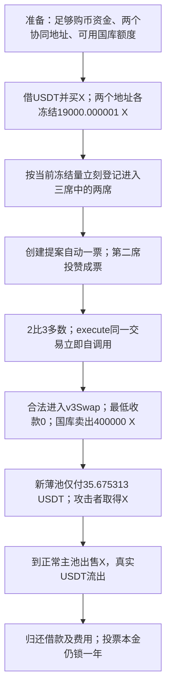

# X100 Senate：刚买来的投票权为什么能立即支配国库

X100 允许按当前冻结的 X 代币数量竞争治理席位。攻击者借钱买币，分给两个地址冻结，让它们马上进入三席议会，再用两票通过一笔对自己有利的国库兑换。权限检查没有被绕过：议会的合法执行流程替攻击者完成了付款。

源表第 **22** 条，日期 **2026-10-24**，Ethereum。第一笔攻击在 **14:11:47 UTC**、区块 **26263022**。三笔代表交易是 [0x38c60844…d81d0](https://etherscan.io/tx/0x38c60844f1923d53fdce7d99e9bc2a2d8c73a08e793341dfbb479f8cc74d81d0)、[0x77c46e1a…235c0](https://etherscan.io/tx/0x77c46e1aa9037ed4fbc9cc7e00d199dcd752acf576b4b5d3446e785dc45235c0)、[0x7c49bf28…ad99a](https://etherscan.io/tx/0x7c49bf28865defd5c1345f6527210360d635e510fa49279d0b62e6e02cfad99a)。原始事件入口为 [Defimon / Decurity 披露](https://x.com/DefimonAlerts/status/2114007082055700836)。本批保存了三笔成功回执及完整调用树。

## 1. 正常业务与角色

用户将 X 冻结后取得长期持仓凭证。Freezer 既记录这些冻结资产，也持有协议可以治理使用的国库资产。Senate 把登记用户按冻结量排序，排在前面的若干地址取得议席，议员可以提案、投票和执行允许的操作。

| 地址或合约 | 角色 |
| --- | --- |
| `0x79f35a33fe2813414851c4ae8daeacd14d822a46` | Freezer，包含 Senate 和国库入口；本例受害合约 |
| `0xcd5762ac6013fa762782ac1797ab09152c1028e8` | 固定 DexModule，执行国库兑换；不是任意可替换的攻击实现 |
| `0x100a2c7f45fd48e217fdce72e658dc78fd43a100` | X 代币，6 位小数 |
| `0x0d85edd90c94053fc5997551b1baa8a77aa02fa0` | 正常 X/USDT 主池，攻击者最终把取得的 X 卖入这里 |
| `0x9a03c41c539880b51508bebbc2dde7b738f6f075` | 首笔攻击使用的新薄池，攻击者先建立有利的报价/流动性 |
| `0x37541fc4a6f1ec86889ba506f51dc39f2bedd10a` | 首笔攻击主编排合约，调用行为以保存的跟踪为依据 |
| `0xe08107e7…19f37`、`0x176d1ea0…6619c` | 首笔取得两席的辅助地址 |

正常流程是：用户冻结 X → 登记候选资格 → 系统按持仓排名 → 议员审查并投票 → 国库按已通过的参数操作资产。设计需要让治理权具有持续性，并使不利报价不能在刚取得控制权的同一笔交易里立即执行。

## 2. 代码中的缺口

`Freezer._stakeOf` 直接返回 `frozenOf(account)`，见 [Freezer.sol:616](../../dataset/20261024_X100/freezer/project/contracts/Freezer.sol#L616)。`Senate.applyForSenate → _register → _onStakeChanged` 使用这个当前数值更新排序，没有历史快照或最短任职期，见 [Senate.sol:103](../../dataset/20261024_X100/freezer/project/contracts/Senate.sol#L103) 与 [同文件:312](../../dataset/20261024_X100/freezer/project/contracts/Senate.sol#L312)。

取得席位后，`propose` 会自动记提案人一票赞成；第二个议员调用 `vote` 即可形成多数。`execute` 在投票仍开放时就检查当前席位的赞成票，然后立即执行 `address(this).call(proposal.data)`，见 [同文件:113](../../dataset/20261024_X100/freezer/project/contracts/Senate.sol#L113)、[同文件:166](../../dataset/20261024_X100/freezer/project/contracts/Senate.sol#L166)。投票期限限制的是“什么时候还能投票”，不是“必须等到期限结束才能执行”。

多数关系是：

```text
通过条件：support × 2 > senateSize
本笔：2 × 2 > 3，因此立即通过
```

`DexTreasury.v3Swap` 仍有 `onlySenate`；这个检查要求调用者是合约自身。问题是上面的执行流程恰好合法地产生了自调用，因此检查不会拒绝已经被控制的多数。入口再把原始参数转发给固定模块，见 [DexTreasury.sol:48](../../dataset/20261024_X100/freezer/project/contracts/DexTreasury.sol#L48)。

模块把提案给定的 `amountOutMinimum` 原样交给路由器，见 [DexModule.sol:176](../../dataset/20261024_X100/dex-module/project/contracts/DexModule.sol#L176)。首笔实际参数为：`dex=1`、X→USDT、`fee=100`、`amountIn=400000000000`、`amountOutMinimum=0`。所以，即使国库的 400,000 X 只换回几十 USDT，兑换仍可成功。

根本缺口是**当前买到的持仓能够立刻成为多数，且多数可以立刻按没有有效最低收款保护的参数处置国库**。借款只解决了临时购币资金，并不是绕过 `onlySenate` 的特殊权限。

## 3. 需要哪些条件

- 要能买到足以进入前排的 X，并支付候选登记成本。第一笔两个地址各冻结 **19,000.000001 X**，成功登记与排名事件已经核对；没有独立重建此前每一席的完整余额。
- 两个不同地址需要能协同提案和投票。跟踪显示两个辅助地址在同一交易中完成这些操作。
- 国库必须仍有可卖出的自有 X 和剩余卖出额度；不能把冻结给用户的资产保护条件写成已经失效。
- 要有一个满足模块“合法池”检查但报价极不利的交易池。首笔的新池与路由调用已在跟踪中核对，管理员没有直接把国库转给攻击者。

另一个关键条件是资金规模。tier 0 的 X 冻结期限为 **一年**，并非可在本笔解冻归还。攻击者用卖出国库 X 的所得还借款，自己冻结的投票本金仍被锁住。不能把本例写成“借来投票、立即把同一批投票代币取回”的模板。

## 4. 首笔交易的完整链路

1. 攻击主合约收到 Aave 来源的 **1,942,457.637245 USDT**。跟踪显示它用其中大部分在正常主池买入 X，为取得席位和建池准备资产。
2. 两个辅助地址各调用 `freeze(tier=0, amount=19000000001, ...)`，产生 `FrostCreated`、`Frozen`，再调用 `applyForSenate`。日志 9–20 显示其冻结、登记和排名。这一步把购币资金转换成可立即使用的席位。
3. 攻击者为薄池准备流动性，并由其中一席创建提案 **7**。提案内容是让国库通过指定费率池卖出 **400,000 X**，最低收款设为 **0**。`ProposalCreated` 后紧接提案人的自动赞成票。
4. 第二席对提案 7 投赞成票，`execute(7)` 读取当前三席中的两票。跟踪接续出现 Freezer 自调用 `v3Swap`，再 `DELEGATECALL` 固定 DexModule。
5. 国库向新池交出 400,000 X，只得到 **35.675313 USDT**。该数直接见 `Swapped`，不是攻击者的总兑换收入。新池中的 X 随后由攻击相关地址取用并卖入深度较大的主池。
6. 主合约向借款来源返还 **1,943,428.866064 USDT**，其中本金之外 **971.228819 USDT** 是本笔借款成本。之后经中转地址向第一发送者转出 **4,749,726.096973 USDT**。

后两笔交易由其他发送者继续利用同一机制。三笔主池 USDT 净变动合计为 **−4,848,988.782396 USDT**；这个值由三份回执中的代币转账独立求和得到，不包含任何当前价格换算。

## 5. 为什么资产保护检查没有拦住

`Freezer._afterExecute` 检查执行后合约的 X 余额仍不低于 `totalFrozen`，见 [Freezer.sol:624](../../dataset/20261024_X100/freezer/project/contracts/Freezer.sol#L624)。它保护的是“用户冻结 X 仍有足额对应 X”，并没有保证国库自有 X 的出售价格合理，也没有给新任议员增加等待期。

因此错误控制权进入合法提案 → 合约合法自调用 → 路由器按攻击者选择的参数卖币 → 资金从国库的自有资产转移到攻击者控制的市场 → 攻击者再从正常主池换走 USDT。普通池子和路由器依照收到的参数工作，不应因此都被称为漏洞合约。



## 6. 影响与核实范围

首笔攻击者收款 **4,749,726.096973 USDT**、三笔主池净流出 **4,848,988.782396 USDT**，以及源表约 **4,848,017 美元**的收益统计分别保留。后者不是国库资产的统一净损失口径；残余 X 的价值也没有按当前市场价格补算，所以两份 CSV 的损失列均留空。

三份核心源码包共 **56 个原始文件**：Freezer/Senate、DexModule 和 X 代币。分别用攻击区块 `eth_getCode` 与提供方归档的运行码逐字节比较，三者一致。**这个检查证明历史运行码与提供方代码相同，不是本地重新编译源码的证明。** 未跑编译或分叉复现，也未重新核实未来治理控制、全部残余 X 处置及最终美元净收益。

本地入口：[来源与哈希](../../dataset_artifacts/20261024_X100/SOURCE.md)、[首笔完整跟踪](../../dataset_artifacts/20261024_X100/evidence/trace-official.json)、[第二笔](../../dataset_artifacts/20261024_X100/evidence/second-trace.json)、[第三笔](../../dataset_artifacts/20261024_X100/evidence/third-trace.json)、[首笔解码](../../dataset_artifacts/20261024_X100/evidence/x100-decoded.json)、[本批快照和逐行结果](batches/20261110_latest5/README.md)。
