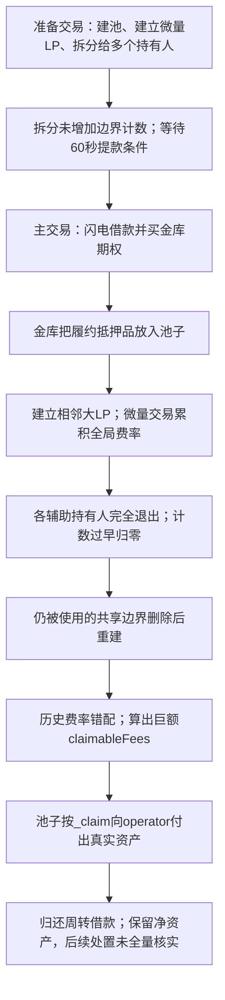

# Premia V3：拆分头寸后，为什么手续费会从抵押本金里付出去

这起事件的关键不是“空池一出现就不安全”，而是一个头寸拆成多个持有人后，池子没有同步更新边界计数。之后每个人退出时又各扣一次计数，于是仍被大头寸使用的价格边界被当成无人使用而删除。重新建立边界改变了手续费计算的起点，系统便给攻击者记出并未真正赚到的手续费，再从池中的真实资产付款。

源表第 **10** 条，日期 **2026-11-01**，Arbitrum。准备交易 [0xe3c263fc…831f5](https://arbiscan.io/tx/0xe3c263fcae544954367998e48e13112875cfd38a3b9a240e7818bb96313831f5) 后，第一笔攻击在 **03:15:39 UTC**、区块 **520166479**，交易 [0x64602cbb…441ac](https://arbiscan.io/tx/0x64602cbbeba5d3c7a5e2cff4f98cc118886fc6051c56fa50458abec2c90441ac)；另一笔是 [0xd7e8086d…244ff](https://arbiscan.io/tx/0xd7e8086df0570c5389ca27eb9bcdff290e810c094155b410a42e5bad2b3244ff)。[Blockaid 原始披露](https://x.com/blockaid_/status/2116745378674463229)与 [GoPlus 原始分析](https://x.com/GoPlusSecurity/status/2117191582361555366)给出空池、金库抵押和约 40 万美元以上的事件线索；下面的计数、费率和付款链条来自本批取得的源码与回执。

## 1. 背景：金库与期权池各管什么

期权让买方支付一笔权利金，取得未来按约定条件买卖资产的权利。卖方为了保证将来能够履约，需要放入抵押品。Premia 的 Underwriter Vault 汇集存款人的资产，用这些资产为买方写出期权并收取权利金。

Option Pool 同时保管期权抵押品和做市头寸。做市头寸用价格区间表示：每个区间有上下两个边界，系统在这些边界记录流动性变化和手续费起点。这里的 tick 可以理解成“区间边界上的记账点”，不是独立资产。

| 角色 | 职责或代表地址 |
| --- | --- |
| Underwriter Vault | 收权利金，向池子提供期权抵押品；WBTC 例为 `0x45df5ea836a15b561937ae8373ab9ee984aea531` |
| WBTC 期权池 | `0x1b25f69cfc2b3a9fcc0a7c0944a81723d5dcd77d`，存放抵押品、LP 头寸及手续费记账 |
| PoolProxy / Diamond / 函数模块 | 池代理按函数选择器寻找实际执行模块；当前解析结果与历史解析分别记录 |
| 攻击相关主合约 | `0x577168c8c6fa937495c3d6961f1d7d734b2d785f`，在事件中买期权、建头寸、交易和收款 |
| 辅助持有人 | `0x39eee49f…da803a`、`0xedd1970c…83f1c0`、`0x28cff810…95f88`，准备交易将头寸分给这些地址 |
| Balancer Vault | `0xba12222222228d8ba445958a75a0704d566bf2c8`，提供周转资金；其正常借款功能不是本例根因 |

正常流程是：LP 存入区间资产 → 边界计数与流动性同步增加 → 真正的交易产生手续费 → 处在有效区间的 LP 按费率变化领取 → 头寸完全退出时解除其边界引用。无论头寸如何转让，**计数都应反映仍然存活的头寸，手续费也应只来自对应区间真正积累的收益**。

## 2. 三段代码怎样接成错误

第一段是 [PoolInternal.sol:1055](../../dataset/20261101_PremiaV3/pool-core/contracts/pool/PoolInternal.sol#L1055) 的 `_transferPosition`。它允许把部分头寸转给新的 owner/operator，移动 LP 代币、手续费和 `lastDeposit`，但没有相应增加因拆分而新增的边界引用计数。把一个头寸分成三个人持有后，真实头寸数变多了，tick.counter 却没有跟上。

第二段是 [PoolInternal.sol:489](../../dataset/20261101_PremiaV3/pool-deposit/contracts/pool/PoolInternal.sol#L489) 的 `_withdraw` 与 [同文件:1487](../../dataset/20261101_PremiaV3/pool-deposit/contracts/pool/PoolInternal.sol#L1487) 的 `_updateTicks`。每个持有人把自己的份额全部取出时，都会以 `isFullWithdrawal=true` 减一次上下边界计数。拆分时少加、退出时照常多减，计数便会过早降到零。

当两个相邻大头寸的边界净流动性变化相互抵消时，共享边界的 `delta` 可以为零，但这不代表两边的头寸不存在。`_removeTickIfNotActive` 以 `counter==0 && delta==0` 允许删除，见 [同文件:1457](../../dataset/20261101_PremiaV3/pool-deposit/contracts/pool/PoolInternal.sol#L1457)。计数错误使这个本来合理的条件得到错误答案。

第三段是边界重建和费用计算。[同文件:1433](../../dataset/20261101_PremiaV3/pool-deposit/contracts/pool/PoolInternal.sol#L1433) 的 `_getOrCreateTick` 对位于当前价格以下的新边界设置 `externalFeeRate = globalFeeRate`。原有大头寸的 `lastFeeRate` 并不会因为边界被删掉而自动重建，所以新旧起点不再对应。

费用公式见 [同文件:274](../../dataset/20261101_PremiaV3/pool-deposit/contracts/pool/PoolInternal.sol#L274)：

```text
可领取费用增量 = (区间当前费率 − 头寸 lastFeeRate) × liquidityPerTick
区间费率 = globalFeeRate − 区间上方费率 − 区间下方费率
```

在当前价格高于整个区间时，区间费率可化为“上边界 externalFeeRate − 下边界 externalFeeRate”。只有一个共享边界被删除重建，就能把本来不属于大头寸的历史全局费率带进区间。问题发生在费率的归属，乘法本身没有算错。

## 3. 条件与准备交易

攻击者需要能够创建池和自己的 LP 头寸、拆分给辅助持有人，并准备相邻的大头寸。没有证据显示它需要控制金库管理员。

准备交易回执在 WBTC 池显示三次微量 `Deposit`，并把一个 `0.00003` 的头寸分出两份各 `0.00001` 给新持有人；两条 `TransferPosition` 在日志 **42、45**。这是直接可核对的拆分证据。相关持有人之后各有完全退出事件。

源码要求提款距离原 `lastDeposit` 至少 **60 秒**，转让会保留较晚的存入时间。攻击者预先准备头寸，主攻击发生在等待期后。因此，闪电贷不能解释全部准备工作，也不能写成所有存入和退出都在同一交易刚刚完成。

代理当前路由取得了 `PoolDepositWithdraw=0x386dd942d3b058543f0dfa19034a0284a49ba5fd` 和 `PoolCore=0xa1a1ea8b5a6045b6bfa51afb9b1c8c44f3f296bc`，两者原始源码的提供方验证时间都早于事件。**历史路由读取未成功**；当前解析加上事件吻合不是历史绑定的完整证明。

## 4. 第一笔攻击如何把错账变成真钱

以 WBTC 池这一组为例，回执能核对以下顺序：

1. 主合约从 Balancer 取得 0.9 WBTC、11 WETH 和 6,000 USDC 等周转资金，随后向 WBTC 金库买入 **3.75** 份按标的数量计的期权。金库收取 **0.11714618 WBTC** 的总权利金，并向池子转入 **3.76125 WBTC**，其中 3.75 是抵押品、0.01125 是写入费用。`WriteFrom` 与金库 `Trade` 在日志 **14、15**。
2. 主合约在相邻区间建立两个大头寸。WBTC 池日志 **22、28** 的 `contractSize` 都是 **187.1**，分别投入 **0.28065** 和 **0.46775 WBTC**，且区间共享边界。这些位置位于当时交易价格以下；不能把它们说成正常参与了后来每次交易的活跃流动性。
3. 日志 **32–100** 有 **16 次**小额买卖，每次交易规模为 0.0001，价格在 0.098 与 0.099 间来回。它们确实产生了微量真实手续费，并把小规模活跃流动性对应的 `globalFeeRate` 推高。
4. 三个准备好的微量头寸依次完全退出，日志 **106、112、118** 是对应 `Withdrawal`。共享边界计数降为零，而大头寸仍在。计数缺陷与相邻大头寸净 delta 抵消一起，使边界能被删除。
5. 日志 **123** 的 `UpdateTick` 直接记录共享边界的 `externalFeeRate` 变为 **0.024**；日志 **124** 的 `Deposit` 记录重新建立微量头寸及其 `lastFeeRate`。原大头寸的费用起点仍为零，区间费用被错误抬高。
6. 日志 **128** 的 `ClaimFees` 为 **4.4904 WBTC**，并有实际 WBTC `Transfer`。离线计算 `0.024 × 187.1 = 4.4904` 与事件一致。真实的小额交易不能解释这么大的区间收益；错误的边界历史把池内抵押品变成了“可领取手续费”。

第二笔交易对其他池重复类似序列，回执也已保存。本批没有取得完整内部调用跟踪，以上函数连接由公开原码和事件次序共同支持；不描述未公开编排合约的内部程序。

## 5. 最终付款为什么会接受假手续费

[PoolInternal.sol:307](../../dataset/20261101_PremiaV3/pool-core/contracts/pool/PoolInternal.sol#L307) 的 `_claim` 会更新 `claimableFees`、清零该记录，然后从 `l.getPoolToken()` 对应的真实资产余额向 `p.operator` 转账。它没有把“LP 实际赚得的费用余额”与“期权卖方放入的履约抵押品”分成两个可独立耗用的付款余额。

因此，只要前面的边界错误算出巨额费用，而池子正好持有足够抵押品，付款就能成功。金库提供抵押品扩大了可被拿走的资产；头寸计数和边界费率错误才是本批源码能定位的核心缺陷。



## 6. 金额与限制

4.4904 WBTC 是一个池子的费用付款总额，包含攻击者自己的入池资金所参与的资金周转，不能直接等同于金库损失或攻击者利润。3.76125 WBTC 转入池也不是损失的最终口径。应分别看金库净变动、池子净变动、攻击者投入及借款偿还。[两笔原币转账净额](../../dataset_artifacts/20261101_PremiaV3/evidence/premia1-decoded.json)与[第二笔](../../dataset_artifacts/20261101_PremiaV3/evidence/premia2-decoded.json)保留这些计算所需整数。

本批归档 **426 个原始源码文件**，包含金库代理/实现、池代理、关键执行模块、完整价格/位置数学库和依赖。固定的官方仓库提交 `fe3b821ab87a0b98cb6f1142134e2ddaadbc4c4d` 作为辅助对照，正式代码以提供方返回的每个完整编译包原文为准。

尚未核实历史路由、所有池的攻击前状态和全案最终美元损失；缺失完整内部跟踪，因此不把每个辅助调用写成直接观察。初报约 400,000 美元与后续约 464,600 美元不是本批统一估值结果，两份 CSV 金额均留空。未本地编译、部署、分叉复现或执行上游 PoC。

本地入口：[来源、完整包与哈希](../../dataset_artifacts/20261101_PremiaV3/SOURCE.md)、[准备交易解码](../../dataset_artifacts/20261101_PremiaV3/evidence/premia-setup-decoded.json)、[第一笔解码](../../dataset_artifacts/20261101_PremiaV3/evidence/premia1-decoded.json)、[本批快照与筛选](batches/20261110_latest5/README.md)。
