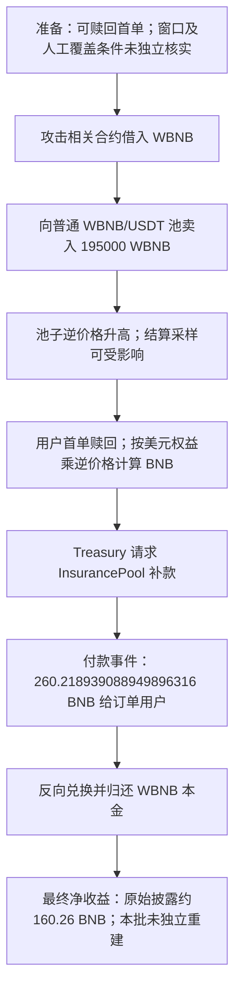

# CoreVault / InsurancePool：被改变的兑换价格为什么会放大保险储备付款

本例的错误发生在“把账上的美元权益换成 BNB”这一步。系统把交易池当时显示的兑换比例放进一个只有三条记录的小窗口，再用这个结果付款。攻击者先用借来的大量 WBNB 改变池子的比例，使“一美元可换多少 BNB”突然变大，然后让一个满足赎回条件的旧订单结算。付款合约认可了这个计算结果，自己的余额不够便向保险池补钱。

源表第 **5** 条的 `date` 为 **2026-11-04**，目录沿用该日期。链上交易在 **2026-11-03 21:50:20 UTC**、北京时间 **11 月 4 日 05:50:20**，可由时区差异解释。区块 **131507810**，代表交易为 [0x072a10a5…c598b3](https://bscscan.com/tx/0x072a10a579e2a8afa26a681205a2aaaa38f74bcb9d1064b12bd9e9ebe2c598b3)。[TenArmor 原始披露](https://x.com/TenArmorAlert/status/2117794176079376390)报告约 112,300 美元，[CertiK 原始披露](https://x.com/CertiKAlert/status/2117807084939129050)将其描述为报价操纵、赎回放大和约 160.26 BNB 获利。这些估计与下面的总付款不是同一口径。

## 1. 背景与正常业务

CoreVault 记录用户存入后的本金和收益，用户满足锁定期、订单序号及收益上限要求后可以领取或赎回。这里的“美元权益”是系统内部的记账单位，并不表示合约一定持有等量美元稳定币。因此，真正支付 BNB 前，需要把账面权益换算成 BNB 数量。

| 角色 | 地址及职责 |
| --- | --- |
| CoreVault | `0x302f5084ba0e4a2d4de5e6bc5dd5247028f5d674`，管理订单、收益与赎回计算 |
| OracleLib | CoreVault 原码中的价格库，读取池子储备并维护采样窗口 |
| Treasury | `0xfc1b8abb7414b68daf2b64604f0ac3b8ef159ef5`，支付 BNB 和协议奖励 |
| InsurancePool | `0xf40e0d525003fb6c6a9a7d79734a87a465053df1`，在 Treasury 不足时提供储备 |
| WBNB/USDT 池 | `0x16b9a82891338f9ba80e2d6970fdda79d1eb0dae`，正常执行兑换，被用来改变参考比例 |
| 借款来源 | `0x8f73b65b4caaf64fba2af91cc5d4a2a1318e5d8c`，本笔提供并收回 WBNB；不是本例的漏洞归属 |
| 赎回收款地址 | `0xd9c2e4f19746b4617ad658152adaa306c47ef86b`，付款事件所指的用户地址；其内部程序和早期归属未核实 |
| 交易发送者 | `0xd3565b191b28b49cc517189b984dacdb1ff05304`，与源表的 malicious_address 一致，但不能填成受害合约 |

正常流程是：用户建立订单 → 等待锁定期 → 合约计算可赎回的美元本金 → 取得可靠的 BNB 兑换比例 → 关闭订单并付款。价格应反映足够稳定的兑换关系，不能由赎回者在本笔交易中暂时改变。

## 2. 程序具体哪里出错

赎回路径见 [CoreVaultFarming.sol:345](../../dataset/20261104_CoreVault_InsurancePool/corevault/Contracts/CoreVaultFarming.sol#L345)。它先检查首单、关闭标志、锁定期和收益上限，再得到 `redeemableUsd`，最后计算：

```text
bnbAmount = floor(redeemableUsd × wbnbPerUsd / 10^18)
```

`wbnbPerUsd` 的含义是“每一美元应付多少 WBNB”，是 BNB 美元价格的倒数。BNB 价格被压低时，这个数会升高，因此同一份账面美元本金会被换成更多 BNB。

关键问题在 [OracleLib.sol:102](../../dataset/20261104_CoreVault_InsurancePool/corevault/src/core/OracleLib.sol#L102) 的 `getAccountingPrices`：它在本次结算中调用 `_updateAccountingSnapshots`，把当时的池子储备比值纳入平均窗口。`spotWbnbPerUsd` 直接读取 `getReserves()`；`_pushTimeSample` 在符合采样间隔时接受该现货值，窗口大小只有 **3**，间隔为 **3 分钟**。相关代码在 [OracleLib.sol:246](../../dataset/20261104_CoreVault_InsurancePool/corevault/src/core/OracleLib.sol#L246) 和 [OracleLib.sol:275](../../dataset/20261104_CoreVault_InsurancePool/corevault/src/core/OracleLib.sol#L275)。

```text
spotWbnbPerUsd = WBNB 储备 / USDT 储备（按 10^18 缩放）
窗口平均值 = (sample0 + sample1 + sample2) / filled
```

原码还有 TWAP、三源选择和人工覆盖逻辑，但不能看到这些函数就声称赎回一定经过了它们。这里必须沿 `getAccountingPrices → _updateAccountingSnapshots → _avgWbnbPerUsdView` 这条实际代码路径解释。窗口没有记录时还会退回现货值；本笔到底走了哪种窗口状态，需要历史状态才能确认。

本批未读到攻击前的三个样本、`lastTs` 或人工覆盖槽，因此不把“窗口为空”或某个具体旧样本组写成已核实事实。源码能够确认的是：符合采样条件时，结算会使用可被同笔兑换改变的现货采样，且没有独立的异常报价拒付条件。

## 3. 利用条件

| 条件 | 证据状态 |
| --- | --- |
| 持有可赎回首单，且满足锁定期、未关闭和收益上限 | 源码要求；本笔 `PrincipalRedeemed` 显示用户地址和 `positionId=0`，攻击前订单槽未单独读取 |
| 能暂时改变 WBNB/USDT 储备 | 回执直接显示大额输入和随后变化的 `Sync` |
| 采样时刻及覆盖设置允许畸变报价影响结算 | 源码要求；具体历史窗口和设置未独立核实 |
| Treasury 或 InsurancePool 有可付款 BNB | `ReserveWithdrawn` 与 `TreasuryPayout` 事件直接显示付款路径 |

这不是“任何新建地址都能马上提款”。首单和锁定期仍是代码中的条件；旧订单地址如何在攻击前建立及被控制，本批未完全追溯。

## 4. 本笔交易怎样推进

以下顺序依据成功回执的日志顺序。函数调用名在没有内部跟踪时，是根据原始源码解释事件的对应路径，不冒充完整调用记录。

1. 地址 `0x92f5…f542` 收到 **207,358.410468476651095719 WBNB**。这是周转借款，不能算损失或利润。
2. 它向 WBNB/USDT 池转入 **195,000 WBNB**，池子兑出约 **13,791,474.303330882971467699 USDT**。日志 5 的储备为 `1,554,005.067344725172339324 USDT` 和 `216,917.411004339581301445 WBNB`，这会显著抬高 WBNB/USDT 的逆比例。
3. CoreVault 处理地址 `0xd9c2…f86b` 的首单收益和本金。日志 80 是 `YieldClaimed`，日志 83 是 `PrincipalRedeemed(positionId=0)`；其可赎回记账金额为 **5,480.473616513366045241** 个按 18 位缩放的美元记账单位。实际入口和样本更新的内部调用未取得完整跟踪。
4. 日志 81 的 `ReserveWithdrawn(address(0), Treasury, 260.218939088949896316 BNB)` 与日志 82 的 `TreasuryPayout(user, 同额)` 接续出现，说明保险池和最终付款合约按放大后的结算量提供资金。
5. 攻击相关地址把先前取得的 USDT 换回 **194,901.165114669743338960 WBNB**。这比之前卖出的 195,000 WBNB 少，说明改变价格再恢复价格本身有成本。
6. 日志 92 显示向借款来源返还 **207,358.410468476651095719 WBNB**，与收到的本金相同。完整原生 BNB 转账和发送者最终净收益没有独立重建。

## 5. 钱为什么能够流出

错误并不是 InsurancePool 任意向陌生人付款。`Treasury.payoutBnb` 只接受 `farmVault` 调用，见 [Treasury.sol:965](../../dataset/20261104_CoreVault_InsurancePool/treasury/src/core/Treasury.sol#L965)。但它把上游计算出的 BNB 数量当作可信结果，只检查钱是否足够。余额不足时调用 InsurancePool 的 `withdrawReserve`，随后执行 `to.call{value: bnbAmount}("")`。

因此，完整因果关系是：储备被暂时改变 → 可影响结算的逆价格采样升高 → 同一份美元本金被算成更多 BNB → 具备权限的 CoreVault 请求付款 → Treasury 从 InsurancePool 补足 → BNB 付款完成。Treasury 的调用者检查没有防住这个问题，因为发出付款指令的仍然是合法 CoreVault。



## 6. 影响与证据界限

本批直接核对了 **93 条日志**，归档了订单计算、价格库、Treasury、InsurancePool、相关代币和普通交易池共 **100 个原始源码文件**。这些来源能解释从价格输入、订单检查、数量计算到付款的必要代码。

总付款 **260.218939088949896316 BNB**、保险储备净减少、攻击者获利以及报道的美元损失应分开看。约 112,300 美元更接近早期获利估计，本批没有用当前 BNB 价格反推历史美元损失，两份 CSV 的金额都留空。

未取得：完整内部跟踪、订单建立和控制过程、攻击前窗口及人工覆盖槽、原生 BNB 全部收支和关键库/函数模块的独立历史运行码绑定。取得公开源码及提供方的匹配记录，不代表这些项目已核实。未编译、未部署、未运行上游 PoC、未分叉复现、未发送交易。

本地入口：[来源与哈希](../../dataset_artifacts/20261104_CoreVault_InsurancePool/SOURCE.md)、[回执与解码](../../dataset_artifacts/20261104_CoreVault_InsurancePool/evidence/corevault-decoded.json)、[区块](../../dataset_artifacts/20261104_CoreVault_InsurancePool/evidence/block.json)、[本批固定快照及逐行结果](batches/20261110_latest5/README.md)。
